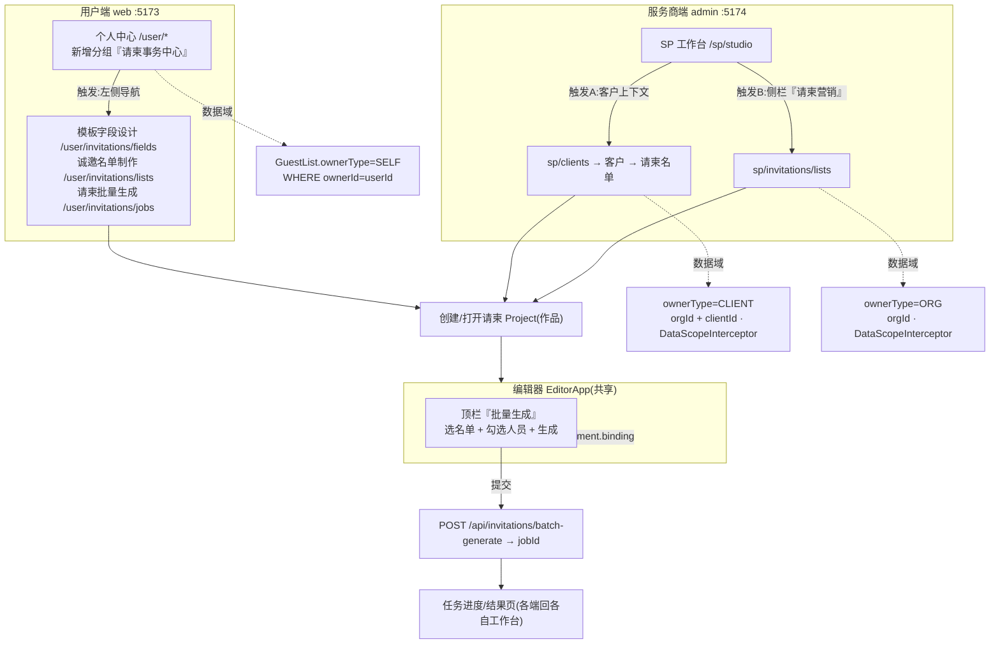

# 批量请柬 · 名单导入与个性化专属渲染 开发规范文档

| 项 | 内容 |
|---|---|
| 文档状态 | 草稿（待评审） |
| 版本 | v1.3 |
| 创建日期 | 2026-10-04 |
| 修订日期 | 2026-10-05 |
| 修订说明 | v1.1 新增「标准化模板下载 / 在线编辑生成名单 / 渲染前勾选人员」三能力详细设计；v1.2 固化 4 项**操作入口决策**（D1 名单归属 / D2 付费额度归属 / D3 UI 共享组件 / D4 批量生成面板位置），新增 §16 操作入口统一架构，并据决策更新 §2（归属术语）/ §6（数据模型归属维度）/ §7（模块落点）/ §13（隔离模型）/ §15（实施切片）；v1.3 新增 §17「请柬事务中心」改造——用户端分组更名「请柬事务中心」、模板字段设计改造为多模板管理（`GuestTemplate` 模型 + 两套不可删除系统默认模板 + ADMIN 专属编辑权）、诚邀名单制作页下载区改造（模板列表 + 下载格式下拉 + 下载按钮）、请柬批量生成页（作品 + 人员名单选择 + `?batchList=` 跳转编辑器）、编辑器 `?batchList=` 自动开批量面板并预选名单。 |
| 适用范围 | 庆柬云 / TAKLIP Cloud 请柬设计系统 — 名单导入与批量个性化渲染 |
| 关联文档 | `template-pipeline-design.md`（模板管线）、`作品统一渲染管线改造开发文档.md`（导出）、`图库管理管线开发文档.md`（配额/隔离范式）、`font-licensing-dev-doc.md`（付费闸门） |
| 实施前提 | 本规范经评审通过后，方可进入编码实施 |

---

## 1. 文档目的与范围

将婚礼、商务活动等场景的**人员名单**接入请柬设计系统：基于统一模板，按名单中的姓名、称谓等字段，自动为每位受邀者生成**专属请柬图片**。

本规范定义：业务规则、状态模型、数据模型、模块职责、接口契约、边界与异常、安全隔离、验收标准。命名与实现须对齐现有 monorepo（`@h5design/core`、`@h5design/editor`、`apps/server`），并复用既有导出/配额/隔离能力。

**范围外**：模板编辑器本身的视觉能力、支付网关对接细节（仅定义配额写入契约）、短信/邮件渠道具体供应商。

---

## 2. 术语与关键概念

| 术语 | 定义 |
|---|---|
| **GuestList（人员名单）** | 用户导入/编辑的数据集，含多条 `GuestRecord`。字段如 `guest_name`、`guest_title`、`unit`、`table_no`。 |
| **GuestRecord（名单行）** | 名单中单条记录，`data` 为 JSONB 字段映射。 |
| **SelectedSubset（勾选子集）** | 用户在名单中勾选、用于渲染的人员集合（有序）。首次渲染取该子集前 3 人。 |
| **BatchRenderProject（批量渲染项目）** | 绑定"一个用户 + 一份锁定名单"的渲染上下文，承载状态机、配额与锁定。 |
| **LockedSnapshot（首次生成快照）** | 首次渲染成功时，对"所选子集 + 当时数据 + 模板版本"的**不可变快照**，后续输出唯一数据源。 |
| **Headcount Quota（人次配额）** | 可渲染专属请柬总数上限。免费赠样 = 3（不占购额）；付费 = 已购 `N`。 |
| **RenderJob（渲染任务）** | 单批次渲染异步任务，归属某 Project，含进度与结果图。 |
| **ownerType（归属类型）** | 名单/项目的归属维度，决定隔离与作用域：`SELF`（用户自营，行级 `WHERE ownerId=userId`）/ `CLIENT`（服务商代客，绑定 `clientId`，走 SP 组织 `orgId` 隔离）/ `ORG`（服务商自营样板，挂 `orgId`）。见 §16 决策 D1。 |
| **Client（客户）** | 服务商代客场景的实际请柬需求方；SP 的名单/渲染项目可关联 `clientId`（复用运营端 `sp/clients` 客户管理，已在 `resources.tsx` 注册）。 |
| **EntrySurface（入口端）** | 功能触发的端：`web`（用户端 :5173）/ `admin`（运营端 :5174，含 SP/AGENT/ADMIN 视角）/ `editor`（共享 `EditorApp`，web 与 admin 两宿主共用同一画布）。见 §16。 |

---

## 3. 业务规则与功能需求（FR）

### FR-1｜付费功能，免费档渲染上限 3 人（赠样）
- 名单的**导入、编辑、修改**对**所有归属类型（SELF/CLIENT/ORG）的名单 owner**无限次开放，不计费、不限次。
- 个性化渲染输出为付费能力；**每个 BatchRenderProject（而非操作人）**的免费可渲染人数上限 = **3（赠样）**。
- 超过赠样上限时阻断渲染，引导购买。
- 注：付费额度归属见 FR-5 与决策 D2——代客场景下"购买的人次"挂在**客户请柬项目**，与 SP 自身会员权益解耦。

### FR-2｜首次选择名单锁定，渲染后不可更换批次
- 系统仅采纳用户**首次渲染所选定的那份名单（SelectedSubset）**作为项目锁定源。
- 首次渲染**成功落库后**，项目进入 `LOCKED`：禁止重新指定 GuestList、禁止切换到"下一批/另一批"人员。

### FR-3｜输出恒等于首次生成名单
- 无论之后**重新导入**或**编辑变更** live 名单，渲染输出**始终只展示首次生成的专属请柬名单**（读取 LockedSnapshot，不读 live 名单）。
- live 名单的增删改对输出零影响。

### FR-4｜未购前首次渲染信息硬性持久化、不可改
- 未购买服务前，首次渲染的人员信息（名单引用 + 子集 recordId + 当时字段值 + 模板版本）被**硬性持久化**于批量渲染流程。
- 该快照在购前**不可修改、不可替换、不可删除**（对应名单软删返回 `IN_USE` 拦截）。

### FR-5｜已购人次决定付费部分上限，实际渲染不超购
- 已购人次 `N` = **付费部分**可渲染专属请柬上限，归属到 **BatchRenderProject（或代客场景的 clientId 维度）**，与操作者（含 SP）自身会员权益**解耦**（决策 D2：规范中的"名单 owner"指项目/客户，而非登录操作人）。
- 实际渲染数量 ≤ `N`（付费部分）；达到 `N` 后第 `N+1` 次渲染被拒（类 `QUOTA_EXCEEDED`）。

---

## 4. 已确认业务歧义与最终口径（决定性）

评审确认的 4 项歧义，作为本规范**权威口径**，实现须严格遵循：

| # | 歧义 | 最终口径 |
|---|---|---|
| C1 | 免费 3 人与已购 N 的关系 | 免费 3 人 = **赠样，不占购额，不计入 N 总数**。总可渲染人数 = `3（赠样）+ N（付费）`，全部来自同一锁定名单。 |
| C2 | B3 取数规则（名单 >3 人） | 取**用户勾选子集（SelectedSubset）的前 3 人**（按子集顺序），而非整份名单前 3 人。 |
| C3 | 付费后是否允许渲染更多人 | **允许**。付费后可在**同一锁定名单**内继续渲染其余人员，至已购 `N`（或按名单人员数量单独购买）。此口径使 FR-2 与 FR-5 兼容。 |
| C4 | 模板改版后能否重渲 | **允许**。模板改版后可对**同一批人（同一快照人员集合）**重新渲染，输出新模板效果；人员集合不变。 |

**配额公式（实现唯一口径）**：
```
freeSampleCap   = 3                         // 赠样，独立，不计入 N
paidCap         = purchasedHeadcount (N)    // 付费部分上限
totalRenderable = freeSampleCap + paidCap   // 全部来自同一锁定名单
alreadyRendered <= totalRenderable          // 硬约束
```
首渲消耗 `min(3, |SelectedSubset|)` 赠样额度；购后渲染消耗 `paidCap`，单批不可跨名单。

### 4.1 操作入口决策（2026-10-05 确认 · 决定性）

经对现有架构（`apps/server/src/common/identity/role-home.ts` 角色落点、用户中心 `apps/web/src/user/shared.tsx`、运营端 `apps/admin/src/config/resources.tsx`）评估后确认以下 4 项，作为入口实现权威口径：

| # | 决策点 | 最终口径 | 影响章节 |
|---|---|---|---|
| **D1** | SP 名单归属 | **纯代客（`clientId`）+ 自营（`orgId`）两者都支持**；UI 主路径走**客户上下文**（触发 A：`sp/clients` → 客户 → 请柬名单），自营样板为辅（触发 B：SP 侧栏「请柬营销」）。数据域严格隔离，绝不混用。 | §2 / §6 / §7 / §13 / §16 |
| **D2** | 付费额度归属 | 代客时购买的"人次"**挂在客户请柬项目（BatchRenderProject / clientId 维度）**，与 SP 自身会员权益**解耦**；规范的"名单 owner"指项目/客户而非登录操作人。 | §3 FR-1/FR-5 / §6 / §13 |
| **D3** | UI 复用方式 | 名单模板下载 / 导入 / 在线编辑 / 勾选四类界面**抽成 `@h5design/ui` 共享组件**，web 与 admin 两宿主复用同一套，避免双份维护。 | §7 / §15 |
| **D4** | 批量生成面板位置 | **编辑器内**（变量绑定就近）。渲染前勾选人员 + 批量生成动作放在共享 `EditorApp` 内，web 与 admin 两宿主共用，无需两处实现。 | §7 / §8.1 / §15 / §16 |

**评估结论**：将名单模板下载 / 导入 / 编辑统一置于「用户工作台 + 服务商工作台」**合理**——两类角色均有真实需求（USER 自助、SP 代客），后端能力（§9/§10）可共用，仅数据域与宿主页不同；但必须以 D1 的归属模型与 D2 的额度归属为前提，否则会把 PII 与归属搞混。具体入口架构见 §16。

---

## 5. 状态机

```
[DRAFT 未渲染]
   │  用户勾选子集 → 首渲成功(≤3, 赠样)
   ▼
[LOCKED 已锁定·未购] ──购买 N──▶ [PAID 按 N 渲染]
   │ 输出=快照,改 live 无效          │ 同锁定名单续渲至 N
   │ 禁止换名单/批次                 │ 模板改版可重渲同批人
   │ 阻断再次渲染(提示购买)          │ alreadyRendered ≤ 3+N
```

- `DRAFT`：live 名单自由编辑；可渲染（受 3 人赠样上限）。
- `LOCKED`：快照已落；live 名单仍可编辑但**不影响输出**；阻断再次渲染/换批，提示购买。
- `PAID`：在**同一锁定名单**内继续渲染至 `N` 人；允许模板改版重渲同批人。

**锁定触发点**：首次渲染任务整体成功（快照落库、`freeRendered` 写入）的瞬间的原子操作。

---

## 6. 数据模型（草案，Postgres / Prisma）

> 金额/配额以整数存储；遵循现有行级隔离（`ownerId` + 查不到 404）。

```prisma
model GuestList {
  id        String   @id @default(cuid())
  ownerId   String   // 创建者/操作者（USER=userId；SP=SP 用户；用于审计）
  ownerType String   // SELF | CLIENT | ORG（决策 D1）
  orgId     String?  // SP 自营/代客所属组织；SELF 时 null
  clientId  String?  // 代客(CLIENT)绑定客户（sp/clients）；否则 null
  name      String
  columnDefs Json    // 列定义/映射配置
  deletedAt DateTime?
  records   GuestRecord[]
  createdAt DateTime @default(now())
  updatedAt DateTime @updatedAt
}

model GuestRecord {
  id        String   @id @default(cuid())
  listId    String
  seq       Int      // 子集内顺序依据
  data      Json     // { guest_name, guest_title, unit, table_no, ... }
  list      GuestList @relation(fields: [listId], references: [id])
  createdAt DateTime @default(now())
}

model BatchRenderProject {
  id                 String   @id @default(cuid())
  ownerId            String   // 项目归属者（USER=userId；SP 代客=客户 clientId 维度，非操作员，见 D2）
  ownerType          String   // SELF | CLIENT | ORG（决策 D1/D2）
  orgId              String?  // SP 场景所属组织
  clientId           String?  // 代客场景客户（付费额度挂此维度）
  listId             String   // 锁定的名单引用
  templateId         String   // 所用模板
  state              String   // DRAFT | LOCKED | PAID
  freeRendered       Int      @default(0)   // 已用赠样额度 (≤3)
  purchasedHeadcount Int      @default(0)   // 已购 N
  paidRendered       Int      @default(0)   // 已用付费额度 (≤N)
  lockedAt           DateTime?
  createdAt          DateTime @default(now())
}

model RenderSnapshot {
  projectId    String  @id   // 1:1 项目
  listId       String
  recordIds    Json   // 首次生成人员 id 有序集合（不可变）
  renderedData Json   // 首次渲染时各人字段值快照（不可变）
  templateId   String
  templateVersion String
  lockedAt     DateTime
}

model GuestListSelection {
  projectId       String @id
  listId          String
  selectedRecordIds Json // 用户勾选子集（有序）
  createdAt       DateTime @default(now())
}

model RenderJob {
  id            String   @id @default(cuid())
  projectId     String
  status        String   // PENDING | RUNNING | SUCCESS | FAILED
  mode          String   // FREE_SAMPLE | PAID | RERENDER
  targetRecordIds Json   // 本批渲染人员
  progress      Int      @default(0)
  resultUrls    Json     // 生成图私有资产路径
  createdAt     DateTime @default(now())
}
```

**锁定/配额一致性**：渲染前用事务级咨询锁（`pg_advisory_xact_lock(hashtext(projectId))`，`$executeRaw`）原子校验并扣减额度，杜绝超卖与重复锁定（沿用图库配额锁范式）。SP 代客场景（`ownerType=CLIENT`）的额度归属 `clientId` 维度，与 SP 自身会员配额**物理隔离**两张账户（决策 D2）。

**归属与隔离映射（实现口径）**：

| ownerType | ownerId | orgId | clientId | 查询隔离 |
|---|---|---|---|---|
| `SELF`（USER 自营） | userId | null | null | 行级 `WHERE ownerId=:me` |
| `CLIENT`（SP 代客） | SP 用户（审计） | SP orgId | 客户 id | `DataScopeInterceptor` + `org-access.guard` 按 orgId 辖区 |
| `ORG`（SP 自营样板） | SP 用户（审计） | SP orgId | null | 同上按 orgId 辖区 |

---

## 7. 模块职责划分

| 模块 | 职责 | 落点 |
|---|---|---|
| **标准化模板下载模块** | 提供 CSV/XLSX 空白模板下载，明确定义字段名/类型/约束与示例；降低导入失败率。 | `apps/server`（文件流）+ **`@h5design/ui` 共享下载组件**（决策 D3） |
| **数据接入模块** | 解析 CSV/XLSX/JSON、表头识别、去重、必填校验、写库；管理 `GuestList`/`GuestRecord`。 | `apps/server` + **`@h5design/ui` 共享导入组件**（决策 D3） |
| **在线编辑模块** | 浏览器内对名单行增删改查、排序、实时保存（防抖）；支持从模板/Excel 粘贴导入；写 `GuestRecord`。 | **`@h5design/ui` 共享编辑组件** + `apps/server` CRUD（决策 D3） |
| **子集勾选模块** | 渲染前在名单中勾选 `SelectedSubset`（有序，支持全选/反选/筛选），写 `GuestListSelection`。 | **编辑器内批量生成面板**（决策 D4）+ `@h5design/ui` 共享勾选组件 + `apps/server` |
| **操作入口与导航模块** | 统一"用户端 / 服务商端 / 编辑器"三端入口联动、触发位置、跳转闭环与权限边界（见 §16）。 | 用户端 `apps/web/src/user/shared.tsx`（新增分组）+ 运营端 `apps/admin/src/config/resources.tsx`（SP 客户子页 / 请柬营销分组）+ 共享 `EditorApp` 批量生成面板 |
| **模板变量模块** | 编辑器内将文本元素标记为变量（`Element.binding`），定义稳定 key。 | `@h5design/editor` + `core` schema |
| **个性化引擎** | 纯函数 `personalizeSchema(baseSchema, record, mapping)`，克隆模板并替换变量；放 `core` 可服务端/客户端复用。 | `@h5design/core` |
| **配额与锁定模块** | 管理 `BatchRenderProject` 状态机、赠样/付费额度、锁定快照、咨询锁。 | `apps/server` service |
| **批量任务/队列模块** | 将 N 条生成拆任务、限并发、可重试、进度查询（轮询/WS）。 | `apps/server` worker |
| **渲染/导出模块** | 复用 `/export/prepare` puppeteer 管线，按 `et` token 渲染每份副本。 | `apps/server` 导出服务 |
| **分发模块** | Zip 打包 / 逐人分享链接 / 二维码；图落 `private-assets`。 | `apps/server` + 前端 |

---

## 8. 核心流程

### 8.1 获取名单与勾选（三入口）
用户可通过以下任一方式获得名单，再进入勾选与渲染：
1. **标准化模板下载**：下载 CSV/XLSX 模板 → 离线填写 → 导入（见 §9.1）。
2. **在线编辑生成**：浏览器内直接增删改名单行，实时保存（见 §9.2）。
3. **文件导入**：直接上传 CSV/XLSX/JSON → 解析校验 → 写 `GuestList`/`GuestRecord`（无限次，免费）。
完成名单后，用户在**编辑器内批量生成面板**勾选 `SelectedSubset`（支持全选/反选/筛选，见 §16 入口 D4 与 §9.3）→ 写 `GuestListSelection`。名单页仅做"模板下载 / 导入 / 在线编辑"，渲染动作统一收口到编辑器。

### 8.2 首次渲染（赠样，≤3）
1. 触发渲染：取 `SelectedSubset` 前 3 人（C2）。
2. 事务内：置项目 `LOCKED`、写 `RenderSnapshot`（不可变）、`freeRendered=min(3,|subset|)`。
3. 调个性化引擎 + 渲染管线生成图。
4. **全有或全无**：任一步失败 → 回滚锁与额度，任务 `FAILED`，不写快照。

### 8.3 付费后续渲染（同锁定名单，至 N）
1. 购买写入 `purchasedHeadcount=N`（C1/C3）。
2. 用户可对**同一锁定名单**剩余人员发起渲染；事务内校验 `paidRendered + batch ≤ N`，扣减 `paidCap`。
3. 渲染落 `RenderJob`，图入 `private-assets`。

### 8.4 模板改版重渲（C4）
1. 用户对同一批人（快照人员集合）以新模板版本重渲。
2. 人员集合不变，仅更新 `RenderSnapshot.templateVersion` 与输出图；不消耗额外配额（重渲同一人视为刷新，非新增）。

---

## 9. 名单获取与选人能力详细设计（新增）

> 本章覆盖三项新增能力：**标准化模板下载（§9.1）**、**在线编辑生成名单（§9.2）**、**渲染前勾选人员（§9.3）**。每节含设计目标、核心交互流程、数据字段规范、接口要求（请求/响应结构）。接口索引见 §10。

### 9.1 标准化人员名单模板下载

**设计目标**
- 给用户一份"填写即对"的空白模板，从源头消除导入格式错误（编码、列错位、必填缺失）。
- 统一字段名与语义，使后续变量映射（§7 模板变量模块）可自动建议列→key 绑定。
- 支持离线批量填写后回传，兼顾非技术用户。

**模板格式**
- 提供两种格式，均由服务端同一份字段定义（`template/schema`）生成：
  - **CSV**：UTF-8 **含 BOM**（保证 Excel 正确识别中文），CRLF 换行，首行为字段 key（英文字段名），第二行为中文说明/示例，后续为数据行。
  - **XLSX**：首个工作表为 `名单`，首行表头 = 字段中文名（与 key 映射固定），第二行示例，附 `字段说明` 工作表列出约束。
- 模板**不含业务数据**（仅 1 行示例，可被整行删除）。

**字段定义（模板列规范）**

| 字段名(key) | 中文表头 | 类型 | 必填 | 约束 | 说明 / 示例 |
|---|---|---|---|---|---|
| `guest_name` | 姓名 | string | **是** | 1–20 字符，去首尾空格 | 受邀者姓名；`张三` |
| `guest_title` | 称谓 | string | 否 | ≤10 字符；枚举建议 `先生/女士/博士/教授/同学/同仁`，亦可留空 | 留空时按 `gender` 推断（先生/女士） |
| `gender` | 性别 | enum | 否 | `M`/`F`/`U`（未知） | 用于称谓自动推断；`M` |
| `unit` | 单位 | string | 否 | ≤50 字符 | 公司/学校/部门；`新疆大学` |
| `table_no` | 桌号 | string | 否 | ≤10 字符（允许 `A12` 等） | 婚宴/宴会桌次；`8` |
| `phone` | 手机号 | string | 否 | 正则 `^1[3-9]\d{9}$`；仅中国大陆 | 用于短信分发；`13900001001` |
| `address` | 地址 | string | 否 | ≤100 字符 | 邮寄/到店地址 |
| `remark` | 备注 | string | 否 | ≤100 字符 | 任意说明 |

> 字段扩展：新增列须在 `template/schema` 登记并同步模板下载与导入解析；未登记列导入时忽略（不报错）。所有文本列空值统一存为 `null`（非空串）。

**核心交互流程**
1. 前端「批量请柬」入口 → 展示「下载模板（CSV / XLSX）」按钮。
2. 用户点击 → `GET /api/guest-lists/template?format=csv|xlsx` → 服务端以 `Content-Disposition: attachment` 返回文件流。
3. 用户本地填写 → 回到导入页上传 → 走 §8.1 文件导入（解析校验同上表约束）。
4. 可选：`GET /api/guest-lists/template/schema` 返回上述字段定义 JSON，供前端「字段说明」浮层与导入列自动映射使用。

**接口要求（请求/响应结构）**

`GET /api/guest-lists/template`
- Query：`format=csv|xlsx`（默认 `xlsx`）。
- 响应（成功）：`200`，`Content-Type: text/csv; charset=utf-8`（CSV，含 BOM）或 `application/vnd.openxmlformats-officedocument.spreadsheetml.sheet`（XLSX）；`Content-Disposition: attachment; filename="guest-template.<ext>"`；body 为文件二进制。
- 响应（失败）：`400 { code:"BAD_FORMAT", message:"仅支持 csv|xlsx" }`。

`GET /api/guest-lists/template/schema`
- 响应（成功）：`200`
```json
{
  "version": "1.0",
  "fields": [
    { "key": "guest_name", "label": "姓名", "type": "string", "required": true,  "maxLen": 20, "example": "张三" },
    { "key": "guest_title", "label": "称谓", "type": "string", "required": false, "maxLen": 10, "enum": ["先生","女士","博士","教授","同学","同仁"], "example": "" },
    { "key": "gender",      "label": "性别", "type": "enum",   "required": false, "values": ["M","F","U"], "example": "M" },
    { "key": "unit",        "label": "单位", "type": "string", "required": false, "maxLen": 50, "example": "新疆大学" },
    { "key": "table_no",    "label": "桌号", "type": "string", "required": false, "maxLen": 10, "example": "8" },
    { "key": "phone",       "label": "手机号", "type": "string", "required": false, "pattern": "^1[3-9]\\d{9}$", "example": "13900001001" },
    { "key": "address",     "label": "地址", "type": "string", "required": false, "maxLen": 100, "example": "" },
    { "key": "remark",      "label": "备注", "type": "string", "required": false, "maxLen": 100, "example": "" }
  ]
}
```

### 9.2 在线编辑与生成人员名单

**设计目标**
- 免去文件往返，浏览器内即可完成名单创建、录入与维护；降低使用门槛。
- 与文件导入共用同一 `GuestList`/`GuestRecord` 数据真值，支持"模板下载→填写→导入"与"在线编辑"混合使用。
- 实时保存（防抖）降低丢失风险；行级增删改即时持久化。

**核心交互流程**
1. 用户「新建名单」→ `POST /api/guest-lists { name }` 建空名单（状态 `DRAFT`）。
2. 打开名单编辑器：表格视图，每行 = 一个 `GuestRecord`；支持新增空行、编辑单元格、删除行、拖拽调整 `seq` 顺序。
3. 单元格失焦/输入停顿（防抖 ~600ms）→ 自动 `POST/PUT` 单行保存；也可「批量粘贴」（从 Excel 复制多列）→ `POST .../records/batch` 批量写入。
4. 顶部提供「下载模板」「从文件导入」入口，导入=对当前名单批量 upsert（默认不删除未包含行，除非显式"覆盖"模式）。
5. 保存后实时反映到 §9.3 勾选面板与渲染预览。

**数据字段规范**
- 行（GuestRecord）元数据：`id`(cuid)、`listId`(FK)、`seq`(int, 列表顺序，从 1 递增)、`data`(JSONB, 见 §9.1 字段表)、`createdAt`、`updatedAt`。
- `data` 校验：与服务端导入解析**同一套约束**（§9.1 字段表）；非法值保存时返回字段级错误，前端标红对应单元格。
- 空 `guest_name` 的行禁止保存（前端禁用 + 后端 `422`）。

**接口要求（请求/响应结构）**

`POST /api/guest-lists` — 新建空名单
- 请求：`{ "name": "婚礼主桌名单" }`
- 响应：`201`
```json
{ "id": "list_abc", "ownerId": "u_001", "name": "婚礼主桌名单", "state": "DRAFT", "recordCount": 0 }
```

`GET /api/guest-lists/:id/records?page=1&size=50` — 分页列表
- 响应：`200`
```json
{
  "listId": "list_abc", "page": 1, "size": 50, "total": 2,
  "records": [
    { "id": "rec_1", "seq": 1, "data": { "guest_name": "张三", "gender": "M", "table_no": "8" }, "updatedAt": "2026-10-05T00:00:00Z" },
    { "id": "rec_2", "seq": 2, "data": { "guest_name": "李四", "gender": "F", "unit": "新疆大学" }, "updatedAt": "2026-10-05T00:01:00Z" }
  ]
}
```

`POST /api/guest-lists/:id/records` — 新增一行
- 请求：`{ "data": { "guest_name": "王五", "gender": "M" } }`
- 响应：`201 { "id": "rec_3", "seq": 3, "data": {...} }`
- 失败：`422 { "code":"INVALID_FIELD", "field":"guest_name", "message":"姓名必填且≤20字符" }`

`PUT /api/guest-lists/:id/records/:rid` — 更新一行
- 请求：`{ "data": { "guest_name": "王五", "table_no": "9" }, "seq": 3 }`
- 响应：`200 { "id":"rec_3", "seq":3, "data":{...}, "updatedAt":"..." }`

`DELETE /api/guest-lists/:id/records/:rid` — 删除一行（软删，重排后续 `seq`）
- 响应：`204`；失败（记录被 `RenderSnapshot` 锁定引用且处于 `LOCKED`/`PAID`）：`409 { "code":"IN_USE" }`

`POST /api/guest-lists/:id/records/batch` — 批量新增（粘贴/导入）
- 请求：`{ "records": [ { "data": {...} }, ... ], "mode": "append|overwrite" }`
- 响应：`200 { "created": 12, "failed": [ { "index": 3, "reason": "guest_name 为空" } ] }`
- `overwrite` 模式：先软删该名单全部行再写入（**不删被锁定的已渲染记录**）。

`PUT /api/guest-lists/:id` — 改名 / 重排
- 请求：`{ "name": "婚礼全部名单" }` 或 `{ "reorder": ["rec_2","rec_1"] }`
- 响应：`200 { "id":"list_abc", "name":"...", "recordCount": 2 }`

### 9.3 生成专属请柬时勾选所需人员

**设计目标**
- 渲染前由用户明确"哪些人进请柬"，避免误把整份名单（可能含工作人员/家属）全部渲染。
- 支持全选/反选/按条件（单位、桌号、性别）筛选后批量勾选，提升大名单操作效率。
- 勾选结果有序持久化为 `SelectedSubset`，直接驱动首渲取前 3（C2）与后续续渲。

**核心交互流程**
1. 渲染面板加载名单表格（带复选框，来自 `GET .../records`），默认继承上一次勾选。
2. 用户勾选/取消、或点「全选」「反选」「按桌号筛选后全选」→ 前端维护 `selectedRecordIds`（按列表 `seq` 排序，保证顺序稳定）。
3. 点「保存勾选」→ `POST/PUT /api/invitations/projects/:id/selection` 持久化。
4. 触发渲染：取 `selectedRecordIds` 前 3 人（免费赠样，C2）；付费后续渲取子集剩余人员至 `N`（C3）。
5. 进入 `LOCKED` 后，勾选面板锁定（提示"已锁定，修改不影响已生成请柬"），但 live 名单编辑仍可改 `data`（不触输出，FR-3）。

**数据字段规范**
- `GuestListSelection`：`projectId`(PK)、`listId`(FK)、`selectedRecordIds`(JSONB, 有序 recordId 数组)、`createdAt`、`updatedAt`。
- 约束：`selectedRecordIds` 元素必须属于该 `listId`；空数组允许但禁止渲染（见 B16）；顺序即为渲染/出图顺序。

**接口要求（请求/响应结构）**

`GET /api/invitations/projects/:id/selection` — 读取当前勾选
- 响应：`200 { "projectId":"prj_1", "listId":"list_abc", "selectedRecordIds":["rec_1","rec_2"], "updatedAt":"..." }`

`POST /api/invitations/projects/:id/selection` — 新建/覆盖勾选（upsert）
- 请求：`{ "listId": "list_abc", "selectedRecordIds": ["rec_1","rec_2","rec_3"] }`
- 响应：`200 { "projectId":"prj_1", "selectedRecordIds":["rec_1","rec_2","rec_3"], "count":3 }`
- 失败：`422 { "code":"INVALID_SELECTION", "message":"勾选含不属于该名单的记录" }`

`GET /api/invitations/projects/:id/selections/candidates` — 候选勾选（筛选辅助，可选）
- Query：`unit=新疆大学&table_no=8&gender=M`
- 响应：`200 { "matched": ["rec_1","rec_4"], "names": {"rec_1":"张三","rec_4":"赵六"} }`

---

## 10. 接口契约草案（索引 + 签名）

> 各接口完整请求/响应结构见 §9 对应小节。所有接口须携带 JWT；越权访问返回 `404`（不暴露存在/归属）。

| 方法 | 路径 | 说明 | 详述 |
|---|---|---|---|
| GET | `/api/guest-lists/template` | 下载 CSV/XLSX 空白模板 | §9.1 |
| GET | `/api/guest-lists/template/schema` | 返回字段定义 JSON | §9.1 |
| POST | `/api/guest-lists` | 新建空名单 | §9.2 |
| GET | `/api/guest-lists/:id/records` | 分页记录（行级隔离） | §9.2 |
| POST | `/api/guest-lists/:id/records` | 新增一行 | §9.2 |
| PUT | `/api/guest-lists/:id/records/:rid` | 更新一行 | §9.2 |
| DELETE | `/api/guest-lists/:id/records/:rid` | 删除一行（软删/重排） | §9.2 |
| POST | `/api/guest-lists/:id/records/batch` | 批量新增（粘贴/导入） | §9.2 |
| PUT | `/api/guest-lists/:id` | 改名/重排 | §9.2 |
| POST | `/api/guest-lists/import` | 文件导入名单，返回 `listId` | §8.1 |
| POST | `/api/invitations/projects/:id/selection` | 写/覆盖 `SelectedSubset` | §9.3 |
| GET | `/api/invitations/projects/:id/selection` | 读取当前勾选 | §9.3 |
| GET | `/api/invitations/projects/:id/selections/candidates` | 候选勾选（筛选辅助） | §9.3 |
| POST | `/api/invitations/batch-generate` | `{ projectId, mode, targetRecordIds? }` → `jobId` | §8.2/8.3 |
| GET | `/api/invitations/jobs/:id` | 任务进度/结果 | §8 |
| POST | `/api/invitations/purchase` | 写入 `purchasedHeadcount`（支付成功后） | §8.3 |
| GET | `/api/invitations/projects/:id` | 项目状态/配额/锁定信息 | §5/§6 |

---

## 11. 边界情况

- **B1** 名单 <3 人：赠样渲染全部即锁定，不强制凑满。
- **B2** 名单为空 / 无 `guest_name`：禁止渲染，返回"名单无有效收件人"。
- **B3** 名单 >3 人（免费）：取 `SelectedSubset` 前 3 人（C2）；其余不渲染。
- **B4** 锁定后编辑 live 名单：允许，提示"已锁定，修改不影响已生成请柬"，输出不变。
- **B5** 锁定未购再次触发渲染：阻断，弹购买引导；不得静默渲染。
- **B6** 购买 `N`：付费部分上限 `N`，赠样 3 独立；总可渲染 = `3+N`（C1）。
- **B7** 购 `N` 但锁定名单总数 < `3+N`：仅渲染实际人数，余額保留（不强制凑数、不消耗）。
- **B8** 并发双渲染：咨询锁串行化，防超卖/重复锁定。
- **B9** 渲染中断（puppeteer 崩溃/部分失败）：全有或全无，不写快照、不消耗配额，任务可重试。
- **B10** 配额临界：第 `N` 次放行，`N+1` 次拒，响应带 `remaining=0`。
- **B11** 删除被锁定名单：返回 `409 IN_USE`（沿用 `WorkImageRef` 级联保护）。
- **B12** 退款/降档：新上限不得低于"已渲染人数"（快照不可变）；仅限制后续。
- **B13** 跨视角/区域（AGENT）：名单与快照属用户私有，AGENT 仅见区域聚合计数，不可读跨用户内容。
- **B14** 模板微调后重渲同一人：允许（C4），视为刷新非新增，不消耗配额。
- **B15** 模板字段超长/非法：导入与在线保存均按 §9.1 字段约束做前端 + 后端双重校验；超长截断或报错，非法值返回字段级错误（如 `guest_name` 超 20 字符、`phone` 不合正则）。
- **B16** 勾选子集为空即触发渲染：等同 B2 拒绝，返回"请至少勾选 1 人"。
- **B17** 在线编辑与文件导入混合：以 live `GuestRecord` 为最终真值；导入默认 `append`（不删未包含行），`overwrite` 模式不删被锁定已渲染记录。

---

## 12. 异常处理

| 编号 | 场景 | 处理约束 |
|---|---|---|
| E1 | 导入解析失败（编码/列错位） | 整体拒绝、字段级报错，不落半截数据 |
| E2 | 缺必填列 `guest_name` | 拒绝并引导映射；不渲染 |
| E3 | 渲染超时 / puppeteer OOM | 任务重试（指数退避），标记 `FAILED`，释放配额，不写快照 |
| E4 | 配额竞态 | 事务级咨询锁串行化，杜绝超 `3+N` 渲染 |
| E5 | 越权访问他人渲染图 | 统一 `404` |
| E6 | 支付校验失败 | 保持 `LOCKED` 未购，不解锁、不消耗 |
| E7 | 批量网络中断 | 按 `jobId` 可恢复，幂等去重，禁止重复渲染同一人 |
| E8 | 存储写满 / 私有资产配额 | 渲染前预检，失败回滚快照与配额 |
| E9 | 模板下载格式不支持 / 生成失败 | 返回 `400` 并提示支持格式；服务端模板生成异常返回 `500` 带错误码，不返回半截文件 |
| E10 | 在线编辑并发保存冲突 | 基于 `updatedAt` 乐观锁；他人已改时返回 `409 CONFLICT`，前端提示"数据已变更，请刷新后再编辑" |

---

## 13. 安全与数据隔离

> 隔离须同时覆盖"用户自营（SELF）"与"服务商代客/自营（CLIENT/ORG）"两套归属（决策 D1），且名单含姓名/手机号属 **PII**，须从严。

- **双归属隔离**：
  - `SELF`：`GuestList`/`BatchRenderProject`/`RenderSnapshot`/`RenderJob` 行级 `WHERE ownerId=:me`，查不到一律 `404`。
  - `CLIENT`/`ORG`：`ownerId` 作审计，真实隔离按 `orgId` 走 `DataScopeInterceptor` + `org-access.guard.ts` 辖区隔离，SP 员工仅限本组织；跨组织/跨用户查询一律 `404`。
- **PII 保护**：姓名/手机号为个人敏感信息。AGENT 仅见辖区**聚合计数**（`regionPath` 统计，如待渲染人数），**不可读名单内容**；ADMIN 总台仅聚合审计 + 违规下架，内容 `404` 不可读；导出/分发图落私有资产，链接带 `et` 鉴权且单次有效。
- **防枚举**：cuid 主键 + 私有桶鉴权下载。
- **软删 + 级联保护**：被锁定名单/快照引用的 `GuestList` 软删返回 `IN_USE`；代客名单删除同时校验 `clientId` 归属。
- **私有存储**：渲染图落 `private-assets/users/{userId}/...`（SELF）或 `private-assets/orgs/{orgId}/...`（CLIENT/ORG），走鉴权下载，不公开静态暴露（沿用图库范式）。
- **付费闸门**：免费赠样图可带水印/低分辨率；付费档按字体授权决定分辨率/去水印（复用 `font-licensing-dev-doc`）；代客付费额度独立挂 `clientId` 维度（D2）。

---

## 14. 验收标准（DoD）

1. 免费用户可无限导入/编辑名单；首次渲染仅输出勾选子集前 3 人。
2. 首渲成功后，重新导入/编辑 live 名单，输出恒为首次快照（FR-3）。
3. 锁定后无法换名单/批次；再次渲染被阻断并引导购买（FR-2/FR-4）。
4. 购买 `N` 后，同锁定名单可续渲至 `N`；总渲染 `≤ 3+N`；第 `3+N+1` 次被拒（FR-5/C1/C3）。
5. 模板改版后可对同批人重渲，人员集合不变（C4）。
6. 并发渲染不超卖、不重复锁定（E4/B8）。
7. 越权访问返回 `404`；被锁名单删除返回 `IN_USE`（E5/B11）。
8. 失败渲染不写快照、不消耗配额（E3/B9）。
9. `@h5design/editor` 与 `apps/server` typecheck/构建通过；新增 E2E 覆盖上述 1–7。
10. **模板下载**：`GET /api/guest-lists/template` 返回合法 CSV(含 BOM)/XLSX，首行字段 key 与 §9.1 字段定义一致；`/template/schema` 返回字段 JSON。
11. **在线编辑**：可新建名单、增删改行、批量粘贴；非法字段（如空 `guest_name`、超长）被拒并标红；`overwrite` 不删被锁定记录。
12. **渲染前勾选**：勾选面板支持全选/反选/筛选；保存的 `SelectedSubset` 有序；首渲取子集前 3 人；空勾选被拒（B16）。

---

## 15. 实施切片建议（待评审通过后执行，不在本规范范围）

1. **Slice A｜数据层**：`GuestList`/`GuestRecord`/`BatchRenderProject`/`RenderSnapshot`/`GuestListSelection`/`RenderJob` 表 + 迁移（手写 migration.sql → execute → resolve → generate，沿用既有迁移流）。
2. **Slice B｜模板变量**：`Element.binding` 字段 + 编辑器"设为变量"开关 + 变量面板。
3. **Slice C｜个性化引擎**：`personalizeSchema` 纯函数（core）+ 单测（替换/条件称谓/长名溢出）。
4. **Slice D｜名单获取三入口（双宿主）**：模板下载（§9.1）+ 文件导入 + 在线编辑 CRUD（§9.2），抽成 **`@h5design/ui` 共享组件**（决策 D3），同时在**用户端个人中心**（新增分组，§16.4）与**运营端 SP 工作台**（客户上下文 + 请柬营销分组，§16.4）两宿主挂载；共用字段约束与解析校验。
5. **Slice E｜编辑器内勾选面板（D4）**：在共享 `EditorApp` 内新增"批量生成"动作，打开勾选面板（§9.3，全选/反选/筛选）+ `SelectedSubset` 持久化 + 首渲取前 3；web 与 admin 两宿主共用同一面板。
6. **Slice F｜配额与锁定**：状态机 + 咨询锁（含 `clientId` 维度，D2）+ 首渲落快照。
7. **Slice G｜批量渲染**：复用 `/export/prepare` + 队列 + 进度。
8. **Slice H｜付费闸门与分发**：购买写入 `N`（挂 `clientId` 维度，D2）、续渲至 N、Zip/分享链接、水印策略。
9. **Slice I｜E2E 与隔离验证**：覆盖 DoD 1–12 + 跨用户/跨组织 `404` + PII 隔离。
10. **Slice J｜操作入口与导航（§16）**：用户端 `USER_CENTER_NAV` 新增「批量请柬」分组（`apps/web/src/user/shared.tsx`）；运营端 `resources.tsx` 在 `sp/clients` 客户详情内嵌请柬子页（触发 A）+ 新增 `invitation`（请柬营销）分组（触发 B）；编辑器顶栏批量生成面板（D4）。权限边界见 §16.6。

> 实施顺序建议 A→B→C→D→E→F→G→H→J；每切片独立 typecheck + 自测，保持"修改不提交、跨轮累积"纪律，统一评审后提交。

---

## 16. 操作入口统一架构（用户端 / 服务商端 / 编辑器）

> 本章落实 §4.1 决策 D1–D4，定义三端入口的**触发位置、跳转逻辑与权限边界**，确保 USER / SP 等不同角色均可顺畅访问名单模板下载、导入、编辑与批量生成能力。

### 16.1 评估结论

将名单模板下载 / 导入 / 编辑统一置于「用户工作台 + 服务商工作台」**合理**，理由：
1. **两类角色均有真实需求**：USER 自助办活动，自管名单自生成（落在 web 端个人中心，符合 `role-home.ts` 的 `USER → web /user/works`）；SP 替客户做请柬，需替客户管名单（落在运营端 SP 工作台，符合 `SERVICE_PROVIDER → admin /sp/studio`）。
2. **后端能力共用**：§9/§10 的 `/api/guest-lists/*` + `/api/invitations/*` 与名单归属无关，只是不同宿主页；UI 经 D3 抽成 `@h5design/ui` 共享组件，避免双份维护。

**前提约束**（否则"统一放置"会出错）：必须以 D1 的**双归属数据域**（SELF/CLIENT/ORG）与 D2 的**额度归属项目/客户**为前提，严禁 SP 名单落到 USER 的 `userId` 名下、严禁代客付费额度计入 SP 自身会员。

### 16.2 现有角色落点事实（单一真值源）

| 角色 | 落点端 | 工作台路径 | 名单归属 |
|---|---|---|---|
| `USER` | web (:5173) | `/user/works` → 个人中心 | `SELF`（行级 `ownerId`） |
| `SERVICE_PROVIDER` | admin (:5174) | `/sp/studio` | `CLIENT`/`ORG`（组织域） |
| `AGENT` | admin (:5174) | `/agent/dashboard` | 仅辖区聚合计数（无内容读） |
| `ADMIN` | admin (:5174) | `/admin/dashboard` | 仅聚合审计（内容 404） |

真值源：`apps/server/src/common/identity/role-home.ts`（`ROLE_HOME`）；用户中心导航：`apps/web/src/user/shared.tsx`（`USER_CENTER_NAV`）；SP 菜单/分组：`apps/admin/src/config/resources.tsx`（`GROUP_LABEL` 与 `sp/clients`）。

### 16.3 三端入口与触发位置

| 端 | 入口 | 触发位置 | 数据归属 | 决策 |
|---|---|---|---|---|
| **用户端** | 请柬事务中心 | 个人中心左侧导航**新增分组「请柬事务中心」**（置于「资源中心」之后），菜单顺序：模板字段设计 → 诚邀名单制作 → 请柬批量生成 | `SELF` | D1 |
| **服务商端（主）** | 客户请柬 | `sp/clients` 客户详情**内嵌「请柬名单」子页**（代客上下文最自然） | `CLIENT`（绑定 `clientId`） | D1（触发 A） |
| **服务商端（辅）** | 请柬营销 | SP 侧栏**新增分组「请柬营销」**（并入 `servicecontent` 组之后） | `ORG`（+可选 `clientId`） | D1（触发 B） |
| **编辑器** | 批量生成 | 共享 `EditorApp` **顶栏「批量生成」动作** | 当前 work 归属者 | D4 |



### 16.4 页面布局与模块划分

**用户端（web）— 个人中心新增分组「请柬事务中心」**
- 落点：`USER_CENTER_NAV`（`apps/web/src/user/shared.tsx`）原有分组 `批量请柬` **更名为 `请柬事务中心`**，置于「资源中心」之后（与作品/图库同属"创作素材"），菜单顺序调整为 **模板字段设计 → 诚邀名单制作 → 请柬批量生成**。
- 菜单项：
  - `模板字段设计` `/user/invitations/fields` —— 多模板管理页（新建 / 查看 / 编辑 / 删除模板记录；含两套不可删除系统默认模板，详见 §17.3/§17.4；仅 ADMIN 可编辑系统模板字段，其余账号仅可用不可编辑）。
  - `诚邀名单制作` `/user/invitations/lists`（原「我的请柬名单」）—— 名单列表页（**模板列表 + 下载格式下拉 + 下载模板 / 导入 / 在线编辑**三大能力收口于此，详见 §17.6）。
  - `请柬批量生成` `/user/invitations/jobs`（原「批量生成任务」）—— 请柬作品选择 + 人员名单选择 + 「批量生成」跳转编辑器并自动开批量面板（详见 §17.7/§17.8）。
- 复用 web 既有 `UserListPage`/`UserTable`/`FilterBar`（`apps/web/src/user/shared.tsx`），颜色令牌不变；"下载标准模板"= 列表页顶部按钮调 `GET /api/guest-lists/template`；"导入/编辑"= 列表页 `导入` + 行内 `编辑`（在线编辑页复用 §9.2）。

**服务商端（admin）— SP 工作台新增「客户请柬」**
- **主路径（触发 A）**：在 `sp/clients`（`resources.tsx:481` 已注册）客户详情内嵌"请柬名单"子页，名单挂 `clientId`，数据归属最清晰。
- **辅路径（触发 B）**：新增独立分组 **`请柬营销`**（或并入 `servicecontent`），`sp/invitations/lists` + `sp/invitations/jobs`，每个名单/任务关联 `clientId`（可空=自营样板）。
- `GROUP_ORDER`：SP 组序 `databoard→orderfulfill→servicecontent→qualification→teamsetting`，新组 `invitation` 插在 `servicecontent` 之后。
- 复用 admin `GenericListPage`/`ConsoleView`（按 resource+layer 参数化），接口复用 `/api/guest-lists/*` 但加 `orgId`/`clientId` 作用域。

**编辑器内（共享 EditorApp）— 第三入口（D4）**
- 名单是"前置准备"，真正的变量绑定 + 批量生成发生在编辑器内：
  - `PropertyPanel` 文本元素"设为变量"开关（`Element.binding`，§7 模板变量模块）。
  - 编辑器顶栏新增"批量生成"动作 → 打开"选名单 + 勾选人员 + 生成"面板（§9.3 + §8 流程）。
- 该面板在 web `/editor/:projectId` 与 admin `/sp/works/:id/editor` 两宿主**共用同一 `EditorApp`**，无需两处实现。

### 16.5 跳转逻辑（统一主链路）

1. 名单页 `新建/导入`（web 个人中心 或 admin SP 工作台）→ 名单详情（在线编辑 / 勾选子集）。
2. `去生成` → 若无 work 则 `POST` 新建请柬 Project（USER 走 web、SP 走 `/api/provider/works`，带 `clientId`/`orgId`）。
3. 跳编辑器 → 绑定变量（`Element.binding`）。
4. 编辑器顶栏「批量生成」→ 选名单 + 勾选人员 → 提交 `POST /api/invitations/batch-generate` 得 `jobId`。
5. 进度页。**跨端纪律**：USER 始终回 web 工作台，SP 始终回 admin 工作台（沿用 `docs/架构重构与角色权限规划.md` §2.2 编辑闭环）。

### 16.6 权限边界（不可妥协）

| 角色 | 名单/项目读 | 写 | 内容可见性 |
|---|---|---|---|
| `USER`（本人） | `@Roles('USER')` + `WHERE ownerId` | 本人名单/项目 | 仅本人 |
| `SERVICE_PROVIDER` | `@Roles('SERVICE_PROVIDER')` + `DataScopeInterceptor(orgId/clientId)` | 本组织/客户的名单/项目 | 本组织内 |
| SP 员工 | 受 `org-access.guard.ts` 限定本组织 | 本组织 | 本组织内 |
| `AGENT` | 仅辖区**聚合计数**（badge/regionPath） | 无名单写权 | 不可读内容（PII） |
| `ADMIN` | 聚合审计 + 违规下架 | 无跨用户写权 | 内容 `404` 不可读（PII） |

- **编辑器生成动作**：两个宿主的 `EditorApp` 都必须先校验"当前 work 归属当前用户/组织"再允许批量生成，防越权生成他人模板/名单。
- **越权/跨域**：一律 `404`，不暴露存在/归属（沿用 §13 隔离范式）。

### 16.7 决策点固化索引

D1 名单归属 · D2 付费额度归属（项目/客户） · D3 `@h5design/ui` 共享组件 · D4 编辑器内批量生成面板 —— 四项均已在 §4.1 确立为权威口径，并联动更新 §2/§6/§7/§13/§15。

---

## 17. 请柬事务中心（用户端批量请柬模块优化 · v1.3）

> 本章落实用户端「批量请柬」分组的二次优化需求：分组更名、模板字段设计多模板化、诚邀名单制作页下载区改造、请柬批量生成页与编辑器 `?batchList=` 联动。后端新增 `GuestTemplate` 多模板模型；前端 `USER_CENTER_NAV` 分组更名 + 菜单顺序调整；`apps/web` 三页改造；`EditorApp` 支持 `?batchList=` 自动开批量面板并预选名单。所有改动维持"修改不提交、跨轮累积"纪律。

### 17.1 优化项与权威口径

| # | 优化项 | 权威口径 |
|---|---|---|
| O1 | 分组与菜单 | 用户端分组 `批量请柬` → **`请柬事务中心`**；菜单顺序固定为 **模板字段设计 → 诚邀名单制作（原「我的请柬名单」）→ 请柬批量生成（原「批量生成任务」）**，路径分别为 `/user/invitations/fields`、`/user/invitations/lists`、`/user/invitations/jobs`。 |
| O2 | 模板字段设计页 | 改造为**多模板管理页**：新建 / 管理多条模板记录；内置两套**不可删除**的系统默认模板（婚礼请柬诚邀模板、通用诚邀模板）；仅**平台超级管理员（ADMIN）**可设计/编辑系统模板字段，其余账号仅可使用不可编辑；用户可自建模板（序号 / 模板ID / 模板名称 / 操作：查看 · 编辑 · 删除）。 |
| O3 | 诚邀名单制作页 | 沿用现有内容与 UI 布局；下载区由「下载 CSV 模板 / 下载 Excel 模板」两按钮改为 **模板列表下拉 + 下载格式下拉（xlsx 默认 / csv）+ 下载模板按钮**；其余导入/在线编辑/新建/编辑/删除沿用。 |
| O4 | 请柬批量生成页 | 提供**请柬作品浏览选择**（`GET /api/projects`）+ **人员名单选择**（`GET /api/guest-lists`）入口；选定后「批量生成」→ 跳 `/editor/:projectId?batchList=<listId>`，编辑器自动开批量面板并预选该名单；下方保留历次批量生成任务记录表。 |

**命名一致性**：原单份 `GuestListFieldDesign`（按 `ownerType/ownerId` 唯一一份）**演进为多模板 `GuestTemplate`**；`?batchList=` 为编辑器自动开批量面板的唯一参数名（O4）。

### 17.2 数据模型 · GuestTemplate（Postgres / Prisma）

> 在 §6 基础上新增多模板模型，替代原单份 `GuestListFieldDesign`（`GuestListFieldDesign` 保留为历史兼容视图，仅系统默认模板字段回退使用，新模板一律走 `GuestTemplate`）。

```prisma
model GuestTemplate {
  id        String   @id @default(cuid())
  ownerType String   // SYSTEM | SELF | CLIENT | ORG
  ownerId   String?  // SYSTEM 模板为 null；用户自建 = userId；SP 自营 = orgId
  name      String
  fields    Json     // GuestFieldDef[] 序列（字段 key/label/type/required/约束）
  isSystem  Boolean  @default(false)   // 系统默认模板不可删除
  seq       Int      @default(0)       // 用户自建模板展示序号（从 1 递增）
  version   String   @default("1.0")
  createdAt DateTime @default(now())
  updatedAt DateTime @updatedAt

  @@index([ownerType, ownerId])
  @@index([ownerId])
}
```

- **系统模板**：`ownerType='SYSTEM'`、`ownerId=null`、`isSystem=true`；共两条种子记录（§17.4）。
- **用户模板**：`ownerType='SELF'`、`ownerId=userId`、`isSystem=false`；行级 `WHERE ownerId=:me`，查不到 `404`。
- **隔离**：系统模板全局可读（所有账号"仅可用"）；用户模板严格行级隔离；SP 自营可走 `ORG` + `orgId`（沿用 D1）。

### 17.3 模板字段定义（GuestFieldDef 复用 §9.1）

`GuestTemplate.fields` 为 `GuestFieldDef[]`，结构沿用 `packages/core/src/guest-fields.ts` 的 `GuestFieldDef` 接口（key / label / type / required / maxLen? / values? / enum? / pattern? / example）。`GUEST_FIELD_DEFS` 仍为默认 8 字段（`guest_name` 必填在前）。

### 17.4 两套系统默认模板字段（种子数据）

**① 婚礼请柬诚邀模板**（name=`婚礼请柬诚邀模板`，ownerType=`SYSTEM`）

| 字段 key | 中文表头 | 类型 | 必填 | 约束 |
|---|---|---|---|---|
| `husband_name` | 丈夫姓名 | string | **是** | 1–20 字符 |
| `wife_name` | 夫人姓名 | string | **是** | 1–20 字符 |
| `table_no` | 桌号 | string | 否 | ≤10 字符 |
| `phone` | 手机号 | string | 否 | 正则 `^1[3-9]\d{9}$` |
| `wechat` | 微信号 | string | 否 | ≤30 字符 |
| `address` | 地址 | string | 否 | ≤100 字符 |
| `remark` | 备注 | string | 否 | ≤100 字符 |

**② 通用诚邀模板**（name=`通用诚邀模板`，ownerType=`SYSTEM`）—— 字段**沿用系统现有 8 字段**（`GUEST_FIELD_DEFS`）：`guest_name`(必填)、`guest_title`、`gender`、`unit`、`table_no`、`phone`、`address`、`remark`。

> 种子脚本 `seed-guest-templates.ts`：用 `prisma-client` 的 `PrismaClient` 对两条系统模板做 `upsert`（按 `ownerType='SYSTEM' AND name` 唯一），`isSystem=true`，`version='1.0'`。

### 17.5 权限边界（系统模板编辑 / 删除）

| 角色 | 系统模板读 | 系统模板编辑 | 系统模板删除 | 用户自建模板 |
|---|---|---|---|---|
| `ADMIN`（平台超级管理员） | 可读 | **可设计/编辑字段** | 禁止（系统模板不可删） | 按 `ownerId` 行级 |
| `USER` / `SERVICE_PROVIDER` 等 | 可读（仅可用） | **不可编辑**（置灰/隐藏编辑入口） | 禁止 | 行级本人 |

- 后端 `PUT /api/guest-lists/templates/:id`：若目标 `isSystem=true` 且调用者 `role!=='ADMIN'` → `403 { code:"FORBIDDEN" }`。
- 后端 `DELETE /api/guest-lists/templates/:id`：`isSystem=true` → `403 { code:"SYSTEM_TEMPLATE_LOCKED" }`；用户模板需行级 `WHERE ownerId=:me` 否则 `404`。
- 前端 `TemplateFieldDesignPage` 据 `useAuthStore.isAdmin` 决定系统模板「编辑」按钮是否可点；非 ADMIN 仅显「查看」。

### 17.6 诚邀名单制作页下载改造（O3）

- 下载区三件套（替换原「下载 CSV 模板 / 下载 Excel 模板」两按钮）：
  1. **模板列表下拉**：`GET /api/guest-lists/templates`（返回系统模板 + 当前用户自建模板，按 `isSystem` 优先 + `seq` 排序），选项显示模板名称。
  2. **下载格式下拉**：选项 `xlsx`（默认）、`csv`。
  3. **下载模板按钮**：点击 → `GET /api/guest-lists/template?templateId=<选中模板ID>&format=<格式>`（默认 `xlsx`）→ `fetch + blob` 下载（沿用 JWT 鉴权，禁止 `window.open`）。
- 其余功能沿用：`新建名单`、`选择文件`、`导入为新名单/现有名单`、`导入`、`在线编辑`、`删除`。
- 接口补充（§10 索引新增一行）：`GET /api/guest-lists/template?templateId=&format=` —— 按模板字段生成对应线下填写模板。

### 17.7 请柬批量生成页（O4）

- 布局：上半部两个选择区 + 一个「批量生成」按钮；下半部任务记录表。
  - **请柬作品选择区**：`GET /api/projects`（当前用户作品列表，来自 `project.controller.findAll(req.user.id)`），卡片/列表单选。
  - **人员名单选择区**：`GET /api/guest-lists`（当前用户名单列表，沿用 `listLists` 返回 `{id,name,recordCount,...}`），单选。
  - **批量生成按钮**：两者均选中 → `navigate('/editor/' + projectId + '?batchList=' + listId)`。
- 任务记录表：沿用现有 `GET /api/invitations/jobs` 轮询（3s）展示历次批量生成任务（状态/进度/下载）。
- 跳转闭环：编辑器读 `?batchList=` → 自动 `setBatchOpen(true)` + 向 `BatchGenerateDialog` 传 `initialListId`（§17.8）。

### 17.8 编辑器 ?batchList= 自动开面板（D4 延伸）

- `EditorApp` 当前仅 `import { useNavigate }`，需新增 `useSearchParams`；`projectId` 就绪后读取 `?batchList=` 值。
- 若 `batchList` 存在且 `!!services.listGuestLists`：`setBatchOpen(true)` 并向 `<BatchGenerateDialog>` 传 `initialListId={batchList}`。
- `BatchGenerateDialog` 新增可选 prop `initialListId?: string`；挂载时若 `initialListId` 命中 `lists` 预选，否则回退原"首条预选"逻辑（第 66 行）。
- 该机制 web（`/editor/:projectId`）与 admin（`/sp/works/:id/editor`）两宿主共用，无需两处实现。

### 17.9 接口补充（§10 索引更新）

| 方法 | 路径 | 说明 | 详述 |
|---|---|---|---|
| GET | `/api/guest-lists/templates` | 列出当前范围内模板（系统 + 用户自建） | §17.2/§17.4 |
| POST | `/api/guest-lists/templates` | 新建用户模板 `{ name, fields }` | §17.2 |
| GET | `/api/guest-lists/templates/:id` | 读取模板字段详情 | §17.2 |
| PUT | `/api/guest-lists/templates/:id` | 编辑模板字段（系统模板限 ADMIN） | §17.5 |
| DELETE | `/api/guest-lists/templates/:id` | 删除用户模板（系统模板禁止） | §17.5 |
| GET | `/api/guest-lists/template?templateId=&format=` | 按模板下载线下填写模板 | §17.6 |

### 17.10 验收标准（DoD 增量）

1. 用户端分组显示「请柬事务中心」，菜单顺序为 模板字段设计 → 诚邀名单制作 → 请柬批量生成。
2. 模板字段设计页可列出两套系统默认模板（不可删除）与用户自建模板；非 ADMIN 看不到系统模板「编辑」入口，仅「查看」。
3. 诚邀名单制作页下载区为"模板列表 + 格式下拉(xlsx 默认) + 下载模板"，点下载按选定模板与格式返回文件。
4. 请柬批量生成页可选作品 + 名单，点「批量生成」跳编辑器并自动开批量面板、预选名单。
5. 编辑器 `?batchList=` 在 web 与 admin 两宿主均自动开面板并预选。
6. `apps/server` + `apps/web` + `packages/editor` typecheck / 构建通过；接口冒烟覆盖 §17.9。

---

## 18. 请柬事务中心二次优化（用户端批量请柬 · v1.4）

> 范围：在 §17「请柬事务中心」基础上，补齐「模板新建时填写名称」「批量生成全程在用户端闭环（不跳转编辑器）」「逐人专属请柬任务进度」「批量勾选打包下载 / 删除」四项能力。
> 设计原则：**复用既有 `$10` 接口与 `@h5design/ui` 共享组件**，仅在必要处新增聚合查询与子集操作端点，避免重复实现编辑器内的选人逻辑。

### 18.1 O5 · 模板字段设计「新建模板」补充名称输入

- §17.2 的多模板管理页「新建模板」模式，原先 `POST /api/guest-lists/templates` 的 `name` 由前端硬编码默认值（如「我的诚邀模板」）。
- v1.4 在 `@h5design/ui` 的 `TemplateFieldDesign` 组件顶部新增**受控「模板名称」输入框**（prop：`showName / nameValue / onNameChange / nameLabel / namePlaceholder`），与字段表格共同构成完整创建表单。
- 保存校验：名称为空时报错阻断（与后端 `createTemplate` 的「name 必填、≤60 字」口径一致）；字段级校验不变（§17.2 `validateLocal`）。
- 后端 `POST /api/guest-lists/templates { name, fields }` **无改动**，仅前端从硬编码改为用户输入透传。

### 18.2 O6 · 请柬批量生成「请柬模板选择」实时预览弹窗

- 原「请柬作品」`<select>` 改为「**请柬模板选择**」按钮：点击弹出 `InvitationTemplatePicker` 弹窗。
- 弹窗左列列出当前用户作品（`GET /api/projects`，取 `effectiveSchema = draftSchema ?? schema`），右舞台用 `@h5design/render` 的 `SchemaRenderer` 在手机壳内**实时渲染多页预览**（含 GSAP 动画重播，复用 `WorkPreviewModal` 的渲染内核），与发布页所见即所得。
- 点选某作品 → 「确认」返回 `{ id, title, schema }`，页面记录为当前模板（即批量渲染的 `templateId`）。
- 复用约束：模板取用仍需过 §16.6 归属校验（后端 `mustGetOwnedTemplate` 按 `userId` 断言），弹窗仅展示本人作品，越权天然不可见。

### 18.3 O7 · 「人员名单选择」弹窗 + 逐人任务进度

- 原「人员名单」`<select>` 改为「**人员名单选择**」按钮：点击弹出 `PersonPickerDialog`，**UI 与交互完全复刻编辑器 `BatchGenerateDialog`**（名单下拉 + 搜索 + 全选 / 反选 + 已选 N 人 + 人员表 + 锁定提示 + 配额提示），但**不跳转编辑器**。
- 弹窗内部：`listGuestLists` → 选名单 → `listGuestRecords` 拉人 → `createBatchProject({ templateId, listId })` 创建/复用批量项目（拿到 `projectId` 与配额 `remaining`）→ `getGuestSelection` / `setGuestSelection` 持久化勾选。确认返回 `{ projectId, listId, selectedRecordIds }`。
- 点「**批量生成**」：本页直接 `setGuestSelection` + `POST /api/invitations/batch-generate { projectId }`（首渲 `FREE_SAMPLE`，续渲 `PAID`），**不再跳转 `/editor`**。
- 任务进度区域改为**逐人任务表**，每条记录含：
  - **任务** = 人员名称（取自快照 `renderedData[recordId].guest_name`）；
  - **状态** = 成功 / 失败 / 生成中（`'ok' | 'failed' | 'pending'` + 进行中）；
  - **进度** = 已生成 / 待生成（按该人是否已进入 `resultUrls`）；
  - **操作** = 预览（鉴权 blob 下载 `GET .../jobs/:jobId/files/:recordId`）、重新生成。
- 任务表数据源：新增聚合端点 `GET /api/invitations/projects/:id/results`（跨该项目全部 job，按锁定快照 `recordIds` 顺序合并每人的最新状态），与具体 job 解耦，支持多次批量生成 / 重渲后统一展示。

### 18.4 O8 · 子集打包下载 / 删除选择（含复选框）

- 逐人任务表每条记录头部增加**复选框**；顶部工具条增加「**全选**」「**删除选择**」「**打包下载**」三按钮。
- **打包下载**：`GET /api/invitations/projects/:id/download?recordIds=a,b,c` —— 跨该项目全部 job 收集指定 `recordIds` 的成功图，按「序号-姓名.png」打包为 Zip 返回（同名自动加序号兜底）。不传 `recordIds` 则打包全部。
- **删除选择**：`DELETE /api/invitations/projects/:id/results { recordIds: [...] }` —— 遍历该项目全部 job，移除指定 `recordIds` 的 `resultUrls` 条目并**尽力删除私有资产文件**，同步各 job 的 `progress`；**不退还已消耗配额**（与 §8 配额口径一致：删除 ≠ 释放名额，重渲走 `RERENDER` 免费）。
- 保留既有 `GET /api/invitations/jobs/:id/download`（整 job 全量 Zip）向后兼容，并补充 `?recordIds=` 子集过滤。

### 18.5 渲染结果逐人状态（resultUrls 结构演进）

- `renderJob.resultUrls` 原结构 `{ recordId, name, storageKey }[]`；v1.4 演进为 `{ recordId, name, status: 'ok'|'failed', storageKey?, error? }[]`（缺 `status` 的旧数据按 `'ok'` 兼容）。
- `runJob` 改为**逐人 try/catch**：单条渲染失败仅标记该条 `failed` 并继续，整 job 不因个别失败而中断；job 终态：
  - 全部成功 → `SUCCESS`；
  - 部分失败 → `PARTIAL`（新增，DB `status` 为 `String` 无需迁移）；
  - 全部失败 → `FAILED`。
- 配额：仅**成功条数**占用名额；`FREE_SAMPLE` / `PAID` 模式下失败条数在 `runJob` 收尾时回退对应桶（`freeRendered` / `paidRendered` 各减失败数），避免占用赠样 / 付费名额。`RERENDER` 不占配额（§8 C4），故「重新生成」单条或整批均免费。

### 18.6 RERENDER 支持显式 targetRecordIds（单条重渲）

- `POST /api/invitations/batch-generate` 的 `RERENDER` 模式原仅重渲「已成功出图的全员」；v1.4 允许携带 `targetRecordIds`，仅重渲其中属于锁定名单者（越权 / 跨批次人回 `INVALID_SELECTION`）。
- 用途：任务表中「重新生成」单条失败记录，或整批刷新模板改版 —— 均走 `RERENDER`，不触发额度扣减。

### 18.7 接口补充（§10 索引更新 · v1.4）

| 方法 | 路径 | 说明 | 详述 |
|---|---|---|---|
| POST | `/api/guest-lists/templates` | 新建用户模板 `{ name, fields }`（`name` 改为前端用户输入，非硬编码） | §18.1 |
| GET | `/api/invitations/projects/:id/results` | **新增**：跨 job 聚合该项目的逐人渲染状态（按锁定快照顺序） | §18.3 |
| GET | `/api/invitations/projects/:id/download` | **新增**：按 `?recordIds=` 子集（或不传=全部）跨 job 打包 Zip | §18.4 |
| DELETE | `/api/invitations/projects/:id/results` | **新增**：删除指定 `recordIds` 的生成记录（尽力删文件 + 同步进度，不退配额） | §18.4 |
| POST | `/api/invitations/batch-generate` | `RERENDER` 支持 `targetRecordIds`（单条重渲）；非空 `targetRecordIds` 在非 RERENDER 模式同样生效 | §18.6 |
| GET | `/api/invitations/jobs/:id/download` | 补充 `?recordIds=` 子集过滤（全量行为不变） | §18.4 |
| GET | `/api/invitations/jobs/:id` | `results[]` 增加 `status`（`ok`/`failed`）与 `error` 字段；`url` 仅成功条有值 | §18.5 |

### 18.8 验收标准（DoD 增量）

1. 模板字段设计「新建模板」出现名称输入框；留空保存报错，填写后透传 `name` 至后端并正确落库。
2. 请柬批量生成页「请柬模板选择」弹窗展示本人作品实时多页预览，确认后回填模板 ID。
3. 「人员名单选择」弹窗 UI / 交互与编辑器批量生成一致，确认后创建批量项目并回填 projectId + 勾选子集。
4. 点「批量生成」在本页发起渲染，任务进度区按人员逐条展示 任务/状态/进度/操作（预览·重新生成），不跳转编辑器。
5. 单条失败可点「重新生成」走 `RERENDER` 免费重渲；成功图可「预览」（鉴权 blob）。
6. 逐人表支持复选框 + 全选；「打包下载」按勾选子集跨 job 出 Zip；「删除选择」移除记录且不退配额。
7. `apps/server` + `apps/web` typecheck / 构建通过；接口冒烟覆盖 §18.7（聚合 results / 子集 Zip / 删除 / RERENDER 单条）。

### 18.9 缺陷修复：模板字段设计「字段 key」输入即失焦（v1.4.1 · P0）

**现象**：web / admin「模板字段设计 → 新建模板 / 编辑」页中，「字段 key」输入框一旦触发键盘输入（按键或退格）立即失焦，导致无法连续输入或连续删除；同一表格的「中文表头」等其他列不受影响。

**根因（P0 · React 行 key 依赖字段内容）**：字段行原以 `<tr key={f.key + i}>` 作为 React key —— key 依赖字段内容 `f.key`。用户在「字段 key」输入框里每敲一个字符（含退格）都会改变 `f.key` ⇒ key 变化 ⇒ React 判定「旧行卸载 + 新行挂载」⇒ 该行所有 `<input>` 的 DOM 节点被重建 ⇒ 焦点落到 `BODY`，第二次按键即作用不到输入框。因「中文表头」列改值不改 `f.key`，故当时只有 key 列出问题，与用户反馈完全吻合。

**修复（★铁律：字段行 key 必须与字段内容无关）**：
1. 组件内部改为 `Row = { id, f }` 行模型：`id` 只在「新增字段 / 载入列表」时分配，内容编辑（key/label/类型/必填…）绝不改动；渲染 `<tr key={r.id}>`。`fields` 由 `rows` 经 `useMemo` 派生，对外数据形态、校验与保存口径完全不变（host 无需改动）。
2. 同区第二缺陷（焦点丢失 + 数据丢失）：`reload` 原为 `useCallback([loadFields])`，而 host 普遍传内联箭头（web「新建模板」为 `loadFields={async () => []}`）⇒ 父级任何一次重渲染（例如在「模板名称」输入框打字）都会重跑 loader ⇒ `setLoading(true)` 让整表卸载（正在输入的行随之失焦）+ 用空列表覆盖已填字段（实测：输入模板名称即整表被清空）。修复为用 `loadRef` 持有最新 loader、使 `reload` 身份稳定并仅在挂载时执行一次。

**回归验证（真实 Chromium，逐键判定「DOM 节点未被重建」而非只看最终值）**：
- `scripts/verify_fieldkey_focus.mjs`（web 宿主，**29 PASS / 0 FAIL**）：连续输入 / 连续退格 / 全选重写 / 多行互不干扰 / 其他列 / 模板名称不清表 / 名称必填拦截 / key 格式校验 / 表头必填 / 保存成功回列表。
- `scripts/verify_fieldkey_focus_admin.mjs`（admin antd 宿主，**5 PASS / 0 FAIL**）：同一共享组件跨宿主一致。
- 负向对照（已跑通并复原）：仅把行 key 换回 `r.f.key + i` ⇒ 首键即 `BLUR(BODY)`、值停在 `field_1a`、8 条断言 FAIL（精确复现用户现象，"中文表头" 列仍 PASS）；仅把 `reload` 依赖换回 `[loadFields]` ⇒ 输入模板名称后整表被清空。

**DoD 追加**：上述两个回归脚本需随行 key / loader 依赖相关改动一并执行并通过。
