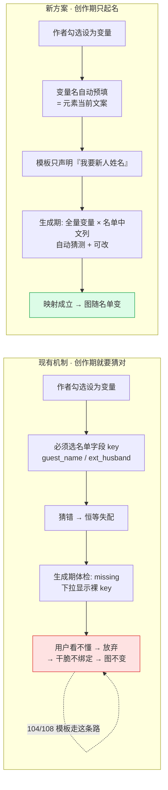

# 请柬变量绑定方案 · 产品评估（别名即变量 / 生成期映射）

> **性质**：产品评估文档，**不含实现**、未修改任何代码。  
> **评估对象**：老板提出的新方案 ——「在编辑器文本对象属性面板『组件别名』旁加『设为变量』复选框，勾选后以别名作为变量；批量生成时弹映射对话框，由生成者指定名单字段」。  
> **基准**：全部结论基于当前磁盘真值与数据库只读扫描（2026-10 扫描），代码位置均已核实。  
> **关联文档**：`docs/批量请柬-变量占位与批量渲染补齐方案.md`（决策 D1~D4）、`docs/批量请柬-名单导入与个性化渲染开发规范.md`。

---

## 0. 结论先行

| #     | 结论                                                                                                                                                                                                                                | 强度 |
| ----- | --------------------------------------------------------------------------------------------------------------------------------------------------------------------------------------------------------------------------------- | -- |
| **1** | **方向正确，必须做**。现有机制要求模板作者在创作期猜中名单字段 key，而真实名单 key 完全不可预测（`d_h` / `Male` / `guest_name1`…），这条路径已实测失效（108 个作品 104 个零绑定）。                                                                                                              | 强  |
| **2** | **但不要复用 `alias`**。三处硬伤：① **文本元素根本没有 `alias` 字段**（`TextElement` / `ImageElement` 未声明，只有日历/图集/拼图/倒计时/地图/留言板/时间轴/点赞/万能组件 9 种非文本组件才有）；② 全库 108 个作品 `alias` 使用数 = **0**；③ 图层列表显示名实际用的是 `BaseElement.name`，不是 `alias`。                  | 强  |
| **3** | **推荐：不新增第三个命名字段，而是给 `binding` 加一个 `name`**。变量 = `{ key(稳定 slug，自动生成/用户不可见) + name(人类可读变量名，创作期填) + sample/fallback/fit }`。既拿到"好懂的名字"，又保住"改名不断映射"。字段名**统一用 `name` 不用 `label`** —— 因为 `label` 在 core 里已是"名单字段中文名"的既定语义（见 §5.1 语义边界）。 | 强  |
| **4** | **真正的爽点不是"起名字"，而是"不用起名字"** —— 勾选「设为变量」时应**自动用元素当前文案预填变量名**（如维文请柬里写死的 `ئەلشىر & تۇمارىس` → 变量名默认「新人姓名」）。                                                                                                                           | 强  |
| **5** | **必须同步补 P0：编辑器 {{token}} 插入入口**。否则变量名变中文后，`TOKEN_RE`（`[a-zA-Z_][a-zA-Z0-9_]*`）**匹配不到中文令牌**，混合文案这条既有能力会直接报废（详见 §4.8）。                                                                                                              | 强  |
| **6** | **MVP 必须包含「方案 D · 生成期元素级绑定」** —— 创作者不会回去给 104 个存量模板逐个补勾别名，只有"在生成对话框里直接选模板上的文字 → 选名单列"才真正兑现老板的原始诉求（改名单→重生成→出图变）。                                                                                                                   | 强  |
| **7** | **工作量被低估约 30%**：admin 两端（用户视角 / 服务商视角）**根本没有映射弹窗**，是"从零新增"而非"保持一致地改"。                                                                                                                                                             | 强  |
| **8** | 优先级：**P0 = 变量 name + 方案 D 生成期绑定 + 三端映射弹窗 + token 收集修复**；P1 = 插入变量按钮 / 重名合并 / 改名提示 / 映射回写模板；P2 = 模板市场变量说明书 / 跨模板变量库。                                                                                                               | 建议 |

> **版本说明**：本文 v2 已与架构评估（`docs/请柬变量绑定方案-架构评估.md`）对齐，吸收了架构侧的三条代码级硬伤（§4.8）、`alias` 误会的根因定位（§1.1）、`blocked` 语义重定义（§5.4）、admin 两端从零新增（§6.3）与 LOCKED 409 放开（§5.7）。

---

## 1. 现状核实（代码 + 数据库双证据）

### 1.1 代码真值

| 事实             | 位置                                                                | 核实结果                                                                                                             |
| -------------- | ----------------------------------------------------------------- | ---------------------------------------------------------------------------------------------------------------- |
| 变量标注结构         | `packages/core/src/schema.ts:157` `ElementBinding`                | `binding?: { key, sample?, fallback?, fit?, minFontRatio? }` 挂在 **`BaseElement`**（所有元素共有）                        |
| 元素备注名          | `schema.ts:212` `BaseElement.name?`                               | 「元素备注名，便于图层列表中识别」                                                                                                |
| 表单向导键          | `schema.ts:216` `BaseElement.bind?`                               | 「一键制作向导按此键注入」——**第三个命名字段，已存在**                                                                                   |
| 组件别名           | `schema.ts:498/563/603/626/643/662/684/708/722` `alias?`          | 只声明在 **calendar / gallery / puzzle / countdown / mapNav / messageBoard / timeline / like / widget** 九种**非文本**元素上 |
| 文本元素           | `schema.ts:281 TextElement`                                       | **无 `alias` 字段**                                                                                                 |
| 图层显示名          | `packages/editor/src/components/Panel/LayerList.tsx:88`           | `const name = el.name \|\| t('editor:element.'+el.type)` → **用 `name`，不用 `alias`**                               |
| 文本属性面板的"名称"输入  | `ComponentSettingsPanel.tsx:450`                                  | `value={el.name}` → 变换分组第一个框，label 为 `editor:property.name`                                                      |
| **老板误解的根因**    | `apps/admin/src/i18n/locales/zh-CN/editor.json:159` 与 `:233`      | `"name": "组件别名"` 与 `"alias": "组件别名"` —— **两个字段、同一个中文标签**。老板说的"组件别名"实际是 `name`（架构侧独立验证，与本文一致）                     |
| 变量绑定 UI        | `ComponentSettingsPanel.tsx:1412 VariableBindingSection`          | 第一行就 `if (el.type !== 'text') return null` —— **只对文本元素开放**                                                       |
| 创作期字段选择        | `ComponentSettingsPanel.tsx:1540`                                 | 下拉 = `GUEST_FIELD_DEFS` 全量 + 「自定义字段…」手输 `ext_xxx`                                                                |
| 变量管理面板         | `packages/editor/src/components/Panel/VariablePanel.tsx`          | 按 key 聚合、「命中 N 处」、重命名有 `^[a-z][a-z0-9_]*$` 守卫                                                                    |
| 取值链            | `packages/core/src/personalize.ts:133`                            | `sourceKey = mapping?.[key] ?? key; raw = data?.[sourceKey]`，空 → fallback → `inferTitle` → `''`                  |
| 混合文案           | `personalize.ts:179` `TOKEN_RE`                                   | `/\{\{\s*([a-zA-Z_][a-zA-Z0-9_]*)\s*\}\}/g` —— **只认 ASCII 标识符**                                                  |
| 变量聚合           | `personalize.ts:93 collectBindings`                               | 只读 `el.binding?.key`，**不扫描 text 内的 `{{token}}`**                                                                 |
| 生成期体检          | `apps/server/src/invitation/invitation.service.ts:1161 getHealth` | 产出 `matched / missing(带 remapTargets) / blocked / emptyHits / unusedFields / fontCoverage`                       |
| 映射持久化          | `invitation.service.ts:1376 saveMapping`                          | 存 `BatchRenderProject.variable_mapping`，仅 DRAFT 可改；**以变量 key 为索引**                                               |
| 体检弹窗           | `apps/web/src/user/InvitationJobs.tsx:436+`                       | **全站唯一一处**；`matched` 只显示绿勾不可改；`missing` 的下拉 option 直接显示**裸 key**（`t2`，非中文 label）                                 |
| {{token}} 插入入口 | 全仓 grep                                                           | **不存在**（编辑器里只能手敲 `{{...}}`）                                                                                      |

### 1.2 数据库只读扫描（108 作品 / 49 名单 / 37 批量项目）

```
作品 Project：108 个
  ├─ 零绑定（全模板无任何 binding）：104   ← 96.3%
  ├─ 有绑定：4
  │    └─ 变量 key 分布：ext_husband ×4 处、ext_wife ×2 处
  ├─ 元素填过 alias：0 处        ★ 全库零使用
  ├─ 元素填过 name ：4 处        ★ 也几乎无人用
  └─ 含 {{token}} 的元素：1 处，其中 1 处**没有 binding.key**
                                  ★ 即 collectBindings 收集不到 → 体检静默漏报

名单 GuestList：49 个
  ├─ columnDefs 为空：33 个（67%）→ 前端回落标准前 5 列
  └─ 实际出现过 6 种互不相同、且完全不可预测的列 key 集合：
       ① ""                                              （空）
       ② guest_name, guest_title, e2e_col
       ③ Male, Female                                     ← 英文标签直接当 key
       ④ guest_name1, guest_name2                         ← 一请柬两宾客
       ⑤ ext_husband, ext_wife
       ⑥ d_h, d_w                                         ← 缩写，不可读
       ⑦ husband_name, wife_name, table_no, phone, wechat, address, remark

批量渲染项目 BatchRenderProject：37 个
  └─ variable_mapping 非空：**0 个**   ★ 映射能力上线至今一次都没被真正用过
```

### 1.3 三条决定性推论

> **推论 A（恒等已死）**：模板侧变量是 `ext_husband/ext_wife`，而真实名单列是 `husband_name/wife_name`。**同名恒等在真实数据下一次都没成立过**。D4 文档写的是"恒等仍是零配置主路径"，实测是"恒等从未生效"。映射不是补救手段，是**唯一通路** —— 老板方案的前提成立。

> **推论 B（猜 key 不可能）**：名单 key 由用户自由命名，出现 `d_h`、`Male`、`guest_name1`。要求模板作者在创作期预先猜中，是**不可能完成的任务**。这是 104/108 零绑定的根因，与"用户懒"无关。

> **推论 C（alias 是空地，不是地基）**：`alias` 全库零使用、且**根本不存在于文本元素上**。老板说的"文本对象属性面板的组件别名输入框"在代码里对应的是 `name`（变换分组的"名称"）。方案落地前必须先澄清这一点，否则工程会做在错误的字段上。

---

## 2. 用户故事与痛点拆解

两类角色**必须分开看**——他们的知识、时机、可容忍的复杂度完全不同。

### 2.1 角色 A：模板作者（创作期）

> 典型画像：新疆本地婚庆服务商的设计师 / 小商家老板本人；可能用维文；**不知道**名单长什么样。

| #   | 用户故事                                               | 现有机制下卡在哪                                                                                                                                                     |
| --- | -------------------------------------------------- | ------------------------------------------------------------------------------------------------------------------------------------------------------------ |
| A-1 | 作为模板作者，我想把请柬上的姓名位置标成"会变的地方"，**以便**同一张版式能印给 200 位宾客 | 勾选「设为个性化变量」后立刻要选「变量字段」，下拉里是 `guest_name / guest_title / gender / unit / table_no / phone / address / remark`。**他不知道名单里会叫什么**，也看不出 `guest_name` = 姓名要靠括号里的中文猜 |
| A-2 | 作为模板作者，我想让请柬显示"新郎 / 新娘"两个自定义内容，**以便**做婚礼请柬         | 必须点「自定义字段…」手输 `ext_husband`。**要理解 `ext_` 前缀规范**，输错前缀（写成 `husband`）不会被拦截，也不会有提示                                                                               |
| A-3 | 作为维文模板作者，我想用维文命名变量，**以便**自己和同事看得懂                  | `VariablePanel` 重命名有 `^[a-z][a-z0-9_]*$` 守卫，**维文/中文一律拒绝**；命名只能用 ASCII                                                                                        |
| A-4 | 作为模板作者，我想在"尊敬的 X 先生"这种句子里插变量，**以便**保留句式            | 引擎支持 `{{token}}`，但**编辑器没有任何插入入口**，只能手敲 `{{guest_name}}`；敲错 key 不报错，生成时静默变空白。全库只有 1 处，且是裸 token（无 binding.key），**体检根本看不见它**                                   |
| A-5 | 作为模板作者，我改了元素文案后想知道映射会不会断                           | 无任何提示。改名后 `variableMapping`（按 key 索引）静默失配                                                                                                                    |

### 2.2 角色 B：批量生成使用者（生成期）

> 典型画像：A 本人（自产自销），**或**终端用户（服务商做好模板、客户只负责上传名单并生成）。  
> **关键差异**：B 手里握着**真实的名单**（有表头、有数据），他不需要"预先知道"，只需要"当场指认"。

| #   | 用户故事                                            | 现有机制下卡在哪                                                                                                               |
| --- | ----------------------------------------------- | ---------------------------------------------------------------------------------------------------------------------- |
| B-1 | 作为生成者，我想一眼看懂"模板上哪些位置会变、分别要填什么"，**以便**判断我的名单够不够用 | 体检弹窗只有一行绿勾 `{label}（{key}）`，例如「姓名（guest_name）」。**模板零绑定时弹窗一片空白**，用户完全不知道下一步该干嘛                                          |
| B-2 | 作为生成者，我想把模板上的"新人姓名"指到我名单里的"丈夫姓名"列，**以便**生成      | 下拉 option 显示的是**裸 key** `husband_name` 而不是中文表头「丈夫姓名」（`remapTargets: defs.map(d => d.key)` 只给了 key）。维文用户面对 `d_h` 完全无从下手 |
| B-3 | 作为生成者，我想改一个"已自动匹配"的变量指向，**以便**纠正误判              | **做不到**。`matched` 只有静态绿勾，没有下拉；只有 `missing` 才能改指向                                                                       |
| B-4 | 作为生成者，我想知道哪些名单列没被用上，**以便**发现漏配                  | `unusedFields` 接口已返回，但**前端没渲染**（弹窗里没有这块 UI）                                                                            |
| B-5 | 作为生成者，改了名单值后想重新生成出新图，**以便**修正错字                 | **这是当前最痛的一条**：104/108 模板零绑定 → `personalizeSchema` 是 no-op → 无论怎么改名单，图**完全不变**。用户会判定为"产品坏了"                             |

### 2.3 两类角色的关系矩阵

| 组合                | 场景               | 对方案的特殊要求                                   |
| ----------------- | ---------------- | ------------------------------------------ |
| A = B（自产自销）       | 小商家自己做模板自己发      | 容忍"两次操作"，但**不能让他来回切换上下文**（编辑器 ↔ 生成页）       |
| A ≠ B（服务商 → 终端客户） | 服务商做模板、客户上传名单生成  | **变量名必须能自解释**（客户看不到作者，只能靠名字猜），映射弹窗必须"一次看懂" |
| A ≠ B（模板市场分发）     | 平台/服务商上架模板，陌生人使用 | 变量语义要能随模板**一起分发**，且**版本演进不能断映射**           |

---

## 3. 新方案 vs 现有机制：逐维度对比

> 说明：新方案按**推荐形态**（`binding` 增加 `label`，key 降级为自动 slug）评估；若按老板原话"直接用 alias 当变量"落地，见 §4 风险，多数维度会退化。

| 维度                        | 现有机制（D4：任意 key + 恒等优先 + 映射补救）                                               | 新方案（创作期只起名 / 生成期建映射）                                                                                       | 判定                                          |
| ------------------------- | --------------------------------------------------------------------------- | ---------------------------------------------------------------------------------------------------------- | ------------------------------------------- |
| **创作期心智负担**               | **高**。必须选/输名单字段 key，要懂 `guest_name`、`ext_` 前缀规范                             | **低**。只勾一个复选框，变量名**自动预填元素当前文案**，可改可不改                                                                      | 新方案 **显著胜**                                 |
| **是否需预知字段 key**           | **是**（致命）。作者要猜名单列名                                                          | **否**。作者完全不需要知道名单                                                                                          | 新方案 **决定性胜**                                |
| **跨名单复用性**                | **差**。key 写死为 `ext_husband`，换一份列名叫 `husband_name` 的名单就全失配，必须每次重映射           | **好**。模板只声明"我要一个新人姓名"，每次生成时对着当次名单指认                                                                        | 新方案 **胜**                                   |
| **改名单时的维护成本**             | 名单改列名 → 存量项目映射断裂，需重配                                                        | 同样需重配（映射在生成期），但**每次生成都会重新体检重确认**，暴露更及时                                                                     | 新方案 **略胜**                                  |
| **改模板时的维护成本**             | 改 key → `variableMapping` 失配（按 key 索引），静默断                                  | 改 `label` → **不断**（key 是稳定 slug）；只有删元素才需要重配                                                                | 新方案 **胜**（前提是采用 key+label 分离，见 §4.2）        |
| **出错可诊断性**                | **差**。① 模板零绑定 → 体检全绿、生成成功、图不变（**最恶劣**：静默错误）；② 混合文案里的 token 不进体检；③ 弹窗显示裸 key | **中→好**。① 可加"模板无任何变量"硬提示；② 若同步修复 token 扫描则覆盖；③ 弹窗显示中文 label + 名单中文表头                                       | 新方案 **胜**（需配套 P0 修复，否则"全绿但不生效"仍存在）          |
| **与混合文案 `{{token}}` 的兼容** | 兼容（ASCII key）。引擎支持，但编辑器无插入入口                                                | **有破坏风险**。`TOKEN_RE` 只认 ASCII，中文/维文变量名插进文本里**匹配不到**。必须配"插入变量"按钮（内部仍写 slug）                                 | **平手，但新方案必须补 P0**，否则倒退                      |
| **多人协作 / 模板分发的语义清晰度**     | **低**。`ext_husband` 对接收方是黑话                                                 | **高**。「新郎姓名」自解释，陌生人拿到模板即可用                                                                                 | 新方案 **胜**                                   |
| **同一变量多处复用**              | 天然支持（同 key 聚合为「命中 N 处」）                                                     | 需**显式设计**：靠"变量名"聚合（同名即同一变量）或靠"从已有变量里选"                                                                     | 新方案 **需补设计**（见 §5.3），否则退化为每个元素一个独立变量，映射弹窗爆炸 |
| **实现改造面**                 | —                                                                           | 中小。`binding` 加一个可选 `label`；`collectBindings` 增扫 token；`getHealth` 增返回 label + 名单 label；弹窗重写。**引擎取值链几乎不用动** | 可接受                                         |
| **存量 104 个零绑定模板**         | 维持不可用                                                                       | 可通过"批量勾选 + 自动预填文案"半自动转化                                                                                    | 新方案 **胜**（有迁移杠杆）                            |

### 3.1 流程对比（Mermaid）



---

## 4. 新方案的产品风险（重点）

### 4.1 风险一：`alias` **在文本元素上根本不存在** 🔴 阻断级

- `schema.ts` 里 `alias?: string` 只声明在 9 种**非文本**元素上；`TextElement`（281 行）与 `ImageElement`（315 行）**都没有这个字段**。
- 而 `VariableBindingSection` 第一行就是 `if (el.type !== 'text') return null` —— **变量能力只开放给文本**。
- 请柬个性化 99% 是文本（姓名/称谓/桌号）。**两个功能的作用域完全不相交。**
- 数据库佐证：108 个作品里 `alias` 使用数 = **0**。

> **影响**：若按字面实现，要么给 `TextElement` 补 `alias`（等于新增字段，与"复用"初衷矛盾），要么方案落不了地。  
> **处置**：把老板口中的"组件别名"澄清为 `el.name`（变换分组的"名称"，图层列表用它显示），或直接采用 §5 的 `binding.label`。

### 4.2 风险二：改名即断映射 🔴 严重（决定架构选型）

- 映射存储 `BatchRenderProject.variable_mapping` 是 `Record<变量标识, 名单字段 key>`，**以变量标识为索引**。
- 若变量标识 = `alias`/`name`/中文 label（用户可随手改），则：
  - 作者把"新郎姓名"改成"新郎" → 已保存的映射 `{"新郎姓名": "husband_name"}` 瞬间失配 → **37 个存量项目 + 每次重生成全部受影响**。
  - 更糟的是：失配后变量变成"未映射"，按 D2 整段变量元素会 **隐藏**，用户看到的是"文字凭空消失"，而不是"名字错了"。
- 现有 `VariablePanel` 的重命名守卫（`^[a-z][a-z0-9_]*$`）虽然丑，但它**保证了"命名空间封闭"**，副作用是映射不会因为一个空格而断。


> **产品判断**：**变量名必须是可变的，映射索引必须是不可变的。二者必须分离。**  
> 因此"直接复用 alias 当变量名"在架构上是错的 —— 它把一个**可随手改的展示字段**当成了**跨系统稳定标识**。

### 4.3 风险三：重名与多处复用 🔴 严重

- `alias` / `name` 当前**可空、可重名**（无唯一性约束）。
- 场景：封面写"ئەلشىر & تۇمارىس"、正文写"ئەلشىر 先生与 تۇمارىس 女士 敬邀" —— 作者给两个元素都起名「新人姓名」。
  - **期望**：映射一次，两处同时生效（这正是"同一变量多处复用"）。
  - **风险**：若实现成"每个元素一个独立变量"，映射弹窗会出现**两行同名「新人姓名」**，用户不知道该配哪个、会不会漏配一个。
- 反过来：作者**误**给两个不同语义的元素起了同名（封面"日期"、页脚"日期"，其实一个指婚礼日期一个指印刷日期）→ 被合并成同一变量 → **错配且难以发现**。

> **处置**：默认**同名即合并**（符合直觉，且天然支持多处复用），但在映射弹窗与变量面板**显式显示"命中 N 处"**&#x5E76;提供「拆分为独立变量」。这把"重名"从 bug 变成 feature。

### 4.4 风险四：中文 / 维文 / 空格 / 特殊字符 🟡 中

| 问题                   | 表现                                                     | 处置                                                                     |
| -------------------- | ------------------------------------------------------ | ---------------------------------------------------------------------- |
| `TOKEN_RE` 不认非 ASCII | `{{新郎姓名}}` **不会**被替换，直接原样印在请柬上                         | 插入变量时**写入内部 slug**，画布上以 label/sample 呈现；用户永远不手敲 token                  |
| 前后空格 / 全角符号          | 「新郎姓名 」 vs 「新郎姓名」被视为两个变量                               | 存储前 trim + 归一化（NFKC），比较时按归一化值                                          |
| 维文连写 / 从右向左          | 变量名输入与下拉在 RTL 下需镜像；且 `Male`/`Female` 这种英文 key 已存在于真实名单 | 变量 label 允许任意 Unicode；映射弹窗的名单列头优先显示 `columnDefs.label`（中文/维文），key 作副标题 |
| 超长名字                 | 映射弹窗布局被撑破                                              | label 限制展示长度 + tooltip；**不限制存储长度**                                     |

### 4.5 风险五：静默错误画像未被根治 🟡 中

- 即便上了新方案，**"模板零变量 → 体检全绿 → 生成成功 → 图不变"** 这条最恶劣的静默路径仍然存在（104/108 的元凶）。
- 新增的静默路径：变量建了 label 但**生成者没配映射** → 按 D2 隐藏 → 请柬上少一块内容，而流程"成功"。

> **处置（P0，与方案绑定）**：`getHealth` 增加 `noVariables: boolean`；当模板零变量时，弹窗**不再显示空列表**，而是红色阻断提示：「该模板没有设置任何可替换内容，生成的请柬将完全一致。请先回到编辑器把需要变化的内容设为变量」。把静默错误变成显式阻断。

### 4.6 风险六：与 `name` / `bind` / `alias` 三套命名并存 🟡 中

- 现状已有：`BaseElement.name`（图层备注名）、`BaseElement.bind`（一键制作向导键）、组件 `alias`（组件别名）。
- 若再加"变量名"，**一个元素会有 4 个"名字"**。用户与后续维护者必然混淆。

> **处置**：**不新增第 4 套**。变量名放进 `binding.label` —— 它在语义上从属于"变量"这个概念，而不是从属于"元素"，天然不会与图层名混淆。

### 4.7 风险小结

| 风险                 | 等级    | 是否可由"key + label 分离"化解       |
| ------------------ | ----- | ---------------------------- |
| 4.1 alias 不存在于文本元素 | 🔴 阻断 | ✅（改挂 `BaseElement`，不用 alias） |
| 4.2 改名断映射          | 🔴 严重 | ✅（key 稳定、label 可变）           |
| 4.3 重名 / 多处复用      | 🔴 严重 | ✅（同名合并 + 命中 N 处 + 可拆分）       |
| 4.4 中文/维文/空格       | 🟡 中  | ✅（slug 承载 token，label 承载展示）  |
| 4.5 静默错误           | 🟡 中  | ⚠️ 需额外 P0（零变量阻断 + 未映射显式确认）   |
| 4.6 四套命名           | 🟡 中  | ✅（不新增字段）                     |

---

## 5. 推荐方案：`binding = { key(稳定 slug) + label(人类可读名) }`

### 5.1 数据形态（纯增量、向后兼容）

```ts
interface ElementBinding {
  /** 稳定变量标识：slug，^[a-z][a-z0-9_]*$，自动生成（如 var_a1b2 / guest_name） */
  key: string;
  /** 人类可读变量名（创作期填，可中文/维文，可改，不参与映射索引） */
  label?: string;
  sample?: string;
  fallback?: string;
  fit?: VariableFitMode;
  minFontRatio?: number;
}
```

- **存量兼容**：老数据只有 `key`（如 `ext_husband`）→ `label` 缺省时回落 `getGuestFieldDef(key)?.label ?? key`，行为完全不变。
- **映射索引不变**：`variableMapping` 仍以 `key` 为索引 → **`saveMapping` / `personalizeSchema` / `resolveBindingValue` 一行都不用改**。
- **改名不断**：用户改 `label` 只影响显示，不影响 `key` → 映射稳固。

### 5.2 创作期 UI（关键：自动预填）

```
组件设置 → 变量绑定
┌────────────────────────────────────────────┐
│ ☑ 设为个性化变量                              │
│                                            │
│ 变量名  [ 新人姓名                    ]  ★ 勾选时自动填入元素当前文案 │
│         ↳ 「生成时请选择名单中对应的列」                    │
│                                            │
│ 样例值  [ ئەلشىر & تۇمارىس          ]  ★ 设计态显示，默认=当前文案 │
│ 兜底值  [ （留空则名单为空时隐藏）      ]                    │
│ 超长时  [ 缩字号 ▾ ]                                     │
└────────────────────────────────────────────┘
```

三条设计要点：

1. **不再出现"变量字段"下拉**（`guest_name` / `ext_xxx` 那套 key 体系从创作期彻底消失）。
2. **变量名自动预填元素当前文案**（截取前 12 字）。作者 90% 情况下什么都不用输，只勾一下。这是把 104 个存量模板变成可个性化模板的杠杆。
3. **勾选时若同名变量已存在 → 自动归入已有变量**（提示「已归入已有变量『新人姓名』，命中 2 处」），而不是新建。

### 5.3 同一变量多处复用（回应 §4.3）

| 机制      | 说明                                                                     |
| ------- | ---------------------------------------------------------------------- |
| 同名即合并   | 变量名相同 → 自动视为同一变量，`collectBindings` 按 **label（缺失时按 key）** 聚合，展示「命中 N 处」 |
| 从已有变量里选 | 勾选「设为变量」时，若模板内已有变量，下拉提供「复用已有变量：新人姓名 / 宾客姓名 / …」，选中即加入命中（内部写同一 `key`）   |
| 可拆分     | 变量面板提供「拆分为独立变量」，为误合并的元素分配新 slug                                        |
| 混合文案复用  | 句子里插变量时，插入的是同一 slug → 自动共享                                             |

### 5.4 生成期映射弹窗：产品设计要点

**目标**：让不懂技术的用户**一次看懂**"左边是模板上的变量，右边选名单里的列"。

```
┌──────────────────────────────────────────────────────────┐
│  请确认：模板上的内容 ← 名单里的哪一列？                        │
│  模板：喀什婚礼请柬   名单：Mirzat-Malika(2)（7 列 / 12 人）    │
├──────────────────────────────────────────────────────────┤
│  ✅ 已自动匹配 3 项（可修改）                                  │
│  ┌────────────────┬────────────────────┬──────┐          │
│  │ 模板变量        │ 名单列              │      │          │
│  ├────────────────┼────────────────────┼──────┤          │
│  │ 新人姓名  (2处) │ 丈夫姓名 husband_name ▾│ 猜测 │          │
│  │ 桌号      (1处) │ 桌号     table_no   ▾│ 同名 │          │
│  │ 手机号    (1处) │ 手机号   phone     ▾│ 同名 │          │
│  └────────────────┴────────────────────┴──────┘          │
│                                                          │
│  ⚠️ 待你指定 1 项                                          │
│  ┌────────────────┬────────────────────┐                 │
│  │ 宾客称呼  (1处) │ （请选择…）        ▾│                 │
│  └────────────────┴────────────────────┘                 │
│                                                          │
│  ⓘ 未使用的名单列：夫人姓名、微信号、地址、备注               │
│  ⚠️ 「宾客称呼」在 12 行中有 5 行为空 → 这些请柬将隐藏该处     │
├──────────────────────────────────────────────────────────┤
│               [ 取消 ]  [ 保存并生成 12 张 ]                │
└──────────────────────────────────────────────────────────┘
```

八条设计要点：

| # | 要点                     | 说明                                                                                                                                          |
| - | ---------------------- | ------------------------------------------------------------------------------------------------------------------------------------------- |
| 1 | **全量可改，不只改 missing**   | 现状 `matched` 是静态绿勾不可改 —— 必须升级为全量下拉。自动猜测只能降低操作量，不能剥夺改的权力                                                                                     |
| 2 | **两边都显示中文/维文名**        | 左列显示 `binding.label`，右列显示 `columnDefs[].label`（中文表头）， key 作灰色副标题。**现状右列只显示裸 key（`d_h`）是最大可用性缺陷**                                            |
| 3 | **默认自动匹配，但必须可改**       | 三级猜测：① 精确同名（`table_no` ↔ `table_no`）；② label 精确相等（「桌号」↔「桌号」）；③ 同义/包含（「新人姓名」↔「丈夫姓名」命中"姓名"）。命中打「已猜测」标记，提示"请确认"                                |
| 4 | **显示"命中 N 处"**         | 让用户知道改一处会影响几个位置（回应 §4.3）                                                                                                                    |
| 5 | **空值/未映射：不阻断，但必须显式确认** | 建议：**仅 `critical`（核心，如姓名类）且未映射时阻断**；其余允许「留空 → 该处隐藏」，但在弹窗内**逐项列出将会隐藏的内容**并给出张数（复用现有 `emptyHits`）。理由：维文/多版式请柬确实存在"这版不需要桌号"的合理场景，一刀切阻断会逼用户造假数据 |
| 6 | **模板零变量 → 硬阻断**        | 不再显示空列表，直接红条：「该模板没有可替换内容，生成的请柬将完全一致」（回应 §4.5，这是 104/108 的直接对策）                                                                              |
| 7 | **渲染 `unusedFields`**  | 现状接口已返回但前端未渲染。展示"未使用的名单列"，帮用户发现漏配                                                                                                           |
| 8 | **实时预览一行**             | 弹窗内用名单**第一行**数据做一次单条预览（"效果预览：尊敬的 ئەلشىر 先生"）。这是让"一次看懂"最有效的手段，且可复用 `personalizeSchema`                                                       |

### 5.5 与 `{{token}}` 的兼容（P0 配套）

- 引擎 `TOKEN_RE` 只认 ASCII → **变量名再好懂，也不能直接写进文本**。
- 处置：编辑器提供「插入变量」按钮（在文本工具栏 / 变量面板"插入到…"），插入的内部串是 `{{slug}}`，**画布与面板上显示为 label 或 sample**，用户从不接触 slug。
- 同时修复 `collectBindings`：**扫描 `text` 内所有 `{{...}}`**，让混合文案里的变量也进体检（现状 DB 里那 1 个裸 token 元素就是漏网之鱼）。

---

## 6. 结论与推荐

### 6.1 值不值得做？

**值得做，且优先级应高于多数增量需求。** 理由：

1. **它是一个"功能存在但等于不存在"的问题**。104/108 模板零绑定、`variable_mapping` 非空数 = 0 —— 个性化引擎、`getHealth`、`saveMapping`、体检弹窗这一整套已上线的能力，**实际使用量为零**。投入产出比极高：改造集中在 UI 与元数据，引擎几乎不动。
2. **它导致的是静默错误**，不是报错。用户改名单后图不变，会判定"产品坏了"，且不会来反馈（以为是自己操作问题）。这类流失最难被察觉。
3. **它挡住了商业模式**。服务商做模板 → 客户生成，是本平台的核心分发路径；变量语义不自解释，这条路径就跑不通。

### 6.2 三个选项的取舍

| 选项                                          | 优点                                                                                                                   | 缺点                                                                                                  | 产品判断       |
| ------------------------------------------- | -------------------------------------------------------------------------------------------------------------------- | --------------------------------------------------------------------------------------------------- | ---------- |
| **A · 直接复用 `alias`**                        | 零新增字段                                                                                                                | ① 文本元素**没有** alias 字段，需先补 schema（等于新增）；② 全库零使用，无历史包袱也无历史价值；③ 可空可重名，无唯一性/稳定性；④ 改名断映射；⑤ 与 `name` 语义打架 | ❌ **不推荐**  |
| **B · 新增独立"变量名"字段**                         | 语义干净                                                                                                                 | 元素上第 4 套命名；与 `binding` 概念割裂（"是不是变量"和"叫什么"存两处，易不一致）                                                  | ⚠️ 可接受但非最优 |
| **C · `binding` 加 `label`（key 降级为稳定 slug）** | ① 不新增第 4 套命名；② key 稳定 → 改名不断映射；③ `variableMapping` 索引不变，引擎/存储零改动；④ 存量 `binding` 天然兼容；⑤ 变量的所有属性（是不是变量/叫什么/样例/兜底）收敛在一处 | 需要一次 `collectBindings` 的聚合键改造（key → label）                                                          | ✅ **推荐**   |

### 6.3 推荐：C（key + label 分离），渐进迁移

```
阶段 1（P0 · MVP）
  ├─ core: ElementBinding 增加 label?（可选）；collectBindings 增扫 {{token}}、按 label 聚合
  ├─ core: 新增 slug 生成（勾选时按 label 生成，或复用既有 key）
  ├─ editor: 「设为变量」勾选时自动用元素当前文案预填 label + sample
  ├─ editor: 创作期移除「变量字段」下拉（不再要求选名单 key）
  ├─ server: getHealth 返回变量 label、名单列 label、noVariables 标志
  ├─ web: 映射弹窗重写 —— 全量可改 + 中文名双向展示 + 自动猜测 + 未使用列 + 零变量阻断
  └─ 验收口径：拿一份列名为 husband_name/wife_name 的名单 + 一个维文模板，
               新用户无需看文档即可完成映射并生成出姓名正确的请柬

阶段 2（P1）
  ├─ editor: 「插入变量」按钮（内部写 {{slug}}，面板显示 label）
  ├─ editor: 同名变量合并 / 拆分 / 命中 N 处
  ├─ editor: 改变量名时若该项目已有映射 → 提示「改名不影响已保存的映射」
  ├─ web: 弹窗内第一行实时预览
  └─ 存量 104 个零绑定模板：提供「一键扫描建议」（把疑似人名的文本标为待确认变量）

阶段 3（P2）
  ├─ 模板市场：模板详情页展示"该模板需要的变量清单"
  ├─ 跨模板变量库（组织级常用变量：新人姓名/桌号/场次）
  └─ 变量映射的"上次选择"记忆（同名名单自动复用历史映射）
```

### 6.4 MVP 范围（可交付的最小闭环）

**一句话**：*作者在编辑器勾选一下就能把任意文案变成变量（名字自动填好）；生成者对着中文表头指认一次就能出图；模板没变量时明确拦住。*

| 必须（MVP 内）                              | 明确不做（MVP 外）            |
| -------------------------------------- | ---------------------- |
| `binding.label` + slug 自动生成            | 变量类型校验（数字/日期/枚举）       |
| 创作期自动预填变量名、移除 key 下拉                   | 跨模板变量库、组织级变量           |
| `collectBindings` 扫 token + 按 label 聚合 | 变量值二次加工（大小写、拼接、称谓推断扩展） |
| 映射弹窗：全量可改 + 中文名 + 自动猜测 + 零变量阻断         | 映射的历史记忆 / AI 智能匹配      |
| 未使用名单列展示                               | 图片类变量（src 注入）          |
| 存量数据向后兼容（label 缺省回落）                   | 模板市场变量说明书              |

### 6.5 需要老板/团队拍板的开放问题

| #  | 问题                                       | 备选                       | 建议                                                    |
| -- | ---------------------------------------- | ------------------------ | ----------------------------------------------------- |
| Q1 | 未映射变量：**阻断**还是**留空隐藏**？                  | ① 全部阻断 ② 仅核心阻断 ③ 全部放行    | **②**（仅"姓名类核心"阻断，其余留空隐藏且显式告知张数）                       |
| Q2 | 创作期是否彻底移除"变量字段"下拉？                       | ① 彻底移除 ② 折叠为"高级"         | **①**（保留会让新机制的心智负担回潮），但 `VariablePanel` 保留 key 可见以便排障 |
| Q3 | 变量名是否允许重名？                               | ① 禁止（强制唯一）② 允许（同名合并）     | **②**（同名合并是多处复用的天然表达），配"命中 N 处"+"可拆分"                 |
| Q4 | 存量 4 个已绑定模板（`ext_husband/ext_wife`）如何迁移？ | ① 自动补 label「新郎/新娘」② 保持原样 | **①**（低风险，且能立刻让现有婚礼模板在 `husband_name` 名单上跑通）          |
