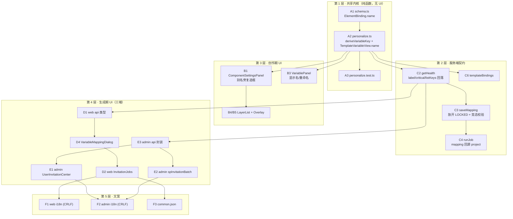
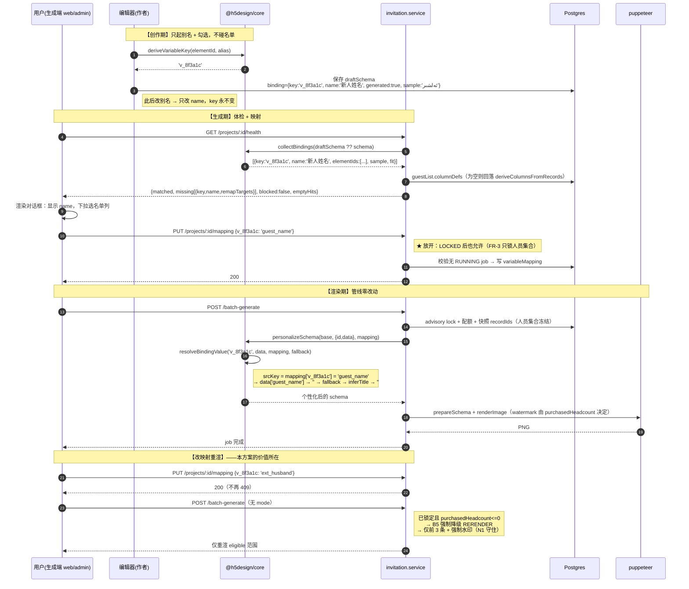
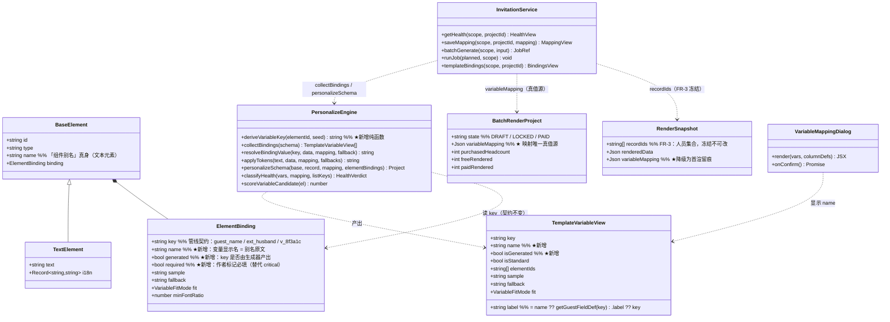

# 请柬变量绑定改造 · 架构与技术可行性评估

> 作者：高见远（架构师）
> 范围：**仅分析 + 方案设计，不含任何代码改动**（本次为纯评估交付）
> 代码基线：`@h5design` monorepo，工作目录 `D:/MyWorkBuddy/2026-08-10-22-39-56`
> 所有行号均取自当前工作区实际文件，可逐条复核

---

## 版本记录

| 版本 | 变更 |
|---|---|
| v1 | 初稿：方案 A/A'/B/C/D 对比，推荐 C + D 紧随 |
| **v2** | 与 PM（许清楚）交叉评审后的修订：<br/>① **§5.1 三级阻断** —— 采纳 PM 反驳，撤回「blocked 一律 false」，改为 `NO_MAPPING_AT_ALL` / `REQUIRED_UNMAPPED` / `NO_USABLE_COLUMN` 三级硬阻断 + 琥珀确认，并补 `ZERO_VARIABLE` 提示<br/>② **§3.5 D-2b** —— 修正 PM 的「回写模板」为「写 `BatchRenderProject.elementBindings`」，规避越权/写冲突/污染模板真值<br/>③ **§2.4 共享组件包** —— 新增强制约束：三端复用 `packages/invitation-mapping`，判定逻辑入 core<br/>④ **§7.5** —— 方案 D **由「紧随」改「进 MVP」**<br/>⑤ 全文档 `binding.name` 定名（与 PM 统一，弃用 `binding.label`） |
> **版本号对齐说明**：本文档 **v5 ≡ 产品文档（`请柬变量绑定方案-产品评估.md`）v5** —— 内容一致。对照表见 §8.1，编号对照见 §8.0。

| **v6** | 第五轮（**老板拍板 Q6 = 画布可视化点选**，推翻我与 PM 的一致建议）：<br/>① **§3.6 新增** —— 画布点选方案。查证后发现**不需要 Konva**：服务端出图用的就是 `SchemaRenderer`（`ExportRenderPage.tsx:14`）、元素 DOM 自带 `data-element-id`（:969）、web 与 admin **两端已在用**该渲染器 ⇒ **成本重估：原估 3–5× 修正为 1.5–2×**<br/>② **五条必须项 M-1~M-5** —— `animated={false}`（否则入场动画导致点不到）、字体预加载（否则高亮框错位）、**预览用首条名单记录个性化后的 schema**（否则看到假文案）、热区 ≥24×24 + zIndex 取最上层、overlay 与 scale 同源<br/>③ **§2.4 修正** —— 共享包可依赖 `@h5design/render`，**禁止依赖 `@h5design/editor`**<br/>④ **PM 的 N-1~N-4 + 新增 N-5（键盘 Tab 兜底）全部纳入 MVP**，不允许降级为「细节」；S5 验证项增 ⑪~⑭<br/>⑤ **Q2/Q8/Q9 三项拍板结果已归档**（三端同期 / 默认勾选仅作者可见 / 继承 P1 不进 MVP）⇒ 我这边无未决项 |
| **v5** | 第四轮（PM 补答 A-Q3/4/5/6/7）：<br/>① **§3.4.1 同名合并规则修正** —— 从「key 唯一、不自动合并」改为「**同名即合并**」（PM 期望跨页多处复用）。不合并会在映射对话框出现两行同名无法区分的条目，与 A-Q6 歧义是同一问题。**改名仍不断链**，误合并由变量面板「拆分」兜底<br/>② **§3.5 候选项消歧** —— 新增 core 纯函数 `describeElementPosition`，MVP 加「第 N 页 · 位置描述」；P1 加静态缩略图高亮（仍非交互热区）<br/>③ **§2.1 A6** —— 新增 `COMMON_VARIABLE_NAMES` 常量候选（PM 的 A-Q7）<br/>④ **§8.0 编号对照表** —— 解决架构 Q# 与产品 Q# 不是同一套的问题；Q3–Q7 已由 PM 答复并归档为 Q3'–Q6'<br/>⑤ **补 Q9**（换名单继承是否进 MVP，此前只存在于消息、未落盘） |
| **v4** | 第三轮交叉评审（PM 指出 SUPERSEDED 劣化 + `name` 逃生口）：<br/>① **§3.5.1 新增** —— SUPERSEDED 若只做「作者赢」会**静默劣化**（切到作者 key 后查不到映射 → 元素隐藏、流程仍显示成功）。处置：**命名归作者、指向归使用者**；采用**不迁移存储 + 渲染期兜底**（`effectiveMapping`），而非 PM 提的迁移存储（触发点难找 / GET 写库 / admin 绕过弹窗时不生效）<br/>② **`elementBindings` 加回可选 `name`** —— 仅当**用户显式改名**时才写（自动派生的名字仍不存快照）；显示规则 `name ?? 当前文案截取前 12 字`<br/>③ **`superseded[]` 结构扩充** —— 增 `toName` / `listField` / `autoApplied`，前端可直接渲染「你选的名单列已保留」<br/>④ **§4.5 继承补两条 UI 约束** —— 标明来源项目 + 提供「清空重新选择」出口（继承只能是默认值，不能是既成事实）<br/>⑤ S5 验证项 ⑧ 加限定、新增 ⑨⑩ 两条 SUPERSEDED 回归 |
| **v3** | 第二轮交叉评审（PM 跑脚本定案后）：<br/>① **§1.4 新增偏差④** —— **变量绑定只活在草稿态**（4 个有绑定的全部只在 `draftSchema`，发布态 `schema` 零命中；Template 表 37 个 100% 零绑定；`variable_mapping` 非空 = 0），并导出 3 条设计影响<br/>② **口径统一 `104/108`**（PM 脚本可复现，与 `getHealth`/`runJob` 取数口径逐字一致）<br/>③ **§3.5 D-2b 瘦身 + 冲突消解** —— `elementBindings` 只存 `{key, generated}`（**不存 name/sample 快照**，避免模板改版后显示名陈旧）；注入改用独立纯函数 `applyElementBindings`，**`personalizeSchema` 签名零改动**；新增 `SUPERSEDED` / `ORPHANED` 两条冲突规则，回答 PM 的「合并优先级」提问<br/>④ **§4.5 新增** —— D-2b 的 project 级代价与继承 P1，并修正继承键为 `projectWhere(scope)+templateId`（防跨客户泄露）<br/>⑤ **§2.4 i18n** —— 弹窗需齐备 **6 locale**（含 `en`），包只接受 `t` prop 不持有文案<br/>⑥ 数据面支持 PM 的「弹窗模式切换」：`GET /health?includeCandidates=1` |

---

## 0. 结论先行

| # | 结论 | 强度 |
|---|------|------|
| 1 | **老板的直觉方向是对的**：把「变量命名」与「字段绑定」解耦，是唯一能根治「创作期必须猜对名单 key」的路径。 | 强 |
| 2 | **但「把别名直接当变量 key」不可行（方案 A 必须否决）**：别名是自由文本（可中文/维文/含空格/空/重名），而 `binding.key` 是管线契约，被当 JSONB 键、被 `applyTokens` 正则约束、被 `getGuestFieldDef` 回落。**裸用别名会同时击穿 3 处语义**。 | 强（有代码证据） |
| 3 | **推荐方案 C**：管线契约（`binding.key`）**一字不改**，仅在 `ElementBinding` 上**新增一个可选 `name`（别名/显示名）**，并引入「稳定 slug 生成器」——**别名 = 显示名，key = 永不变化的稳定 slug**。改名不断链、中文可用、重名可控。 | 强（推荐） |
| 4 | **方案 C 解决不了 104/108 存量零绑定模板**（设计师不会回去逐个勾选）。必须追加**方案 D（生成期元素级绑定）** 才能真正盘活存量。**D 是本项目价值最高的一条，必须进 MVP，不能拆到下一期**（v2）。 | 强 |
| 5 | **「生成期才绑定」与「LOCKED 后映射不可改（409）」确实冲突，必须放开**。已论证放开后**不破坏任何付费闸门 / FR-3 不变量**（见 §4）。 | 强 |
| 5b | **但「放开改映射」不等于「放行错误配置」**（v2 修正）：数据空值仍不阻断（N4），但「一个变量都没映射」必须硬拦截 —— 否则产出一批完全不含名单信息的请柬却显示"成功"，等于把 104/108 的静默坑重挖一遍（见 §5.1）。 | 强 |
| 6 | **影响面比预估小**：`personalize.ts` 全仓库只有 3 处消费方（server / editor VariablePanel / core 单测）。但 **admin 两端目前根本没有体检+映射弹窗**（直接 `POST batch-generate`），需要**新增**而非「保持一致地改」。 | 中（事实偏差提醒） |

---

## 1. 代码实勘：先纠正三个前提偏差

在设计之前，必须先修正任务书里与代码不符的三处描述，否则方案会建在错误的地基上。

### 1.1 偏差①：文本元素**没有** `alias` 字段

`alias?: string` 只存在于 9 个「组件型」元素上：

| 元素 | 行号（schema.ts） |
|---|---|
| CalendarElement | 498 |
| GalleryElement | 563 |
| PuzzleElement | 603 |
| CountdownElement | 626 |
| MapNavElement | 643 |
| MessageBoardElement | 662 |
| TimelineElement | 684 |
| LikeElement | 708 |
| WidgetElement | 722 |

`TextElement`（schema.ts:279）与 `ImageElement`（schema.ts:320）**不在其中**。

老板口中的「文本对象属性面板的组件别名输入框」，实际写的是 **`BaseElement.name`**（schema.ts:217 `name?: string // 元素备注名`）：

- `ComponentSettingsPanel.tsx:447` → `<label>{t('editor:property.name')}</label>`，`value={el.name || ''}`
- `apps/web/src/i18n/locales/zh-CN/editor.json:159` → `"name": "组件别名"`
- 同一文件 `:233` → `"alias": "组件别名"`（widget 元素用）

**即：「组件别名」这个中文标签，在文本元素上绑定的是 `name`，在组件元素上绑定的是 `alias`。两个字段、一个标签。**

这一点的后果极其重要：

| 性质 | `binding.key`（现状） | `el.name`（别名真身） |
|---|---|---|
| 取值约束 | 约定 `^[a-z][a-z0-9_]*$`（schema.ts:152 注释） | **完全自由文本** |
| 可否为空 | 空 = 非变量（语义明确） | **可空**（默认就没填） |
| 可否重名 | 重名 = 同一变量（聚合，有语义） | **可随意重名**（图层名而已） |
| 可否含中文/维文/空格 | 否 | **是** |
| 变更代价 | 改 = 断映射 | 改 = 无副作用（图层显示名） |
| 当前消费方 | 渲染管线 | 仅图层列表显示 |

### 1.2 偏差②：admin 两端**没有**映射弹窗

实测 grep（`-i` 全量）：

```
apps/admin/src/pages/user/UserInvitationCenter.tsx  → 无 health / 无 mapping / 无 bindings
apps/admin/src/pages/spInvitationBatch.tsx          → 无 health / 无 mapping / 无 bindings
apps/admin/src/editorServices.ts:263                → 只有 batchGenerate 一行转发
```

两处的生成路径都是「选模板 → 选人 → `POST /invitations/batch-generate`」**直连**，从不调 `GET projects/:id/health` 与 `PUT projects/:id/mapping`。

- `UserInvitationCenter.tsx:157` → `apiPost('/invitations/batch-generate', …)`
- `spInvitationBatch.tsx:374 / 396` → 同上

**⇒ 不是「三处都要保持行为一致地改」，而是「web 一处要改、admin 两处要从零新增」。** 这一条直接改变了工作量估算与依赖顺序（见 §2.3 / §6）。

### 1.3 偏差③：消费面远小于预期

`personalize.ts` 导出的 7 个函数，全仓库真实消费点只有：

| 函数 | 消费方 |
|---|---|
| `personalizeSchema` | `invitation.service.ts:625`（**唯一**，runJob 内） |
| `collectBindingKeys` | `invitation.service.ts:1157`（templateBindings） |
| `collectBindings` | `invitation.service.ts:1166`（getHealth）、`VariablePanel.tsx:66` |
| `resolveBindingValue` / `applyTokens` / `isWholeElementVariable` / `diffBindingKeys` | **仅 core 内部 + 单测** |

⇒ **没有第二处渲染实现**。所谓「`SchemaRenderer` 预览与 puppeteer 同源同结果」，本质是「core 是零 DOM 纯函数 + 服务端与编辑器共用同一份」——只要**不把任何逻辑搬进 server 或 editor**，这个不变量自动成立。这是好消息：**方案 C 的改动可以 100% 收敛在纯函数层**。

### 1.4 偏差④：变量绑定目前**只活在草稿态**（PM 扫描发现，比「差 1」重要得多）

PM 许清楚跑脚本定案时顺带发现一条更关键的事实（我已复核口径一致）：

| 口径 | 有绑定 | 零绑定 |
|---|---|---|
| **Project，`draftSchema ?? schema`**（与 `getHealth`:1164 / `runJob`:599 **逐字同口径**） | **4** | **104** |
| Project，只看 `schema`（发布态） | **0** | 108 |
| Project，排除 2 个 `e2e-var-bug1` 测试数据 | 2 | 106 |
| **Template 表 37 个** | **0** | **37（100%）** |

**⇒ 全队统一口径采用 `104/108`**（与 `getHealth`/`runJob` 取数口径逐字一致，可复现可验收）。4 个有绑定的分别是 Saypidin-Aliya（维文婚礼）、银婚之喜、`e2e-var-bug1` ×2。

**这条数据真正的含义：`byLiveOnly = 0`** —— 4 个有绑定的项目，binding **只存在于 `draftSchema`，`schema`（发布态）里一处都没有**；108 个作品中仅 24 个有 `draftSchema`。叠加 `variable_mapping` 非空 = 0、Template 表 100% 零绑定，说明这套能力**不只用户没用起来，连内部试用都停在草稿阶段**。

**对设计的三条直接影响：**

| # | 影响 | 处置 |
|---|---|---|
| 1 | `runJob` 取 `draftSchema ?? schema`（:599）—— 设计师**保存新草稿就会改变模板**，C 路径的 `el.binding` 与 D 路径的 `elementBindings` 都会被波及 | 见 §3.5 的冲突消解规则（`ORPHANED` / `SUPERSEDED`） |
| 2 | 存量 4 个有绑定的模板**从未发布**，随时可能被设计师重新保存而丢失 binding | 方案 D 的绑定**不依赖模板**，正好是这类模板的保险；且 D 的存在让「模板有没有 binding」不再决定成败 |
| 3 | MVP 验收不能只挑「有 binding 的模板」 | S5 验收金标准已明确：挑 **104 个零绑定模板之一**，全程不碰编辑器 |

---

## 2. 影响面清单

### 2.1 逐文件清单

> 性质：**新增** / **修改** / **兼容保留**（不改或仅加可选字段，旧数据零影响）

#### A. `packages/core`（共享内核 —— 必须最先动）

| # | 文件 | 改动 | 性质 |
|---|---|---|---|
| A1 | `src/schema.ts` | `ElementBinding` 增 `name?: string`（变量显示名 —— 别名在此落地）；可选增 `generated?: boolean`（标记 key 由 slug 生成器产生，用于区分手工 key） | **修改**（纯加可选字段，旧 schema 零影响） |
| A2 | `src/personalize.ts` | ① 新增纯函数 `deriveVariableKey(seed: string): string`（稳定 slug，见 §3.4）<br>② `TemplateVariableView` 增 `name?: string`、`isGenerated?: boolean`<br>③ `collectBindings` 填充 `name`（优先级 `binding.name ?? getGuestFieldDef(key)?.label ?? key`）<br>④（D 阶段）新增独立纯函数 `applyElementBindings(base, elementBindings)`（§3.5 D-2b）——**注意：`personalizeSchema` 的 3 个参数签名保持不动**<br>⑤ 新增 `classifyHealth(vars, mapping, listKeys)`（三级阻断，§5.1）<br>⑥ 新增 `scoreVariableCandidate(el)`（疑似度排序，§3.5） | **修改 + 新增**（`resolveBindingValue` / `applyTokens` / `personalizeElement` / `isWholeElementVariable` **主体逻辑一行不改**） |
| A3 | `src/personalize.test.ts` | 补 slug 稳定性、中文别名、`{{token}}` 与 slug key 共存、存量 `ext_*` 兼容 4 组用例 | **修改** |
| A4 | `src/index.ts` | 无需改（`export * from './personalize'` 自动导出） | **兼容保留** |
| A5 | `src/guest-fields.ts` | 无需改；`deriveColumnsFromRecords` 将被 server 复用（§4.6） | **兼容保留** |
| A6 | 新增 `src/variable-presets.ts` | **v5 新增**（PM 的 A-Q7）：`COMMON_VARIABLE_NAMES`（新郎姓名 / 新娘姓名 / 桌号 / 场次 / 日期…）作为变量名输入框的**下拉候选** | **新增**（纯常量，零逻辑） |

#### B. `packages/editor`（创作期 UI）

| # | 文件 | 改动 | 性质 |
|---|---|---|---|
| B1 | `components/Panel/ComponentSettingsPanel.tsx` | **主战场**。`TransformSection`（:447 别名输入框）旁加「设为变量」复选框；勾选时写 `binding = { key: deriveVariableKey(seed), name: <别名原文>, sample: <当前文案> }`；别名输入变化时**只同步 `binding.name`，绝不改 key**；别名为空时禁用复选框（或回落到 `v_<elementId 短哈希>`） | **修改** |
| B2 | 同上 · `VariableBindingSection`（1412–1593） | **保留不动**，降级为「高级 / 手工 key」视图：当 `binding.key` 非 `v*` 生成态（如存量 `ext_husband`）时展示常规下拉；生成态时隐藏 key 输入、只显示「变量标识 `v_xxxx`（自动生成）」 | **兼容保留**（少量分支） |
| B3 | `components/Panel/VariablePanel.tsx` | 变量行标题改显示 `v.name ?? v.key`；「重命名」拆成两个动作：**改显示名**（改 `name`，安全）与**改 key**（危险，二次确认 + 提示会断映射） | **修改** |
| B4 | `components/Panel/LayerList.tsx`（:116–126） | 变量 chip 文案 `el.binding.key` → `el.binding.name ?? el.binding.key` | **修改（可选）** |
| B5 | `components/Canvas/VariableOverlay.tsx`（:40–42） | 画布标记文案同上 | **修改（可选）** |
| B6 | `elements/gallery/PropertyGallery.tsx`、`elements/puzzle/PropertyPuzzle.tsx`、`elements/registry.ts:494` | widget 元素 `alias` **MVP 不动**（组件型元素个性化价值低，且无文本可替换） | **兼容保留** |

#### C. `apps/server`（体检 / 映射 / 渲染）

| # | 文件 | 改动 | 性质 |
|---|---|---|---|
| C1 | `prisma/schema.prisma` | **无需改表**：`BatchRenderProject.variableMapping Json @default("{}")`（:961）、`RenderSnapshot.variableMapping Json`（:978）已够用 | **兼容保留** |
| C2 | `invitation.service.ts` · `getHealth`（1161–1236） | ① `missing[].label` / `matched[].label` 用 `v.name ?? v.label`<br>② **`critical` 判定重写**（现 `v.key === 'guest_name'` 在别名方案下永远为 false → 核心阻断形同虚设，详见 §4.2）<br>③ **`listKeys` 为空时回落 `deriveColumnsFromRecords(rows)`**（现 `columnDefs` 空会导致所有变量 missing + blocked，本方案下变量数从 0 涨到 N，此缺陷会被放大）<br>④ 返回值增 `name` / `elementIds` / `isGenerated` | **修改** |
| C3 | 同上 · `saveMapping`（1376–1393） | ① **放开 409**（允许 LOCKED 后改映射，§4.3 论证）<br>② 增「存在 RUNNING job → 409 `RENDER_IN_PROGRESS`」防竞态（§5.8）<br>③ `cleaned` 增加**键侧校验**：只保留当前模板变量集内的 key，清掉改版残留 | **修改（行为变更）** |
| C4 | 同上 · `runJob`（:603–605） | mapping 取值改为 **优先 `project.variableMapping`**，快照降级为兜底：`const mapping = project.variableMapping ?? snap.variableMapping ?? {}` | **修改（约 2 行）** |
| C5 | 同上 · `batchGenerate`（:501） | 首渲快照仍写 `variableMapping`（留痕），但不再是渲染真值源 | **兼容保留**（仅补注释） |
| C6 | 同上 · `templateBindings`（1152–1158） | 返回 `{key, name, elementIds}` 而非 `keys: string[]`（或新增字段、保留 `keys`） | **修改（小）** |
| C7 | `invitation.controller.ts` | 无需新增路由（D 阶段可能加 `GET projects/:id/elements`） | **兼容保留 / 新增（D）** |

#### D. `apps/web`

| # | 文件 | 改动 | 性质 |
|---|---|---|---|
| D1 | `src/api/client.ts`（:336 `BindingHealth`、:1012–1016） | 类型增 `name` / `elementIds` / `isGenerated` | **修改** |
| D2 | `src/user/InvitationJobs.tsx`（:436–565 弹窗、:153–183 onConfirmHealth） | ① 弹窗显示**别名**而非 key（现 `{m.label}（{m.key}）` 会显示 `v_8f3a1c` 天书）<br>② 「未映射」分区文案改写（不再是「映射到」，而是「这个别名对应名单哪一列」）<br>③ 409 容忍逻辑**保留**（后端放开后自然不再触发，留着无害）<br>④ 弹窗内中文硬编码 → 走 i18n | **修改** |
| D3 | `src/user/InvitationTemplatePicker.tsx` | 可选：模板卡片提示「含 N 个可个性化变量」 | **修改（可选）** |
| D4 | 见下方 **§2.4 共享组件包**（PM 要求「必须写死」） | 三端**复用同一个** `VariableMappingDialog`，不复制 | **新增** |

#### E. `apps/admin`

| # | 文件 | 改动 | 性质 |
|---|---|---|---|
| E1 | `src/pages/user/UserInvitationCenter.tsx` | **新增**体检 + 映射弹窗（当前完全缺失）；`onBatchGenerate`（:172）改为先 health 再 generate | **新增（较大）** |
| E2 | `src/pages/spInvitationBatch.tsx` | 同上（:374 / :396 两处生成入口都要挂） | **新增（较大）** |
| E3 | `src/api/*` 或 `editorServices.ts` | 新增 `getInvitationHealth` / `saveInvitationMapping` 封装 | **新增** |

#### F. i18n（**CRLF 铁律**）

| # | 文件 | 改动 | 性质 |
|---|---|---|---|
| F1 | `apps/web/src/i18n/locales/{zh-CN,en,kk-CN,ky-CN,ug,uz-CN}/editor.json` | 增 `component.setAsVariable`（设为变量）、`component.variableName`（变量别名）、`component.variableKeyAuto`（自动标识）、`variable.renameName` / `variable.renameKey` 等 | **修改** |
| F2 | `apps/admin/src/i18n/locales/**/editor.json` | 同上（admin 版 804 行 vs web 版 894 行，**内容不同，需分别改**） | **修改** |
| F3 | `apps/web/src/i18n/locales/**/common.json` | 映射弹窗文案（现为中文硬编码） | **修改（可选）** |

⚠️ **实测行尾**（`grep -c $'\r$'`）：

```
apps/web/src/i18n/locales/zh-CN/editor.json   total=894  crlf=894   ← 100% CRLF
apps/admin/src/i18n/locales/zh-CN/editor.json total=804  crlf=804   ← 100% CRLF
apps/web/src/i18n/locales/ug/editor.json      total=428  crlf=428   ← 100% CRLF
```

**铁律确认有效**：这两个文件（及全部 locale）是纯 CRLF。整文件 `Write` 转 LF 会让 diff 从「+6 行」变成「±894 行」。
**规避手段**：① 只用 `Edit` 做局部字符串替换（Edit 会保留周围行尾）；② 或写脚本用 `python` 以 `newline=''` 打开按字节插入。禁止整文件重写。

### 2.2 依赖顺序（Mermaid）



**关键依赖约束：**

1. **A1/A2 必须先于一切**——server 与 editor 都依赖 `TemplateVariableView.name`。
2. **C2/C3/C4 是原子组**——`getHealth` 改了 label 语义而 `saveMapping` 不放开 LOCKED，会出现「能看到别名、能选映射、保存却 409」的死局。
3. **B1 与 C2 可并行**（editor 只写 schema，server 只读 schema），但联调必须在两者都完成后。
4. **D4（抽组件）应先于 E1/E2**——否则 admin 两处是复制粘贴两份，此后任何一次文案/交互调整都要改 3 遍（历史教训：MEMORY「两套模板别混」）。

### 2.3 工作量重估（因偏差②修正）

| 项 | 原估（三处一致地改） | 修正后 |
|---|---|---|
| 前端弹窗 | 3 处 × 小改 | 1 处改 + 2 处**从零新增** |
| 后端 | 中 | 中（不变） |
| core | 中 | 中（不变） |
| i18n | 2 文件 | 12 文件（6 locale × 2 app）+ 可选 common × 6 |

⇒ **admin 两端的新增是整个方案里最容易被低估的一块**，必须在排期里显式留出。

### 2.4 强制约束：三端必须复用同一个映射弹窗组件（PM 要求写死）

PM 许清楚提出「三端必须复用同一个组件，否则三套交互与文案会各自漂移」。**这条我完全同意，并升级为架构强制约束。**

问题是：`apps/admin` 无法直接 `import` `apps/web/src` 下的组件（两个独立 Vite 应用，无路径别名互通）。可选落点：

| 落点 | 可行性 | 评价 |
|---|---|---|
| `packages/core` | ❌ | core 是零 DOM / 零 React 的纯 TS 包，放 JSX 会污染依赖边界（也是 N6「预览同源」的地基） |
| `packages/editor` | ⚠️ | 是编辑器包，admin 引入它会把整个 Konva 编辑器拖进 bundle |
| 在 admin 里复制一份 | ❌ | 正是要禁止的做法 |
| **新建 `packages/invitation-mapping/`** | ✅ | **推荐** |

**推荐结构：**

```
packages/invitation-mapping/
  src/
    VariableMappingDialog.tsx   ← 纯展示组件，props 驱动，无路由/无 store 依赖
    VariableRow.tsx
    types.ts                    ← 复用 @h5design/core 的 TemplateVariableView / HealthVerdict
    index.ts
  package.json                  ← peerDeps: react, react-i18next

packages/core/src/personalize.ts
  + classifyHealth(vars, mapping, listKeys): HealthVerdict   ← ★ 判定逻辑放 core
  + scoreVariableCandidate(el): number                       ← ★ 疑似度排序放 core
```

**分工铁律：**

- **判定逻辑（三级阻断、疑似度排序、slug 生成、位置描述）→ 全部在 `packages/core` 纯函数**，三端与服务端共享，禁止在任一 app 内重写。
- **只有 JSX 与文案在 `packages/invitation-mapping`**，两端各自 `import` 同一份。
- web 与 admin 的 i18n 各自加载文案，但**键名集合必须一致**（用脚本比对，见 R15）。
- **v6 修正（老板拍板画布点选）**：该包可依赖 **`@h5design/render`**（纯 React DOM 渲染器，两端**已在用**），**禁止依赖 `@h5design/editor`**（Konva，会把整个编辑器拖进 admin bundle）。详见 §3.6。

**i18n 语种约束（PM 提出，采纳）：** 该弹窗是本模块**唯一直接面对维吾尔文终端用户**的界面，文案缺语种等于功能缺失。

- 需齐备 **6 个 locale**：`zh-CN` / `en` / `ug` / `kk-CN` / `ky-CN` / `uz-CN`（实测 web 与 admin 的 `i18n/locales/` 均为这 6 个目录，两侧一致）。
- 实现方式：**包本身不持有文案资源**，通过 `t` prop（或 `useTranslation` 注入）由宿主 app 提供 —— 避免出现**第三套 i18n 真值源**（历史教训：MEMORY「两套模板别混」）。
- 兜底校验：CI 加脚本比对「web 与 admin × 6 locale」下该弹窗的键集合完全一致，缺任一键即失败。
- **CRLF 铁律同样适用于这 6×2 个文件**（见 R14）。

这样 R16（三端行为不一致）从「靠人记住改三处」变成「结构上不可能不一致」。

---

## 3. 方案选型对比（核心章节）

### 3.1 四种落地路径

| 代号 | 一句话 | 管线契约 | 显示名 |
|---|---|---|---|
| **A** 裸用别名 | 勾选后 `binding.key = el.name` | key = 别名原文 | = key |
| **A'** 别名 slug 化 | `binding.key = slug(el.name)` | key = slug(别名)，改名 → 新 slug | = 别名原文（不存，反推不出） |
| **B** 新增独立字段 | 元素上新增 `variableName` + `binding.enabled` | key = 独立稳定 id | = `variableName` |
| **C** 契约不变 + 显示名扩展 ⭐ | `binding` 增可选 `name`，key 由 slug 生成器产出且**永不变** | **key 一字不改** | = `binding.name` |
| **D** 生成期元素级绑定 | 不预先标记，生成期对话框里「选元素 → 选名单列」 | key = elementId（或 slug） | = 元素文案摘要 |

### 3.2 逐方案关键行为对照表（任务书点名要求）

| 关注点 | 现状 | **A** 裸 alias | **A'** slug | **B** 新字段 | **C（推荐）** | **D** 元素级 |
|---|---|---|---|---|---|---|
| **`binding.key` 值** | `guest_name` / `ext_husband` | `"新人姓名"` / `"ئەلشىر"` / `""` | `v_xinrenxingming`（改名即变） | `v_a1b2c3d4`（生成后不变） | **同 B** | 可为空，生成期补 |
| **`resolveBindingValue` 取值链** | `srcKey = mapping[key] ?? key` → `data[srcKey]` → `fallback` → `inferTitle` → `''` | **函数不改**；但恒等路径 `data["新人姓名"]` **必然 undefined**，全靠 mapping | 同左（恒等仍无意义） | 同左 | **同左（函数体 0 改动）** | 增加「elementId 覆盖」分支，`personalizeElement` 增参 |
| **`collectBindings` key 语义** | 「恒等于名单字段 key」（D4） | 变成「显示名」，与注释语义冲突 | 不可读字符串 | 稳定标识，`name` 供显示 | **稳定标识 + `name` 供显示** | 增加「未标记但可选」元素清单（需新 API） |
| **`collectBindings` label** | `getGuestFieldDef(key)?.label ?? key` | 中文 key → 无 def → label = key（重复展示两遍中文） | 同上 | `name ?? def.label ?? key` | **`name ?? def.label ?? key`** | 元素文案前 20 字 |
| **`isStandard`** | `!key.startsWith('ext_')` | 中文别名 → **被误判为「标准字段」** | 误判为自定义 | 生成态视为「自定义/模板变量」 | **同 B**（新增 `isGenerated` 区分，不再复用 `isStandard` 语义） | — |
| **`getHealth` matched 判定** | `listKeys.has(mapping[v.key] ?? v.key)` | 中文 key 恒不在 `listKeys` → **100% missing**（除非每条都显式映射） | 同左 | 同左 | **同左**（判定逻辑不改，改的是展示与 critical） | 判定维度换成 elementId |
| **`getHealth` critical** | `v.key === 'guest_name'` | **永远 false → `blocked` 永不触发，核心阻断失效** | 同 | 同 | **重写**（§4.2） | 同 C |
| **`saveMapping` 存的键** | 变量 key（ASCII） | **中文 / 维文 / 空串键进 JSONB** | slug 键 | slug 键 | **slug 键** | elementId 键 |
| **`applyTokens` 共存** | `TOKEN_RE = /\{\{\s*([a-zA-Z_][a-zA-Z0-9_]*)\s*\}\}/g` | **中文别名永远匹配不到 → 混合文案彻底失效** | ✅ slug 是 ASCII，可匹配 | ✅ | **✅** | ✅ |
| **改名（改别名）** | 改 key = 断链 | 断链 | **断链**（新 slug） | 不断（只改 `variableName`） | **不断（只改 `binding.name`）** | 元素文案改名 → 显示名变，键不变 |
| **别名重名** | 同 key = 同一变量（有语义） | 误合并 | 误合并 | 唯一 key，不自动合并 | **★ v5：同名即合并（多处复用）；变量面板另提供「合并」/「拆分」处理例外**（§3.4.1） | 天然唯一（elementId） |
| **别名空** | — | key = `''` → 变量消失（静默失效） | slug(`''`) 冲突 | 回落 `v_<elementId短哈希>` | **同 B** | 天然有 elementId |
| **存量 `ext_husband/ext_wife`** | ✅ | ✅（无 name，label 回落 key） | ✅ | ✅ | **✅ 完全不动**（`key` 非 `v*` → 视为手工 key，走 legacy 分支） | ✅ |
| **`{{token}}` 混合文案** | ✅ | ❌ | ✅ | ✅ | **✅** | ✅ |

### 3.3 方案 A 的三处硬伤（代码级证据）

**硬伤 1 —— `applyTokens` 正则只认 ASCII**（personalize.ts:179）

```ts
const TOKEN_RE = /\{\{\s*([a-zA-Z_][a-zA-Z0-9_]*)\s*\}\}/g;
```

「尊敬的 {{新人姓名}} 」→ **零匹配** → 混合文案元素被判定为「整段变量」（`isWholeElementVariable`: `text.includes('{{')` 为 true 时返回 false… 注意此处先判 `includes('{{')`，所以是 false = 不隐藏），随后走 `applyTokens` 返回原文 → **出图里直接印出「尊敬的 {{新人姓名}}」**。这是 P0 级事故。

**硬伤 2 —— `getGuestFieldDef` 回落链失效**（personalize.ts:104、161）

```ts
label: getGuestFieldDef(key)?.label ?? key,   // "新人姓名" → label = "新人姓名"（无增益）
sample: resolveDesignValue(el),               // → getGuestFieldDef("新人姓名")?.example ?? '' → ''
```

设计态样例为空 → 元素一勾选就变空白 → 触发 ComponentSettingsPanel:1483 注释里已经踩过的坑（「绑定后元素变空白，且视觉上像被 guest_name 覆盖」）。104 个模板的设计师会立刻认为功能坏了。

**硬伤 3 —— `isStandard` 语义污染**（personalize.ts:105）

```ts
isStandard: !key.startsWith('ext_'),
```

`"新人姓名"` 不以 `ext_` 开头 → `isStandard = true` → `getHealth` 把它当标准名单字段 → `guest_name` 的 critical 判定、字体覆盖体检的分支都会走错。

**⇒ 结论：A 否决。A' 修掉了硬伤 1/2/3，但留下「改名即断链」，等价于交了一半的 B。既然要做，直接做 C。**

### 3.4 方案 C 的核心机制：稳定 slug 生成器

```ts
// packages/core/src/personalize.ts（新增纯函数，零副作用）
const GENERATED_KEY_RE = /^v_[0-9a-z]{6}$/;

/**
 * 由「别名 + 元素 id」派生**稳定且唯一**的变量 key。
 * ★ 稳定：key 只在**首次勾选**时生成一次，此后改别名/改文案/改位置都不变 → 映射永不断链。
 * ★ 稳定性优先：key 生成后永不变（改名只改 name），故不会断映射。
 *   （v5：同名复用已有 key —— 见 §3.4.1 合并规则；本函数仅在「无同名可复用」时生成新 key）
 * ★ ASCII：输出恒为 /^v_[0-9a-z]{6}$/ → 可被 applyTokens 正则匹配、可作 JSONB 键、不会被误判标准字段。
 */
export function deriveVariableKey(elementId: string, seed?: string): string {
  const h = fnv1a32(`${elementId}|${seed ?? ''}`).toString(36).padStart(6, '0');
  return `v_${h.slice(-6)}`;
}
```

配套的 `ElementBinding` 扩展示意（**只加可选字段**）：

```ts
export interface ElementBinding {
  key: string;            // 契约不变：guest_name / ext_husband / v_8f3a1c
  /** ★ 新增：变量显示名（= 编辑器「组件别名」原文）。仅供 UI 展示，不参与取值。 */
  name?: string;
  /** ★ 新增：key 是否由 deriveVariableKey 生成（true → UI 隐藏 key 输入、改名只改 name） */
  generated?: boolean;
  sample?: string;
  fallback?: string;
  fit?: VariableFitMode;
  minFontRatio?: number;
}
```

**为什么 key 要「不可读」？** 因为映射对话框里用户看到的是 `name`（"新人姓名"）和右侧的名单列下拉，**根本不需要看到 key**。key 只是 `variableMapping` JSON 里的一个内部键。可读性换稳定性，这笔交易划算。

#### §3.4.1 同名变量的合并规则（v5 修正：从「永不合并」改为「同名即合并」）

v1–v4 我的设计是「key 混入 elementId → 天然唯一，**不自动合并**，需要复用时由用户显式合并」（见 R1/R5）。**PM 回答 A-Q5 时明确期望「跨页同名即合并（多处复用）」，我复核后认为他是对的，改。**

**为什么原设计站不住：** 若两处同别名产生两个不同 key，映射对话框里会出现**两行都叫「新人姓名」、无法区分**的条目 —— 这与 PM 在 A-Q6 指出的「两页相同文案无法区分」是**同一个可用性问题的两个面**。用户要么映射两次，要么猜。

**修正后的规则（首次创建变量时）：**

```ts
// core 纯函数
export function normalizeVariableName(name: string): string {
  return name.trim().replace(/\s+/g, '');   // 去首尾空格 + 折叠内部空格
}

// 首次勾选「设为变量」（或 D 阶段新建绑定）时的 key 生成：
function resolveKeyFor(schema: Project, alias: string, elementId: string): string {
  const norm = normalizeVariableName(alias);
  // ① 已存在「显示名归一化后相同」的变量 → 复用它的 key（★ 自动合并）
  const existed = collectBindings(schema).find(v => normalizeVariableName(v.name ?? '') === norm);
  if (existed) return existed.key;
  // ② 否则生成新 key
  return deriveVariableKey(elementId, alias);
}
```

| 场景 | 行为 |
|---|---|
| 封面与正文都填「新人姓名」并勾选 | **自动合并为同一变量**（`collectBindings` 显示「命中 2 处」），映射一次、两处都替换 ✅ |
| **改名** | 只改 `binding.name`，**key 不变** → 映射不断链 ✅（这是相对方案 A' 的关键优势，合并规则不破坏它） |
| 改名后与另一变量同名 | **不自动合并**（避免意外吞并），由用户在变量面板显式「合并」 |
| 误合并（两个语义不同却同名） | 变量面板提供**「拆分」**操作：给选中元素重生成独立 key |

⇒ 既拿到 PM 期望的多处复用，又保住「改名不断链」，误合并由「拆分」兜底。

⚠️ **注意 `collectBindings` 需相应调整**：现在的聚合键是 `binding.key`（:98），合并后同 key 多元素会自然聚合为一条（`elementIds` 多条），**逻辑无需改动** ✅ —— 这正是复用 `binding.key` 作契约的收益。

### 3.5 为什么还需要方案 D（存量兜底）

**方案 C 解决不了老板真正的痛点。** 再走一遍因果链：

```
104 个模板零绑定
   ↓ 方案 C 上线
设计师仍需在编辑器里：选中文本 → 填别名 → 勾选「设为变量」 → 保存草稿
   ↓
104 个模板依然是零绑定（没人会回去补）
   ↓
用户改名单 → 重生成 → 出图仍然完全不变   ← 老板的抱怨原封不动
```

⇒ **必须允许「在生成期对话框里，把模板上任意一个还没被标记的文本元素，临时绑定到一个名单列」。** 这就是方案 D。

D 的实现形态（**不需要画布交互，成本可控**）：

- 新增 `GET /api/invitations/projects/:id/elements` → 返回模板内所有**文本元素**的 `[{elementId, pageIndex, textPreview(前 20 字), positionLabel, hasBinding, bindingName, score}]`
- 疑似度排序（PM 提的 D-1）：由 **core 纯函数** `scoreVariableCandidate(el)` 打分（短文本 ≤20 字 / 无句末标点 / 人名·数字·日期特征），置顶高分项、其余折叠。**放 core 而非前端**，保证三端排序一致。
- 映射对话框下半区加「+ 添加绑定」：下拉选元素 → 下拉选名单列

##### ⚠️ 候选项必须有消歧信息（PM 的 A-Q6，v5 采纳）

PM 指出「下拉 + 文案预览前 20 字」会出问题，我复核成立：**请柬里同一文案常跨页重复**（封面与正文都是「ئەلشىر & تۇمارىس」），只显示文案 → 两行一模一样、必然选错；选错后要「重新生成 → 看图 → 回来改」，来回成本很高。

**低成本解法（无需任何画布交互）：** schema 里已有 `pageIndex / x / y`，可直接派生位置描述。

```ts
// core 纯函数（三端一致、可单测）
export function describeElementPosition(
  el: Element, pageIndex: number, pageHeight: number, pageWidth: number,
): string {
  const v = el.y + el.height / 2 < pageHeight / 3 ? '上' : el.y + el.height / 2 < pageHeight * 2 / 3 ? '中' : '下';
  const h = el.x + el.width  / 2 < pageWidth  / 3 ? '左' : el.x + el.width  / 2 < pageWidth  * 2 / 3 ? '中' : '右';
  return `第 ${pageIndex + 1} 页 · ${v}${h === '中' ? '' : h}部`;   // 「第 1 页 · 中」「第 2 页 · 下」
}
```

候选项显示：`⭐ ئەلشىر & تۇمارىس — 第 1 页 · 中` / `⭐ ئەلشىر & تۇمارىس — 第 2 页 · 下`

| 阶段 | 形态 | 成本 |
|---|---|---|
| **MVP** | 候选项 = `文案截取 · 第 N 页 · 位置描述` | 近乎为零（纯派生） |
| **P1** | 选中候选项时侧栏显示该页静态缩略图 + 元素边框高亮 | 复用现有渲染，**仍非交互热区** |

⇒ 同意 PM 的判断：这条虽小，但直接决定 D 好不好用。

#### ⚠️ D-2 存储键：PM 的「回写模板」建议需修正为「写 project」

PM 建议「生成期绑定时为该元素补写 `binding`（含新 slug），映射仍按 slug 索引」——**方向我完全同意（C/D 同构、零特例），但「补写到模板」这一步在架构上不可行**：

| 问题 | 说明 |
|---|---|
| **越权** | 生成者（USER）批量生成时用的模板是**别人的作品**（平台模板 / 服务商模板）。`runJob` 用 `mustGetOwnedTemplate`（:598）做归属校验，让生成者写 `draftSchema` 直接违背归属模型。 |
| **写冲突** | 多个用户同时用同一模板生成，各自补写 binding → 互相污染设计师的草稿。 |
| **污染真值** | `draftSchema ?? schema` 是模板单份真值（personalize.ts:7 注释：「名单绝不 baked 进模板」），被生成者改动会破坏这条设计原则。 |

**修正为 D-2b（写 project，不碰模板）：**

```ts
// prisma/schema.prisma —— BatchRenderProject 新增一列（无需改 variableMapping 的键空间）
elementBindings  Json  @default("{}")  @map("element_bindings")

// ★ v3 瘦身 + v4 逃生口：只存「身份」，不存自动派生的「外貌」
// 形状：{ [elementId]: { key: 'v_8f3a1c', generated: true, name?: string } }
//                                                        ↑ 仅当用户显式改名时才写
```

| 字段 | 存否 | 理由 |
|---|---|---|
| `key` | ✅ 存 | 稳定 slug，映射索引 |
| `generated` | ✅ 存 | 供 `SUPERSEDED` / `ORPHANED` 判定 |
| `sample` | ❌ **不存** | `runJob` 取 `draftSchema ?? schema`（:599），设计师一保存草稿改了文案，存的样例就**陈旧** → 渲染时现场取 |
| `name` | ⚠️ **仅显式改名时存** | v4 采纳 PM 修正：自动派生的名字（= 文案摘要）绝不能存快照；但**用户手输的名字是他自己的意图，不是快照，不会陈旧**。全砍掉会导致「用户改名没地方持久化」的功能缺口 |

**显示规则：** `显示名 = elementBindings[id].name ?? 当前文案截取前 12 字`

⇒ 作者改文案 → 显示名跟着变（S5 验证项⑧ 成立，限定条件：用户未显式改名）；用户改了名 → 名字固定。两个诉求同时满足。

**注入方式改为独立纯函数，`personalizeSchema` 签名零改动（v3 修正）：**

```ts
// packages/core/src/personalize.ts —— 新增纯函数（不动 personalizeSchema 的既有 3 个参数）
export function applyElementBindings(
  base: Project,
  elementBindings?: Record<string, Pick<ElementBinding, 'key' | 'generated'>>,
): Project
// 深克隆 → 对 elementBindings 命中的 elementId 注入 binding → 返回新 schema（不改入参）

// server runJob（:625）改为两步，第二步与今天逐字相同：
const base2 = applyElementBindings(base, project.elementBindings);
const schema = personalizeSchema(base2, { id: rid, data }, mapping);
```

⇒ **`personalizeSchema` / `personalizeElement` / `resolveBindingValue` / `applyTokens` / `isWholeElementVariable` 全部零改动**，结果仍与方案 C 彻底同构、零特例。C 和 D 是同一套机制的两次暴露，不是两套机制 —— 这正是 PM 想要的效果，只是把「写回模板」换成了「写在 project 上」，且连 core 的函数签名都不用动（N6 更安全）。

#### 冲突消解规则（回答 PM 的「合并优先级」提问）

PM 问：「设计师在 D 之后又保存了草稿，binding 会不会被覆盖？我的理解是 elementBindings 优先，所以不受影响。」

**我的结论：不是「优先级」问题，而是「同一元素不允许同时走 C 与 D 两条路径」。** 三条规则：

| 场景 | 规则 | 理由 |
|---|---|---|
| **正常态** | D 的元素选择器**只列 `hasBinding === false` 的元素**（已是 C 变量的在上半区列表里改映射，不进 D 域） | 结构上避免冲突，而不是靠优先级压过去 |
| **作者后来给该元素设了 `binding`** | 判为 **`SUPERSEDED`**：**命名归作者**（用 `el.binding.key`），**指向归使用者**（见下方 §3.5.1） | 模板是作者的长期意图且对所有使用者生效；project 侧是使用者临时意图。**作者正式接管后应以作者为准** —— 否则生成者的一次临时选择会在作者不知情时永久压制作者的正式配置 |
| **元素被删 / 重建（elementId 变了）** | 判为 **`ORPHANED`**，体检报 missing 并允许一键重指 / 清理 | 与「别名改名断链」同机制 |

⇒ 两条都写进 `getHealth` 的返回（`orphaned: []` / `superseded: []`），让用户**看得见**而不是静默失效 —— 这与 §5.1「静默路径必须有声音」是同一条原则。

#### §3.5.1 SUPERSEDED 的劣化风险与处置（PM 在 v4 指出，采纳）

PM 指出「作者赢」若只做一半会**产出废品**，链路如下（我复核成立）：

```
作者设 el.binding.key = 'ext_husband'
生成者之前用 D 把该元素指向名单列 husband_name（mapping['v_8f3a1c'] = 'husband_name'）
  ↓ 若简单切到 el.binding
查 mapping['ext_husband'] → 不存在 → srcKey 回落 'ext_husband' → data['ext_husband'] 大概率也无
  ↓
变量变「未映射」→ 按 D2 隐藏 → 请柬少一块内容，流程仍显示成功   ★ 静默劣化
```

这正是 §5.1 要防的事，等于在 SUPERSEDED 这条新路径上又挖了一个坑。

**处置原则：命名归作者，指向归使用者。** 两者分开归属，作者赢的同时不产生劣化。

**但我不采用 PM 提的「迁移存储」做法**，改为**不迁移 + 渲染期兜底**，两个理由：

| 迁移存储（PM 提议） | 不迁移 + 渲染期兜底（我的修正） |
|---|---|
| 需要在**某个时点**把 `mapping['v_8f3a1c']` 改名成 `mapping['ext_husband']` 并清理 `elementBindings` | 存储不动，`elementBindings` 保留原记录 |
| 触发点难找：作者设 binding 发生在**编辑器**，server 无感知；若放在 `getHealth`（GET）里写库 → **GET 带副作用 + 并发风险** | 无写操作，纯读时计算 |
| 若用户绕过 health 直接 `batch-generate`（**admin 两端现状正是如此**）→ 迁移不发生 → 再次劣化 | **任何路径都不劣化**，包括 admin 现状与 API 直调 |

```ts
// core 新增纯函数（可单测、三端共享）
export function resolveElementBindings(
  schema: Project,
  elementBindings: Record<string, { key: string; generated?: boolean; name?: string }>,
): { superseded: { elementId: string; fromKey: string; toKey: string }[]; orphaned: string[] }

// server runJob —— 组装有效 mapping（显式 mapping 始终优先）
function effectiveMapping(project, schema) {
  const { superseded } = resolveElementBindings(schema, project.elementBindings);
  const carried: Record<string, string> = {};
  for (const s of superseded) {
    const explicit = project.variableMapping?.[s.toKey];
    if (!explicit && project.variableMapping?.[s.fromKey]) {
      carried[s.toKey] = project.variableMapping[s.fromKey];   // ★ 沿用使用者原指向
    }
  }
  return { ...carried, ...(project.variableMapping ?? {}) };   // 显式优先，carried 只兜底
}
```

⇒ **渲染期一次 fallback 即可，存储零迁移、GET 零副作用、任何调用路径都不劣化。** 用户后续若显式设了 `mapping['ext_husband']`，`carried` 自动被覆盖 —— 无需清理动作。

**`superseded[]` 返回结构（比 PM 要的 `migratedTo` 更完整，可直接渲染他要的那句话）：**

```ts
superseded: {
  elementId: string;
  fromKey:   string;        // 'v_8f3a1c'（使用者原变量）
  toKey:     string;        // 'ext_husband'（作者新变量）
  toName:    string;        // 作者起的显示名，如「新人姓名」
  listField: string | null; // ★ 实际将生效的名单列（含 carried 兜底后的结果）
  autoApplied: boolean;     // ★ true = 走了自动沿用；false = 作者 key 已有显式映射
}[]
```

前端文案（PM 提供）：「该元素你之前指定为『丈夫姓名』，模板作者已将其设为正式变量『新人姓名』。已改用作者的设置，**你选的名单列（`listField`）已保留**。」

**D-3「保存为模板变量」（PM 的 Q7）= 打通 D→C 的闭环**：仅当**生成者 == 模板所有者**时，才把 `elementBindings` 里的项回写到 `draftSchema`（即 PM 原提议的 D-2a）。此时权限成立、无冲突。非所有者则该勾选项置灰并提示「仅模板作者可保存」。

#### D 的风险与兜底

- **模板改版后元素被删/重建 → elementId 断链**：与「别名改名断链」同类，用同一个「体检报 missing + 一键重指」机制兜住；`getHealth` 里 `elementBindings` 中已不在当前模板内的 elementId 应被标为 `ORPHANED` 并允许清理。
- **键空间隔离**：`elementBindings` 用独立列，**不混进 `variableMapping`**（避免 `v_xxx` 与 elementId 两种键挤在同一个 JSON 里，日后难以推理）。

### 3.6 画布可视化点选（老板拍板 v6）—— 成本重估：不需要 Konva

**老板拍板选了画布点选**（推翻我「下拉 + 文案预览、不做画布交互」的默认假设）。这条同时推翻了我在 §2.4 的一个架构前提，必须先重新查证才能估成本。

#### 查证结果：现成资产已具备，成本远低于原估

| 事实 | 代码依据 |
|---|---|
| **服务端出图用的就是 `SchemaRenderer`** | `apps/web/src/pages/ExportRenderPage.tsx:14` —— puppeteer 加载的专用渲染页，`import { SchemaRenderer } from '@h5design/render'` |
| **每个元素 DOM 自带 `data-element-id`** | `packages/render/src/SchemaRenderer.tsx:969` —— `'data-element-id': el.id` |
| **Web 端已在用** | `apps/web/src/user/InvitationTemplatePicker.tsx`、`TemplatePreviewModal.tsx`、`WorkPreviewModal.tsx` |
| **Admin 两端已在用** | `apps/admin/src/pages/user/UserInvitationTemplatePicker.tsx:2,330`、`spInvitationBatch.tsx:15`（注释明写「渲染内核一致：模板预览复用 admin 既有 WorkPreviewModal（同 @h5design/render SchemaRenderer）」） |
| **渲染器是纯 React DOM，无 Konva 依赖** | `SchemaRenderer.tsx:1-3` 注释：「框架无关的纯 React 渲染器，供 Web 端、运营端、微信小程序共用」 |

⇒ **画布点选不需要引入 Konva / `@h5design/editor`。** 我原估的「3–5× 成本」建立在错误假设上（假设要拖进编辑器）。实际只需在既有 `SchemaRenderer` 外面加一层 overlay。

**成本重估：下拉方案 1× → 点选方案约 1.5–2×**（不是 3–5×）。

#### 推荐实现（对 `SchemaRenderer` 零侵入）

```
┌─ 映射弹窗（packages/invitation-mapping）────────────────┐
│  左：画布区                        右：绑定侧栏（常驻）  │
│  ┌─────────────────────────────┐   ┌────────────────┐  │
│  │ <SchemaRenderer             │   │ 已绑定 N 项     │  │
│  │   project={previewSchema}   │   │ · 新人姓名 → 姓名│ │
│  │   currentPage={page}        │   │ · 单位   → 单位 │  │
│  │   scale={scale}             │   │      [×]        │  │
│  │   animated={false}  ★必须   │   │ [清空全部重选]  │  │
│  │ />                          │   └────────────────┘  │
│  │ + <PickOverlay/>  ★新增     │                        │
│  │   绝对定位透明热区层         │   [第 1/2 页] [<][>]   │
│  └─────────────────────────────┘                        │
└─────────────────────────────────────────────────────────┘
```

**`PickOverlay` 的做法**（纯派生，不碰渲染器）：

1. 遍历当前页元素，为每个**候选元素**生成一个绝对定位的透明 `<div>`：`left/top/width/height = el.x/y/width/height × scale`
2. **热区不小于 24×24**（PM 的 N-3）：`w = max(el.width × scale, 24)`，居中对齐原元素中心
3. **重叠按 `zIndex` 取最上层**（N-3）：overlay 按 `zIndex` 降序渲染，或点击时取命中的最大 `zIndex` 者
4. 点击 → 直接得到 `elementId`（**不需要 `closest('[data-element-id]')` 事件委托**，因为 overlay 本身就携带 elementId）
5. 选中态：overlay 高亮边框；已绑定的用区分色

> 备选：也可以不建 overlay，直接在容器上 `onClick` + `e.target.closest('[data-element-id]')`。**但不推荐** —— 那样无法保证 24×24 最小热区，也无法控制重叠取上层。

#### 五条必须项（漏任何一条都会出问题）

| # | 必须项 | 不做会怎样 | 依据 |
|---|---|---|---|
| **M-1** | **`animated={false}`** | 入场/循环动画会让元素在点击瞬间 `opacity:0` 或位移 → **点不到 / 点到错位**。缩略图场景同样传 false | `SchemaRendererProps.animated`，`SchemaThumbnail` 亦如此 |
| **M-2** | **字体预加载 `ensureFontsByFamilies`** | 字体未加载完 → 用 fallback 渲染 → 行宽/换行不同 → **高亮框与实际文字错位** | `ExportRenderPage.tsx:15` 已这么做（出图前必做），点选预览必须同口径 |
| **M-3** | **预览用「首条名单记录个性化后」的 schema** | 只显示设计态样例 → 用户看到的是假文案，无法判断是否选对 | `personalizeSchema` 是 core 纯函数、零 DOM，前端可直接调；且这正是 N6「同源」的现成证明 |
| **M-4** | **overlay 热区 ≥24×24 + zIndex 取最上层** | 小字号点不中；重叠元素点错 | PM 的 N-3 |
| **M-5** | **scale 与 overlay 同源** | 高亮框与元素错位 | overlay 尺寸必须乘**同一个** `scale` |

**M-3 值得单独强调**：它把「点选」从「挑个位置」升级为「看着真实效果挑」——用户看到的就是这批名单第一人的真实出图样式，选错概率大幅下降。实现成本几乎为零（`personalizeSchema` 已有）。

#### 对 §2.4 的修正

原写「共享包不引入渲染器」。修正为：

- `packages/invitation-mapping` **依赖 `@h5design/render`**（✅ 轻量、纯 React DOM）
- **禁止依赖 `@h5design/editor`**（Konva，会把整个编辑器拖进 admin bundle）
- web 与 admin **都已在用** render 包 ⇒ 无新增 bundle 成本

#### PM 提的 N-1~N-4 落点

| # | 需求 | 架构落点 | 成本 |
|---|---|---|---|
| N-1 | 多页翻页，翻页不丢已选 | `currentPage` 由弹窗外层 state 控制；绑定侧栏在弹窗级 state（不在页级）⇒ 天然不丢 | 低 |
| N-2 | 撤销三条出口（再点取消 / 列表「×」/ 清空全部） | 纯弹窗 UI 状态 | 低 |
| N-3 | 热区 ≥24×24 + zIndex 取最上层 | `PickOverlay` | 中 |
| N-4 | 页码/位置提示降级为辅助 | `describeElementPosition` 保留（v5 已加 core 纯函数），用于侧栏列表与键盘 Tab 兜底 | 低 |
| **新增 N-5** | **键盘可达性兜底**（Tab 遍历候选、Enter 选中） | 仅靠鼠标点选对**维吾尔文 RTL + 触屏**场景不友好；且 PM 自己在 N-4 提到「键盘 Tab 兜底」 | 低 |

⇒ N-1~N-5 **全部纳入 MVP**，不允许降级为「细节」。

### 3.7 推荐组合

```
MVP = C（新模板可用 + 存量 3 个模板零影响）
      + C3（放开 LOCKED 改映射）
      + 三级阻断判定（core 纯函数 classifyHealth）
      + 三端对话框（web 改 / admin 新增，复用同一个共享组件）
      + D（生成期元素级绑定，盘活 104 存量模板）   ← ★ v2：由「紧随」改为「进 MVP」
```

**不要做 A。不要单独做 A'。B 与 C 本质是同一件事**（C = B 的类型扩展 + 管线零改动），直接按 C 落地。

**v2 变更说明**：初版我把 D 排在 MVP 之后。PM 与我复核后一致认为 —— **D 是本项目价值最高的一条**（方案 C 对 104 个存量模板一条都不兑现老板的诉求），拆到下一期等于本迭代交付一个「老板看不出区别」的功能。**D 必须进 MVP。**

---

## 4. 存量兼容与迁移

### 4.1 104 个零绑定模板

| 处理 | 说明 |
|---|---|
| **数据层** | **零迁移**。无 `binding` 字段 = 非变量元素，`personalizeSchema` 原样保留，行为与今天完全一致。 |
| **功能层** | 靠 **方案 D**（生成期元素级绑定）兜底，不改模板也能绑。 |
| **运营层（可选）** | 跑一个只读扫描脚本，输出「模板 × 候选文本元素（短文本、非纯装饰、位于姓名常见位置）」清单，供运营批量勾选。**脚本只读不写**，不进本次交付。 |
| **禁止** | ❌ 禁止任何"按文案内容猜是不是姓名"的自动写入（如匹配「先生/女士」）。误标会导致出图被错误覆盖，属于不可回滚的破坏。 |

### 4.2 3 个已绑定 `ext_husband` / `ext_wife` 的模板

**完全不动，天然兼容。** 判定依据：

```ts
// 只在 UI 层区分，不动管线
const isGenerated = GENERATED_KEY_RE.test(binding.key);   // 'ext_husband' → false
```

- `isGenerated === false` → 走 legacy 视图：VariableBindingSection 显示标准字段下拉 / 自定义 `ext_` 输入（现状保留）
- `label` 回落链：`binding.name ?? getGuestFieldDef(key)?.label ?? key` → `ext_husband` 无 def → label = `ext_husband`（与今天一致）
- `variableMapping` 里键仍是 `ext_husband`，不受影响
- 这类模板的别名框为空（设计师没填）→ 复选框可勾但无意义，UI 应显示「该元素已有手工变量 `ext_husband`」

### 4.3 「生成期才绑定」 vs 「LOCKED 后映射不可改（409）」——确认冲突，建议放开

**冲突是真实的。** 走一遍时序：

```
T0  state=DRAFT   用户点「批量生成」→ 弹窗 → PUT mapping（200 ✅，因为还 DRAFT）
T1  batchGenerate → nextState = DRAFT→LOCKED（service.ts:506）
                 → renderSnapshot.create({ variableMapping: fresh.variableMapping })  (:501)
T2  state=LOCKED
T3  用户发现映射错了 / 换了名单 → 想改映射 → PUT mapping → **409 LOCKED** ❌
```

而 `runJob` 的取值又是「快照优先」（service.ts:605）：

```ts
const mapping = (snap?.variableMapping ?? planned.mapping ?? {}) as Record<string, string>;
```

⇒ **「首渲即冻结映射」与「生成期才绑定」在设计哲学上直接对冲。** 若不改，用户将永远只有一次机会填对映射，而这恰恰是本方案要消灭的问题。

**建议：放开。三条理由 + 三条安全论证。**

**为什么该放开：**

1. **FR-3 锁的是「人员集合」，不是「映射」。** 代码里 `snap.recordIds` 与 `snap.variableMapping` 是两个独立字段（schema.prisma:975–978），规范原文是「人员集合恒等于首渲锁定名单」。映射与人员集合**正交**。
2. **映射不消耗任何资源**：不占配额（`RERENDER` 本就不占，C4/B14）、不产生新人员、不改变水印。
3. **不放开 = 功能自废**：本方案的全部价值（推迟绑定）都在「能改」上。

**放开后为什么不破坏既有不变量（逐条论证）：**

| 不变量 | 放开后的路径 | 是否安全 |
|---|---|---|
| 免费用户只出前 3 条 | 改映射 → 重渲 → `batchGenerate` 无 mode → `mode = state==='DRAFT' ? FREE_SAMPLE : PAID` → **B5 分支**（service.ts:368，`snap && purchasedHeadcount<=0 && mode!=='RERENDER'`）强制降级为 `RERENDER` → `rerenderCap = FREE_SAMPLE_CAP`（:415）→ `eligible = recordIds.slice(0, 3)`（:416） | ✅ 安全 |
| 免费用户必须带水印 | 同上 → `rerenderWatermark = purchasedHeadcount <= 0`（:414）→ `watermark = true`（:453）→ `scale: 1` | ✅ 安全 |
| 单条重生成只重渲该条 | `targetRecordIds:[id]` → `allow = new Set(eligible)` 校验（:425–431） | ✅ 安全，与映射无关 |
| 人员集合恒等于锁定名单 | `snap.recordIds` **不开放修改**，`saveMapping` 完全不碰它 | ✅ 安全 |
| 空值不阻断 | `resolveBindingValue` 未映射 → `''` → D2 隐藏/留空 | ✅ 安全 |

**具体改法（最小改动）：**

1. `saveMapping`（:1376–1380）删掉 `if (p.state !== 'DRAFT') throw 409`，改为：
   ```ts
   // 名单锁定后仍允许改映射：FR-3 只锁「人员集合」，映射与配额/水印正交。
   // 唯一禁止：有 RUNNING 任务时改（会导致同一 job 内前后半段用不同映射）。
   ```
2. 新增 RUNNING 竞态校验（§5.8）。
3. `runJob`（:605）改为：
   ```ts
   const mapping = (project.variableMapping ?? snap?.variableMapping ?? planned.mapping ?? {});
   ```
   **单一真值源收敛到 `BatchRenderProject.variableMapping`**，`RenderSnapshot.variableMapping` 降级为「首渲历史留痕」（已有 job 的图不受影响，只有重渲才变——这正是用户预期）。

### 4.4 迁移检查表（实施前必跑）

| # | 检查项 | 期望 |
|---|---|---|
| 1 | 全库 `BatchRenderProject.variableMapping` 现状 | 预期几乎全为 `{}`（104/108 零绑定 → 无需映射） |
| 2 | 全库 `RenderSnapshot.variableMapping` | 同上；**放开后这些将成为兜底值，不可删** |
| 3 | `guestList.columnDefs` 为空的名单数 | 若 > 0，§4.6 的回落**必须**随 C2 一起上 |
| 4 | 模板 `draftSchema` 与 `schema` 不一致的数量 | `runJob` 用 `draftSchema ?? schema`（:599），改版后元素 id 可能变 → 影响方案 D |
| 5 | 有 `draftSchema` 的作品数（PM 实测 24/108） | §1.4：binding 只活在草稿态，改版风险集中在这 24 个 |

### 4.5 D-2b 的代价与补偿：`elementBindings` 是 project 级 → 换名单要重绑（P1，PM 提出）

PM 指出一条我 v2 漏掉的产品代价，成立：

| 场景 | 是否需重绑 |
|---|---|
| 同一 project 内**改名单值** → 重新生成（**老板核心诉求**） | ✅ **不需要** |
| 新建 project：同模板 + **换名单** | ❌ **需要重绑** |
| 新建 project：同模板 + 同名单 | ❌ 需要重绑 |

**核心诉求不受影响**，但「第二场婚礼 / 另发一批」确实是常见场景。

**补偿方案（P1，非 MVP 阻断项）：新建 project 时继承历史绑定。**

```ts
// createProject（service.ts:176）—— 在既有 existing 分支之后、create 之前插入
const seedFrom = await tx.batchRenderProject.findFirst({
  where: { ...this.projectWhere(scope), templateId },          // ★ 用 projectWhere(scope) 而非裸 ownerId
  orderBy: { updatedAt: 'desc' },
  select: { elementBindings: true },
});
// 继承时必须过滤：只保留在当前模板 schema 中仍存在的 elementId（否则一创建就是孤儿）
const inherited = filterAliveElementIds(seedFrom?.elementBindings, baseSchema);
```

两个实现要点（比 PM 的 `(ownerId, templateId)` 更严）：

1. **键必须是 `projectWhere(scope) + templateId`，不能只用 `ownerId`。** `BatchRenderProject` 的归属是四元组 `ownerId / ownerType / orgId / clientId`（schema.prisma:947–950），代客场景下付费额度挂在 `clientId` 维度。只用 `ownerId` 会把 A 客户的绑定泄露给同一服务商下的 B 客户。
2. **继承时过滤孤儿 elementId**（模板可能已改版），否则新 project 一诞生就带着一批 `ORPHANED`。

UI 提示：「已沿用上次绑定（N 项），可修改。」

**PM 补的两条 UI 约束（采纳，避免继承变成新的静默错误）：**

1. **标明来源**：提示必须写明「已沿用上次绑定（**来自 XX 项目**），可修改」。
2. **提供「清空重新选择」出口**：否则继承来的**错误**绑定会被用户当作自己的正确配置而信任 —— 又一条静默错误。这与 §5.1 硬阻断 1 保留「跳过」出口同理：**继承只能是默认值，不能是既成事实。**

**架构备选（供 PM 评估，我认为优于继承）**：把「默认绑定」提到**模板维度**由作者维护 —— 即 D-3「保存为模板变量」的广义版。继承是「使用者各自复制一份」，模板默认值是「作者维护一次，所有人受益」。两者不冲突：MVP 先做继承（P1），若 D-3 数据证明作者愿意维护，再升级为模板默认值。

---

## 5. 必须同时保住的不变量（逐条落到设计里）

| # | 不变量 | 现状实现位置 | 本方案如何保住 | 风险等级 |
|---|---|---|---|---|
| N1 | **免费用户只出前 3 条且必须带水印**，不可借「改名单→重渲」绕过 | service.ts:414–416（`rerenderCap` / `rerenderWatermark`）、453（`watermark`）、B5 分支 368 | ① 改映射**不新增任何渲染入口**，全部复用既有 `batchGenerate`/`resumeJob`<br>② 绝不新增「指定 mode=PAID 且不校验 purchasedHeadcount」的调用<br>③ **回归用例**：免费用户改映射后重渲 → 断言 `resultUrls.length ≤ 3` 且 `watermark === true` | **P0** |
| N2 | **名单锁定（FR-3）**：人员集合恒等于首渲锁定名单 | service.ts:376 `recordIds = snap.recordIds`；`setSelection`:262 锁 listId | `saveMapping` **只写 `variableMapping`，绝不碰 `recordIds` / `listId`**；`getHealth` 只读 | **P0** |
| N3 | **数据回源实时名单**（改名单要生效） | service.ts:377–381 `liveRows` 回查 `guestRecord` | 完全不动。映射改的是「取哪一列」，数据仍回源 | P1 |
| N4 | **空值不阻断生成**（D2） | `resolveBindingValue` → `''`；`isWholeElementVariable` → `visible=false`；runJob 逐人 try/catch（:659） | ① 未映射 / 名单值为空 = 取不到值 = 走 `''` 分支，**不 throw**<br>② 但**配置级**「一个都没映射」必须拦（§5.1 三级判定的硬阻断 1）—— 这不是 N4 的范畴，N4 只管**数据**空值 | **P0** |
| N5 | **单条重新生成只重渲该条** | `onRegenerate` → `mode:'RERENDER', targetRecordIds:[id]`；service.ts:424–431 `allow` 校验 | 不改；改映射后单条重渲同样走这条路径 | P1 |
| N6 | **预览与出图同源同结果** | core 是零 DOM 纯函数；`personalizeSchema` 全仓库唯一消费点是 runJob:625 | ① 新增逻辑**全部放 core**（`deriveVariableKey` 是纯函数）<br>② 禁止在 server/editor 里写任何"变量解析"分支<br>③ A3 单测必须覆盖 core 层 | **P0** |
| N7 | **配额只按成功条数扣**（C1） | runJob:693–705 失败回退 | 不改 | P2 |
| N8 | **i18n 多语种文案同步替换** | personalize.ts:225–237 | 不改；别名方案下 `i18n[lang]` 同样被整段替换（现存行为） | P2 |

### 5.1 `critical` 失效 → 三级阻断判定（v2：采纳 PM 修正）

现状 `getHealth`（:1187）：

```ts
critical: v.key === 'guest_name',
```

别名方案下 key 是 `v_8f3a1c`，**永远不等于 `guest_name`** → `critical` 永远 false → `blocked` 永远 false → 前端「存在核心变量未匹配」的红条永不出现。

我初版的结论是「让 `blocked` 一律 false 以守住 N4（空值不阻断）」。**PM 许清楚反驳了这个结论，我接受他的修正** —— 我把「空值不阻断」这条铁律套到了性质不同的两件事上：

| | 名单某行某字段为空 | 变量根本没建映射 |
|---|---|---|
| 性质 | **数据**问题（这行确实没填桌号） | **配置**问题（没告诉系统取哪一列） |
| 影响范围 | 个别几张 | **全部 N 张** |
| 用户意图明确吗 | 明确（他知道这行没填） | **不明确**（大概率没看懂/忘了配） |
| N4 铁律覆盖吗 | ✅ 覆盖 → 不阻断 | ❌ **不覆盖 → 必须拦截** |

若一律琥珀放行，产出的是**一批完全不含名单信息的请柬**而流程显示"成功" —— 这正是 104/108 那条最恶劣静默路径的翻版，等于花一整期把同一个坑重挖一遍。

#### 修正后的三级判定

| 级别 | 条件 | 可否生成 |
|---|---|---|
| 🔴 硬阻断 1 `NO_MAPPING_AT_ALL` | `varCount > 0 && mappedCount === 0` | 否（除非用户**显式**选「跳过，生成统一版式」） |
| 🔴 硬阻断 2 `REQUIRED_UNMAPPED` | 存在 `binding.required === true` 的变量未映射 | 否 |
| 🔴 硬阻断 3 `NO_USABLE_COLUMN` | 名单完全没有可用列（`listKeys.size===0` 且 `deriveColumnsFromRecords` 也推导不出） | 否 |
| 🟡 琥珀确认 | 部分未映射但 `mappedCount >= 1` | **是**，逐项列出「将留空/隐藏，共 N 张」 |
| 🟢 放行 | 全部映射 / 仅空值 | 是 |

硬阻断 1 保留「跳过，生成统一版式」出口（确实存在「我就想发通用版」的合理场景），但必须是**用户显式选择**，不能是默认行为。
`binding.required` 默认 **false**（不要求作者预判），有硬阻断 1 兜底即可。

#### 新增：零变量模板的琥珀提示（我的补充）

三级判定之外还有一个**判定盲区**：`varCount === 0`（模板完全没有变量）。

- **不可阻断** —— 这正是 104 个存量模板的现状，今天它们能正常生成，阻断即回归事故。
- **但必须明示** —— 这是老板抱怨的根源（出图不随名单变化），却完全无声。

⇒ 新增 `🟡 ZERO_VARIABLE` 琥珀提示：「该模板没有任何可个性化内容，出图不会随名单变化。可在下方『添加绑定』指定。」（**不阻断**，但让静默路径显式化。）

#### `getHealth` 返回值增补

```ts
interface HealthView {
  // … 既有字段（matched / missing / emptyHits / fontCoverage / unusedFields）保留
  varCount: number;          // ★ 模板内变量总数（含 D 阶段补建的）
  mappedCount: number;       // ★ 已有有效映射的变量数
  blocked: boolean;          // 语义升级：三级硬阻断任一命中
  blockReasons: ('NO_MAPPING_AT_ALL' | 'REQUIRED_UNMAPPED' | 'NO_USABLE_COLUMN')[];
  warnings: ('ZERO_VARIABLE' | 'PARTIAL_UNMAPPED')[];   // ★ 琥珀级
  unmappedRequired: { key: string; name: string }[];    // ★ 硬阻断 2 的明细
  orphaned: { elementId: string; fromKey: string }[];   // ★ v3：D 绑定指向的元素已不在模板中
  superseded: {                                         // ★ v4：作者已给该元素设了正式 binding（命名归作者、指向归使用者）
    elementId: string; fromKey: string; toKey: string; toName: string;
    listField: string | null; autoApplied: boolean;
  }[];
  candidates?: { elementId: string; pageIndex: number; textPreview: string; score: number }[];
  //            ↑ v3：?includeCandidates=1 时返回，供 PM 的「弹窗模式切换」一次取齐，避免二次请求闪烁
}
```

⇒ **`blocked` 从「变量维度」升级为「配置维度」**：既守住了 N4（数据空值仍不阻断），又拦住了「全批静默失效」这条配置级灾难。

⚠️ **注意**：三级判定必须是 **core 纯函数**（`classifyHealth(vars, mapping, listKeys): HealthVerdict`），三端共享，禁止在 web/admin 各写一遍 —— 否则三端阈值必然漂移（见 R16）。

### 5.2 存量 `personalize.test.ts` 的兼容底线

A3 新增用例的同时，**以下现有断言必须全部保持通过**（防止回归）：

```
collectBindingKeys:      ['guest_name','guest_title','unit']         (:88)
personalizeSchema:       变量整段替换 / 混合文案 / 不修改原模板        (:92,:105)
inferTitle:              M→先生 / F→女士 / U→''                      (:113-115)
resolveBindingValue:     mapping 改指向生效                          (:132)
diffBindingKeys:         识别缺失                                     (:137)
isWholeElementVariable:  整段 true / 混合&无绑定 false                (:261-268)
collectBindings:         聚合 elementIds/sample/fallback/fit          (:280)
ext_session 非标准:      isStandard=false, label 回落 key              (:302)
applyTokens 多令牌各自 fallback                                       (:344)
```

---

## 6. 风险与边界情况

| # | 风险 | 影响 | 应对 |
|---|---|---|---|
| R1 | **别名重名**（两个元素都叫"姓名"） | A/A' 下被误合并为同一变量 → 两处都被同一名单值覆盖 | **v5 改为「同名即合并」**（§3.4.1，PM 期望的多处复用）。误合并风险由变量面板**「拆分」**操作兜底（给选中元素重生成独立 key）；用户可见 `collectBindings` 的「命中 N 处」并可「定位」核对 |
| R2 | **别名空**（没填就勾选） | A 下 key=`''` → 变量静默消失 | C：复选框在 `name` 为空时 **disabled + 提示「请先填写别名」**；或允许空、key 回落 `deriveVariableKey(elementId)`，显示名回退「元素 N」 |
| R3 | **别名含空格 / 维文 / emoji** | A 下破坏 `applyTokens` 正则 + JSONB 键可读性 | C：key 恒为 `/^v_[0-9a-z]{6}$/`，**与别名内容完全解耦**；`name` 原样存、原样显示 |
| R4 | **别名改名导致映射失效** | A/A' 下断链 | C：**改名只改 `binding.name`，key 永不变** → 零断链。UI 要明确区分「改显示名」（安全）与「改 key」（危险，二次确认） |
| R5 | **同一变量多处复用**（期望行为） | v1–v4 设计下不会自动合并 → 对话框出现两行同名条目 | **v5：同名自动合并**（§3.4.1）；变量面板另提供「合并」/「拆分」两个显式操作处理例外 |
| R6 | **非文本元素（图片 src）能否用别名** | 引擎**已支持**（`personalize.ts:43 imageSrcOf` + `:242-247`），但 UI 硬编码 `if (el.type !== 'text') return null`（:1428） | **MVP 不开**（与现状一致，缩小风险面）。后续只需放开守卫 + 补「替换图片地址」文案。二维码/头像场景有价值，列入二期 |
| R7 | **混合文案 `{{token}}` 与别名共存** | A 下彻底失效（正则不匹配中文） | C：key 是 ASCII slug → `{{v_8f3a1c}}` **可被 `TOKEN_RE` 正常匹配** ✅。需在编辑器里提供「插入变量 token」按钮（否则用户手打不出 `v_8f3a1c`） |
| R8 | **i18n 多语言下别名是否需多语言** | 别名是作者写的标识 | **不翻译**：`binding.name` 单值（作者语言），弹窗原样显示。多语言显示名属增强项（可后加 `binding.nameI18n?: Record<lang,string>`），MVP 不做 |
| R9 | **并发：改映射 vs 正在 RUNNING 的 job** | job 已把 mapping 读进内存（`planned.mapping`），改映射对它无效 → 同一 job 前后半段行为不一致 | `saveMapping` 增校验：该项目存在 `status:'RUNNING'` 的 job → 409 `RENDER_IN_PROGRESS`。前端提示「有任务进行中，映射将在下次生成生效」 |
| R10 | **并发：多端同时改映射** | 后者覆盖前者 | `saveMapping` 用 `prisma.$transaction` + `pg_advisory_xact_lock(projectId)`（与 batchGenerate 同口径）。映射是小对象，整存整取，无需字段级锁 |
| R11 | **性能：`getHealth` O(V×N)** | 现状 `:1206-1213` 对每个 matched 变量遍历全部选中行。别名方案让 V 从 0→N。N=1000、V=10 → 1e4 次，可忽略 | 真正的瓶颈是 `checkFontCoverage`（`elements × chars × rows`，可达 5e6）。建议顺带加**抽样上限（前 200 行）**，与本方案无关但会一起被感知 |
| R12 | **性能：`personalizeSchema` 每条 JSON 深克隆** | `deepClone`（:26-35）对每条记录全量 `JSON.parse(JSON.stringify())`。1000 条 × 200KB × `RENDER_CONCURRENCY` → 内存峰值 | 与变量数**无关**，属存量问题，不在本方案范围。记录备查 |
| R13 | **模板改版后元素 id 变化**（方案 D） | D 用 elementId 作键 → 复制/粘贴重建元素后断链 | 与 R4 同机制兜底：体检报 missing + 一键重指；mapping 里 elementId 键在 `cleaned` 时若已不在模板中则丢弃 |
| R14 | **i18n CRLF 铁律** | 整文件 Write → diff 从 ±6 行暴涨到 ±894 行 | 只用 `Edit` 局部替换，或用 `python newline=''` 脚本按字节插入；**禁止整文件重写** |
| R15 | **admin 与 web 的 editor.json 内容不同**（894 vs 804 行） | 以为"同步改一份"会漏 | 两侧分别加键；加完后用脚本比对两侧 key 集合一致 |
| R16 | **三端行为不一致**（web 有弹窗、admin 无） | 管理员用模板时无法绑定 → 变量全空 | MVP 必须含 E1/E2；先抽 `VariableMappingDialog`（D4），admin 复制一份并挂「三处一致」检查清单 |

---

## 7. 推荐方案与实施计划

### 7.1 推荐：**C + D 同进 MVP**，配套「放开 LOCKED 改映射」与「三级阻断判定」

```
┌─ 创作期（编辑器）────────────────────────────────────────┐
│  文本元素属性面板：                                        │
│    组件别名 [ 新人姓名        ]  ☑ 设为变量                │
│                                                          │
│  勾选时写入（一次）：                                      │
│    binding = {                                           │
│      key: 'v_8f3a1c',        ← deriveVariableKey，永不变  │
│      name: '新人姓名',        ← 别名原文，随便改           │
│      generated: true,                                    │
│      sample: 'ئەلشىر'         ← 当前画布文案，设计态显示   │
│    }                                                     │
└──────────────────────────────────────────────────────────┘
                          ↓
┌─ 生成期（映射对话框）────────────────────────────────────┐
│  变量「新人姓名」  →  名单列 [ 姓名 guest_name      ▾ ]   │
│  变量「单位称呼」  →  名单列 [ 单位 unit            ▾ ]   │
│  ⚠ 未映射 2 个 → 这些元素将留空/隐藏（不阻断）            │
│  ────────────────────────────────────────────────────   │
│  + 添加绑定：[ 选择模板上的文字 ▾ ] → [ 名单列 ▾ ]  ← 方案D│
└──────────────────────────────────────────────────────────┘
                          ↓
┌─ 管线（零改动）──────────────────────────────────────────┐
│  resolveBindingValue: srcKey = mapping['v_8f3a1c'] ?? …  │
│  personalizeSchema:   一行不改                            │
└──────────────────────────────────────────────────────────┘
```

### 7.2 关键时序图



### 7.3 数据结构（类图）



### 7.4 分步实施计划（5 步，每步含验证方式）

> 📌 **派工版已单独输出**：`docs/请柬变量绑定方案-实施任务清单.md`（S1–S6 逐步的文件清单 / 依赖 / 验收断言 / M-1~M-5 与 N-1~N-5 归属）。本节为设计侧概要，派工以那份为准。

| 步骤 | 内容 | 涉及文件 | 依赖 | 验证方式 |
|---|---|---|---|---|
| **S1**<br/>core 契约扩展<br/>（纯加法，零 UI 变化） | `ElementBinding` 增 `name`/`generated`/`required`；新增 `deriveVariableKey`、`classifyHealth`、`scoreVariableCandidate`；`TemplateVariableView` 增 `name`/`isGenerated`；`collectBindings` 填 name | A1 A2 A3 | — | ① `pnpm --filter @h5design/core test` **全绿**，且 §5.2 列出的存量断言全部保持<br/>② 新用例：`deriveVariableKey` 稳定（同输入同输出）、唯一（不同 elementId 不同输出）、输出恒匹配 `/^v_[0-9a-z]{6}$/`<br/>③ **新用例：`classifyHealth` 三级判定真值表全覆盖**（见 §5.1 表格 5 行，逐条断言 `blocked` / `blockReasons` / `warnings`）<br/>④ 存量 `ext_husband` schema 过 `collectBindings` → `isGenerated=false`、`label='ext_husband'`（与改造前逐字段相等） |
| **S2**<br/>编辑器创作期 UI | 别名输入框旁「设为变量」复选框；勾选写 `{key,name,generated,sample}`；改名只同步 `name`；VariableBindingSection 降级为手工 key 视图；变量面板显示 name + 拆分两种重命名 | B1 B2 B3 B4 B5 | S1 | ① 手测：文本元素填别名「新人姓名」→ 勾选 → `draftSchema` 中 `binding` = `{key:'v_xxxxxx', name:'新人姓名', generated:true, sample:'ئەلشىر'}`<br/>② 改别名为「宾客姓名」→ 复查 `binding.key` **未变**、`binding.name` 已变<br/>③ 别名清空 → 复选框 disabled<br/>④ 两个元素同名 → 两个 key **不同**<br/>⑤ 存量 `ext_husband` 元素打开面板 → 仍显示标准/自定义下拉，不被强制改 key<br/>⑥ 编辑器画布元素**不变空白**（sample 已同步） |
| **S3**<br/>服务端体检/映射改造 | `getHealth` 返回 name/elementIds + **`varCount` / `mappedCount` / `blockReasons` / `warnings`**；`required` 替代 `critical`；**三级阻断**走 core `classifyHealth`；`ZERO_VARIABLE` 琥珀提示；`listKeys` 空时回落 `deriveColumnsFromRecords`；`saveMapping` 放开 LOCKED + RUNNING 竞态校验 + 键侧清理；`runJob` mapping 回源 project；`templateBindings` 增字段 | C2 C3 C4 C6 | S1 | ① **接口级**：DRAFT 存映射 200 → 生成 → 变 LOCKED → **再 PUT 映射返回 200**（不再是 409）<br/>② **N1 回归**：免费账号改映射后重渲 → 断言 `resultUrls.length ≤ 3` 且出图**带水印**（人工目视 1 张）<br/>③ **N2 回归**：改映射前后 `renderSnapshot.recordIds` 逐字节不变<br/>④ **三级阻断**：模板有 3 个变量且一个都没映射 → `blocked=true, blockReasons=['NO_MAPPING_AT_ALL']`；映射 1 个 → `blocked=false, warnings=['PARTIAL_UNMAPPED']`；`required=true` 未映射 → 硬阻断 2<br/>⑤ **N4 回归**：已映射 ≥1 个、另一个变量值为空 → 生成**成功**，该元素隐藏（数据空值不阻断）<br/>⑥ **N5 回归**：单条重生成 → 只该条 resultUrls 更新<br/>⑦ 构造 `columnDefs` 为空的名单 → health 仍能列出可选列（不再全 missing）<br/>⑧ **零变量模板** → `warnings=['ZERO_VARIABLE']` 但 `blocked=false`（不回归 104 个存量模板） |
| **S4**<br/>三端映射对话框 | web：`InvitationJobs` 弹窗显示别名、抽出 `VariableMappingDialog`、i18n 化；admin 两页**新增**弹窗 + api 封装；i18n 六语种（**CRLF 保持**） | D1 D2 D3 D4 E1 E2 E3 F1 F2 F3 | S3 | ① 同一 `projectId`，web 与 admin 两页调 `health` 返回**同一份 vars**（key/name/elementIds 完全一致）<br/>② 三端 UI 均显示「新人姓名」而非 `v_8f3a1c`<br/>③ 三端改映射后生成，出图**逐像素一致**（取同一 recordId 对比）<br/>④ `git diff --stat` 确认 i18n 文件改动**行数 ≤ 预期**（CRLF 未被破坏；`grep -c $'\r$'` 仍等于总行数）<br/>⑤ admin 两页的 409 容忍逻辑与 web 一致 |
| **S5**<br/>存量兜底（方案 D）<br/>**★ v2：进 MVP** | 新增 `BatchRenderProject.elementBindings` 列（`{key, generated, name?}`，`name` 仅显式改名时写）；core 增纯函数 `applyElementBindings`、`resolveElementBindings`（**`personalizeSchema` 签名不动**）；`runJob` 用 `effectiveMapping` 做 SUPERSEDED 兜底；`GET projects/:id/elements`（含 `scoreVariableCandidate` 排序）；对话框「+ 添加绑定」+ 模式切换；D-3「保存为模板变量」仅所有者可见；`getHealth` 增 `orphaned` / `superseded` / `candidates` | C1(新列) C4 C7 + A2 扩展 + D2/E1/E2 | S4 | ① **验收金标准（与 PM 一致）**：拿一个 104 里的**零绑定模板**（如含「ئەلشىر & تۇمارىس」的维文请柬），**不进编辑器、不预标记**，仅在生成对话框里指认一次 → 改名单值 → 重新生成 → **出图确实变化**<br/>② 换回原名单 → 出图还原<br/>③ **不碰模板**：断言该模板的 `draftSchema` / `schema` **逐字节未变**（验证 D-2b 生效，没有越权回写）<br/>④ 非所有者登录 → 「保存为模板变量」勾选项置灰<br/>⑤ 两个不同用户用同一模板各自建不同的 elementBindings → 互不影响<br/>⑥ **冲突消解**：建好 D 绑定后，作者给同一元素设正式 binding → 体检报 `superseded`；渲染**命名以作者为准**（用 `el.binding.key`）且**指向沿用使用者原选择**（§3.5.1）<br/>⑦ **孤儿**：删掉该元素 → 体检报 `orphaned`，允许一键重指/清理<br/>⑧ **改版不陈旧**：改了该元素文案 → 弹窗里显示的名字**跟着变**（限定：用户**未显式改名**时）；用户显式改了名 → 名字固定不随文案变<br/>⑨ **SUPERSEDED 不劣化**（v4）：生成者用 D 绑了元素 X 指向 `husband_name` → 作者给 X 设 `el.binding.key='ext_husband'` → 断言：a) 体检 `superseded[]` 含 `{fromKey:'v_xxx', toKey:'ext_husband', listField:'husband_name', autoApplied:true}`；b) 出图**没有少内容**（`ext_husband` 生效且取到 `husband_name` 的值）；c) 用户显式设 `mapping['ext_husband']='other'` 后 → `autoApplied=false` 且以显式为准<br/>⑩ **SUPERSEDED 绕过弹窗也安全**（v4）：不加 health 直接 `POST /batch-generate`（admin 现状路径）→ 出图同样不劣化（验证兜底在渲染侧而非 UI 侧）<br/>⑪ **画布点选（v6 老板拍板，五条必须项逐条验）**：a) `animated={false}`（元素不因入场动画而点不到）；b) 字体预加载完成后高亮框与文字**不错位**；c) 预览用的是**首条名单记录个性化后**的 schema（不是设计态样例）；d) 小字号元素热区**实测 ≥24×24** 可点中；e) 两个重叠元素点击取 `zIndex` **最上层**<br/>⑫ **点选态不随翻页丢失**（PM N-1）：第 1 页选 2 个 → 翻到第 2 页选 1 个 → 翻回第 1 页，**仍显示 3 个已绑定**<br/>⑬ **撤销三条出口**（PM N-2）：再点已选元素取消 / 侧栏每项「×」解绑 / 「清空全部重选」，三条都可用<br/>⑭ **三端画布同源**（N6）：web 与 admin 两页中点选同一个元素 → `elementId` 一致 → 出图逐像素一致 |
| **S6（P1）**<br/>换名单继承 | `createProject` 按 `projectWhere(scope)+templateId` 继承历史 `elementBindings` 并过滤孤儿 elementId；UI 提示「已沿用上次绑定（N 项）」 | C-part（service.ts:176） | S5 | ① 同模板换名单新建 project → 绑定自动沿用<br/>② **跨客户隔离**：同一服务商下 A 客户的绑定**不会**被 B 客户继承（断言 `clientId` 维度）<br/>③ 模板改版删了元素 → 继承时该 elementId 被过滤，不产生孤儿 |

### 7.5 MVP 范围界定（v2）

**MVP 必做（S1–S5）：**

- ✅ core：`name` + `generated` + `required` + `deriveVariableKey` + `classifyHealth` + `scoreVariableCandidate`（管线零改动）
- ✅ 编辑器：别名旁「设为变量」复选框、改名不断链
- ✅ 服务端：`getHealth` 显示别名 + **三级阻断**、`saveMapping` **放开 LOCKED**、mapping 回源 project
- ✅ 三端对话框（web 改 + admin 新增，**复用同一个共享组件包**）
- ✅ **方案 D（生成期元素级绑定）—— 本项目价值最高的一条**
- ✅ 六语种 i18n（CRLF 保持）

**MVP 不做（明确砍掉）：**

- ❌ 非文本元素（图片 src）变量 → 二期
- ❌ 别名多语言 label → 二期
- ❌ 自动识别/自动标记存量模板 → **永久不做**（误标不可回滚）
- ❌ 「插入变量 token」按钮 → 二期（否则用户手打不出 `v_xxxxxx`；但不阻塞 MVP，因为 D 阶段用户不接触 key）

**MVP 交付后老板能看到什么（对账口径）：**

| 场景 | 改造前 | MVP 后 |
|---|---|---|
| 新做的模板，作者勾了别名 | 需猜对 `guest_name` / `ext_` 前缀 | 只起别名，生成期选列 |
| **104 个存量零绑定模板** | 出图随名单**完全不变** | 生成期对话框里指认一次即可，**出图随名单变化** ✅ |
| 映射配错了 | 409 锁死，只能弃项目重开（额度不退） | 随时改映射并重新生成 |
| 免费用户改映射重渲 | 同上 | 仍仅前 3 条 + 强制水印（闸门不失） |
| 一个都没映射 | 静默产出一批无名单信息的请柬 | **硬阻断 + 「跳过」显式出口** |

---

## 8. 需要产品/业务侧确认的问题（Anything UNCLEAR）

| # | 问题 | 影响 | 我的默认假设 |
|---|---|---|---|
| Q1 | 「组件别名」在**文本元素**上真身是 `el.name`（图层备注名），在 widget 上是 `el.alias`。老板说的"组件别名输入框"指前者？ | 若指 widget 的 `alias`，则 MVP 要改的是另一批文件（PropertyGallery/PropertyPuzzle/registry） | 按**文本元素的 `name`** 设计（因为请柬个性化 99% 是文本） |
| Q2 | admin 两端（服务商/总台视角）**是否必须**有映射对话框？还是管理员只用已配好映射的模板？ | 直接决定 E1/E2 是否进 MVP（约 30% 工作量） | 假设**必须**有（否则管理员完全无法绑定） |
| Q3 | 「放开 LOCKED 后改映射」是否需要运营审计（谁在什么时候改了映射、改前改后）？ | 若需要 → 加一张 `variableMappingAudit` 表或写日志 | 假设**先不加审计表**，仅在 `RenderSnapshot` 留首渲留痕 |
| Q4 | 免费用户改映射后重渲，是否计入「重渲次数」限制？ | 当前代码 RERENDER **不占配额**（C4/B14），理论上可无限次重渲 | 假设保持现状（不占配额），但**必须带水印 + 仅前 3 条** |
| Q5 | 变量别名的**唯一性**作用域：整个模板唯一，还是整个页面唯一？ | 影响 `deriveVariableKey` 是否需要 pageIndex | 假设**整个模板唯一**（elementId 已全局唯一，无需额外处理） |
| Q6 | 方案 D 的「选择模板上的文字」是否需要**可视化点选**（缩略图 + 热区）？ | 可视化点选成本是下拉选择的 3–5 倍 | MVP 用**下拉 + 文案预览前 20 字**，不做画布交互 |
| Q7 | 是否有「变量市场/预设变量包」（如婚礼模板预设新郎/新娘/日期）？ | 若有，可大幅降低别名填写成本 | ~~假设没有，MVP 纯手填~~ → **v5 已答（PM）**：不做"市场"（需运营供给，另一条业务线），但加**常量候选列表** `COMMON_VARIABLE_NAMES`（§2.1 A6），成本近乎为零 |
| Q8 | 方案 D 建的绑定是否**默认「保存为模板变量」**（PM 的 Q7）？ | 决定 D 是「一次性补丁」还是「C/D 闭环」。**注意：非模板所有者无权回写**（§3.5 D-2b） | 建议**默认勾选**，但仅当生成者 == 模板所有者时可见；否则置灰 |
| **Q9** | **换名单继承（S6）是否进 MVP？** | 同模板换名单新建 project 需重绑一次（§4.5）。核心诉求「同项目改名单值」不受影响 | 建议 **P1 不进 MVP**（仅影响「第二场婚礼 / 另发一批」场景） |
| Q3' | ~~放开 LOCKED 后改映射是否需要运营审计~~ | — | **v5 已答（PM）：不加审计表**。改映射不改变人员集合、不绕过配额，无套利路径；`RenderSnapshot` 首渲留痕足够追溯 |
| Q4' | ~~免费用户改映射后重渲是否计入次数~~ | — | **v5 已答（PM）：不计入，保持现状**。改映射是纠错不是新增产出；若纠错要钱用户会直接拿废品走人。前提是保留「带水印 + 仅前 3 条」两道闸。**且 RERENDER 不占配额是既有现状，不借本次改造顺手改收费口径** |
| Q5' | ~~变量别名唯一性作用域~~ | — | **v5 已答（PM）：整个模板唯一，且同名即合并**（跨页多处复用）。→ 触发 §3.4.1 的设计修正 |
| Q6' | ~~方案 D 是否需可视化点选~~ | 决定方案 D 的交互形态与成本 | ~~v5 PM 答：不做热区~~ → **v6 老板拍板：要画布可视化点选**。→ 触发 §3.6 重写与成本重估（**实测远低于原估，见下**） |

### 8.0 编号对照（架构 Q# ↔ 产品 Q#）

两套文档的 Q 编号不同，给老板的拍板清单**必须用一套**。对照如下（建议对外统一用**架构 Q#**，因为它是超集）：

| 架构 | 产品 | 议题 | 状态 |
|---|---|---|---|
| Q1 | Q1 | 「组件别名」确指文本元素的 `el.name`？ | 待老板确认 |
| **Q2** | **Q5** | **admin 两端是否同期做**（≈30% 工作量） | **待老板拍板**（建议同期） |
| Q3 | Q3 | LOCKED 后放开改映射是否需审计 | ✅ PM 已答：不加表 |
| Q4 | Q4 | 免费用户改映射重渲是否计次 | ✅ PM 已答：不计 |
| Q5 | Q6 | 别名唯一性作用域 / 同名是否合并 | ✅ PM 已答：模板唯一 + 同名合并（→ §3.4.1 修正） |
| Q6 | Q7 | 方案 D 是否需可视化点选 | ✅ **老板已拍板：要画布点选**（推翻 PM 与我的一致建议）→ §3.6 重写 |
| Q7 | Q8 | 是否有预设变量包 | ✅ PM 已答：不做市场，加常量候选 |
| **Q8** | **Q2** | **D 绑定是否默认「保存为模板变量」** | **待老板拍板**（建议默认勾选、仅作者可见） |
| ~~Q9~~ | — | 换名单继承（S6）是否进 MVP | ✅ **老板已拍板：接受重绑；继承 P1 不进 MVP** |

⇒ **三个拍板项（Q2 / Q8 / Q9）已全部出结果**：

| 编号 | 老板决策 | 对架构的影响 |
|---|---|---|
| **Q2** | ✅ **三端同期** | E1/E2（admin 两端从零新增）**进 MVP**，占约 30% 工作量 |
| **Q8** | ✅ **默认勾选，仅模板作者可见** | D-3 按此实现；非所有者置灰 |
| **Q9** | ✅ **接受重绑；继承 P1 不进 MVP** | §4.5 继承降为 S6（P1），MVP 不含 |
| **Q6** | ✅ **要画布点选**（推翻我与 PM 的建议） | §3.6 重写；**成本重估 3–5× → 1.5–2×**（复用既有 `SchemaRenderer`，无需 Konva） |

⇒ **我这边已无未决项**，可进入排期。若老板后续对清单中其余项（P1~P13）有新口径，我再同步架构侧影响。

### 8.1 与 PM 文档的口径对齐

| 项 | 本文档（架构） | PM 文档（产品） | 状态 |
|---|---|---|---|
| 可读名字段名 | `binding.name` | `binding.name`（v2 已从 `label` 改名） | ✅ 已统一 |
| `TemplateVariableView` | 增 `name`（变量自身名），`label` 保持「名单侧表头」 | 同 | ✅ 已统一 |
| 三级阻断 | §5.1 | §5.4.1 | ✅ 已采纳 PM 方案 |
| `getHealth` 增 `mappedCount` | §5.1 接口（`varCount`/`mappedCount`/`blockReasons`/`warnings`） | PM 要求 | ✅ 已补 |
| 方案 D 进 MVP | §3.7 / §7.5 | §5.6 | ✅ 已统一 |
| **D 的交互形态** | §3.6 **画布点选**（v6） | PM 原建议下拉、我原建议下拉 | ⚠️ **老板推翻双方建议**：要画布点选。→ 我查证后**成本重估 3–5× → 1.5–2×**（复用既有 `SchemaRenderer`，无需 Konva），并补出五条必须项 M-1~M-5 |
| 点选必须项 | §3.6 M-1~M-5 | PM 的 N-1~N-4 | ✅ 全部纳入 MVP；我另加 **N-5 键盘 Tab 兜底**（维文 RTL + 触屏场景） |
| D-2 存储键 | **`BatchRenderProject.elementBindings`（不写模板）** | 原提议「补写 binding 到模板」 | ⚠️ **已修正**，理由见 §3.5（越权 / 写冲突 / 污染真值），方向仍是「C/D 同构」 |
| 三端复用组件 | §2.4 新建 `packages/invitation-mapping` | PM 要求「写死」 | ✅ 已写死为强制约束 |
| 零绑定模板数量 | ~~105/108~~ → **104/108**（v3 已改） | **104/108** | ✅ **已统一**（PM 脚本定案，口径 = `draftSchema ?? schema`，与 `getHealth`:1164 / `runJob`:599 逐字一致，可复现可验收） |
| binding 只活在草稿态 | §1.4（v3 新增） | PM 扫描发现 | ✅ 已纳入，并导出 3 条设计影响（含「存量 4 个有绑定模板从未发布」的风险） |
| D-2b 冲突消解 | §3.5 三条规则（`hasBinding` 过滤 / `SUPERSEDED` / `ORPHANED`） | PM 提问「合并优先级」 | ✅ 已回答：**不是优先级问题，是「同一元素不走两条路径」**；作者后来设了 binding → 以作者为准 |
| `elementBindings` project 级代价 | §4.5 继承 P1（键用 `projectWhere(scope)+templateId`） | PM 的 Q8 | ✅ 已纳入，并修正键维度（`ownerId` → 完整 scope 四元组，防跨客户泄露） |
| 弹窗 i18n 语种 | §2.4（6 locale，包不持有文案） | PM 要求 5 语种 | ✅ 已纳入（实测为 **6** 个 locale，含 `en`；包只接受 `t` prop，避免出现第三套 i18n 真值源） |
| ZERO_VARIABLE 弹窗形态 | §5.1 琥珀提示（架构只保证 `warnings` 有值） | PM 升为**弹窗模式切换**（C 模式 / D 模式） | ✅ 兼容：模式切换是纯前端分支，数据面只需 `GET /health?includeCandidates=1` 一次返回候选元素（避免弹窗二次请求闪烁） |
| SUPERSEDED 劣化 | §3.5.1 **不迁移存储 + 渲染期兜底** | PM 提「迁移 mapping 到新 key」 | ⚠️ **已修正**：迁移的触发点难找（作者改 binding 发生在编辑器、server 无感知）、`getHealth` 写库有副作用、且**绕过弹窗直连 batch-generate（admin 现状）时不生效**。改为渲染侧 `effectiveMapping` 兜底，任何路径都不劣化 |
| `superseded[]` 字段 | 增 `toName` / `listField` / `autoApplied`（比 PM 要的 `migratedTo` 更完整） | PM 要 `migratedTo: {key, listField}` | ✅ 已满足并扩充（`autoApplied` 用于区分「自动沿用」与「已有显式映射」） |
| `elementBindings.name` | 可选，**仅显式改名时写** | PM 要求留逃生口 | ✅ 已采纳（自动派生名字仍不存快照）；显示规则 `name ?? 当前文案截取前 12 字` |
| 继承的 UI 约束 | §4.5 标明来源项目 + 「清空重新选择」出口 | PM 补充 | ✅ 已采纳（继承只能是默认值，不能是既成事实） |
| 模板维度默认绑定（备选） | §4.5 备选 | PM 同意原理更优但**现实前提不成立** | ✅ 一致：MVP/P1 先做继承，D-3 有数据再升级 |
| **同名变量是否合并** | §3.4.1 **v5 改为「同名即合并」** | PM（A-Q5）期望跨页同名合并 | ⚠️ **我改了原设计**：v1–v4 我设为「key 唯一、不自动合并」。PM 期望合并，我复核后接受 —— 不合并会在对话框里出现两行同名无法区分的条目，与 A-Q6 的歧义是同一问题。**改名仍不断链**（只改 name，key 不变），误合并由变量面板「拆分」兜底 |
| D 候选项消歧 | §3.5 `describeElementPosition`（core 纯函数） | PM（A-Q6）指出纯文案下拉会歧义 | ✅ 已采纳：MVP 加「第 N 页 · 位置描述」，P1 加静态缩略图高亮（仍非交互热区） |
| 预设变量包 | §2.1 A6 `COMMON_VARIABLE_NAMES` | PM（A-Q7）不做市场但加常量候选 | ✅ 已采纳：纯常量、零逻辑；作为**显示名下拉候选**，不改变 key 生成规则 |
| 审计 / 计次 | §8 Q3' / Q4' | PM 已答 | ✅ 已记录：不加审计表、不计次（保持 RERENDER 不占配额的既有口径） |

---

## 附：关键代码坐标速查

| 关注点 | 位置 |
|---|---|
| 文本元素「组件别名」输入框（真身 `el.name`） | `packages/editor/src/components/Panel/ComponentSettingsPanel.tsx:447` |
| 变量绑定面板（创作期） | `packages/editor/src/components/Panel/ComponentSettingsPanel.tsx:1412–1593` |
| 变量面板 `patchBinding` | `packages/editor/src/components/Panel/VariablePanel.tsx:82–88` |
| `resolveBindingValue` 取值链 | `packages/core/src/personalize.ts:133–146` |
| `collectBindings` 聚合 | `packages/core/src/personalize.ts:93–122` |
| `applyTokens` 正则（ASCII-only，方案 A 的死穴） | `packages/core/src/personalize.ts:179` |
| `isWholeElementVariable`（D2） | `packages/core/src/personalize.ts:171–176` |
| `ElementBinding` 定义 | `packages/core/src/schema.ts:157–180` |
| `BaseElement.name`（文本元素别名真身） | `packages/core/src/schema.ts:217` |
| `alias` 的 9 处声明 | `packages/core/src/schema.ts:498,563,603,626,643,662,684,708,722` |
| `getHealth` | `apps/server/src/invitation/invitation.service.ts:1161–1236` |
| `saveMapping`（409 来源） | `apps/server/src/invitation/invitation.service.ts:1376–1393` |
| `runJob` mapping 取值（快照优先） | `apps/server/src/invitation/invitation.service.ts:603–605` |
| 首渲快照写 variableMapping | `apps/server/src/invitation/invitation.service.ts:501` |
| B5 免费用户降级 + 水印闸门 | `apps/server/src/invitation/invitation.service.ts:368–370, 414–416, 453` |
| `variableMapping` 字段定义 | `apps/server/prisma/schema.prisma:961`（project）、`:978`（snapshot） |
| web 映射弹窗 | `apps/web/src/user/InvitationJobs.tsx:436–565` |
| web `onConfirmHealth`（409 容忍） | `apps/web/src/user/InvitationJobs.tsx:153–183` |
| admin 直连 batch-generate（无弹窗） | `apps/admin/src/pages/user/UserInvitationCenter.tsx:157`、`apps/admin/src/pages/spInvitationBatch.tsx:374,396` |
| i18n（CRLF 实测 100%） | `apps/web/src/i18n/locales/**/editor.json`（894 行全 CRLF）、`apps/admin/src/i18n/locales/**/editor.json`（804 行全 CRLF） |
